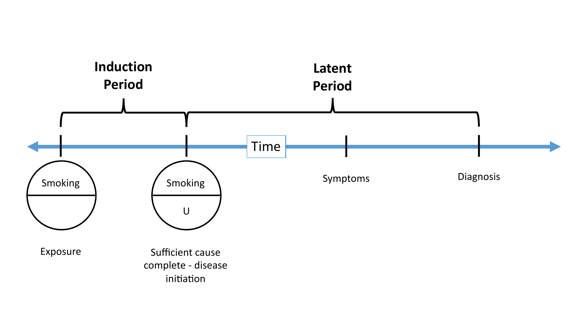
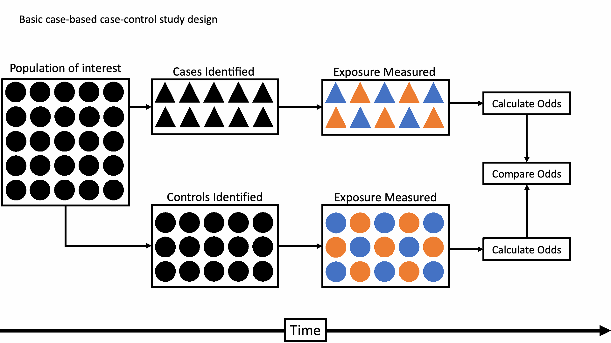
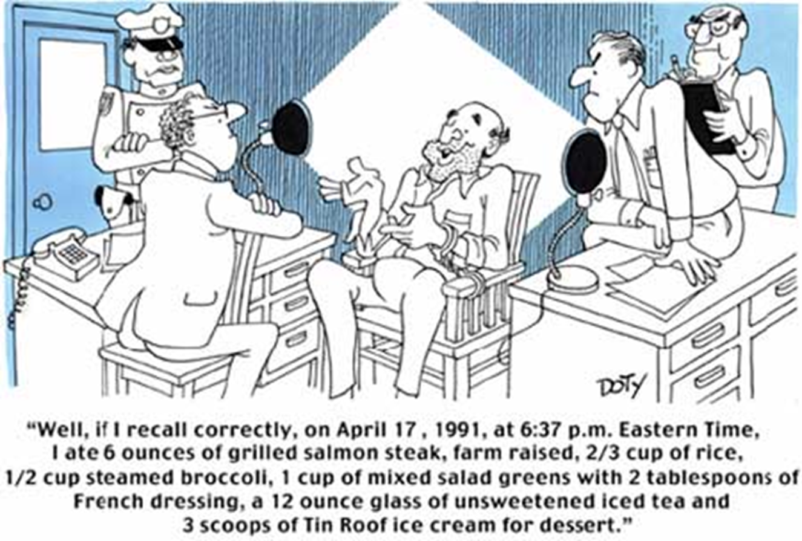

## Hierarchy of Study Designs

{fig-alt="Diagram grouping study designs into observational and experimental approaches. From left to right: case descriptions, ecological, cross-sectional, case-control, and cohort studies are observational; nonrandomized and randomized studies are experimental. An arrow indicates that evidence typically becomes more convincing from left to right."}

::: {.notes}
- Here is a review of our study design hierarchy.
:::

## Basic Experimental Study Design

{fig-alt="Experimental design: researchers assign exposure to an initially unexposed, outcome-free source population, follow exposed and unexposed groups, measure outcomes, and compare incidence proportions. Orange denotes exposed, blue unexposed, triangles outcomes, and circles no outcome." .nostretch width="1120" height="530" style="object-fit:contain;"}

## Common Prospective Cohort Study Design

{fig-alt="Complete prospective cohort design: identify the cohort, measure exposure, follow exposed and unexposed groups for outcomes, calculate each incidence proportion, and compare the two." .nostretch width="1120" height="530" style="object-fit:contain;"}

## Common Retrospective Cohort Study Design

{fig-alt="Retrospective cohort design: exposure and outcomes occur before researchers identify the cohort and gather exposure and outcome measurements from records. Incidence proportions are calculated and compared for exposed and unexposed groups." .nostretch width="1120" height="530" style="object-fit:contain;"}

## When Cohort Is Not Ideal

Cohort studies are powerful — but not always practical.

- What if:

    - The disease is **rare**?

    - The outcome has a **long latency period**?

    - Long-term follow-up is **too costly or infeasible**?

    - You need results **quickly**?

    - In these situations, a different design may be more efficient.

## Induction and Latent Periods

{fig-alt="Timeline distinguishing the induction period, from smoking exposure to disease initiation when the sufficient cause is complete, from the latent period, from disease initiation to diagnosis. Symptoms appear between disease initiation and diagnosis. Causal pies show smoking followed by the addition of U, representing other causal components." .nostretch width="1120" height="530" style="object-fit:contain;"}

::: {.notes}
- The induction period is the time from exposure to disease initiation. In this diagram, disease begins when the sufficient cause is complete.

- The latent period is the time from disease initiation to detection, shown here as diagnosis. Disease can be present before we detect it.

- The key idea is that exposure, disease initiation, symptoms, and diagnosis can occur at different times. A cohort study may need a long follow-up period to observe the outcome.

- Source: cohort_studies.pptx, slide 23. The original slide notes cite Kenneth J. Rothman, Epidemiology: An Introduction, p. 81.
:::

## Basic Case-Control Study Design

{fig-alt="Case-control design: identify cases with the outcome and controls without the outcome from the population of interest, measure prior exposure in each group, calculate the odds of exposure among cases and controls, and compare those odds. Orange denotes exposed, blue unexposed, triangles cases, and circles controls." .nostretch width="1120" height="530" style="object-fit:contain;"}

::: {.notes}
- Here’s my graphical representation of the basic case-control study design. There are other case-control designs, but this gives us an intuitive starting point.

- Exposures and outcomes occur out in the world. We then identify a group of people who have experienced the outcome of interest, called cases, and measure their history of exposure.

- We also identify a comparison group without the outcome, called controls, from the population that gave rise to the cases. We measure their history of exposure in the same way.

- Finally, we calculate the odds of prior exposure in each group and compare those odds.

- In this example, orange represents exposure to smoking and blue represents no exposure to smoking. Triangles represent people with lung cancer, and circles represent people without lung cancer.
:::

## Retrospective Cohort vs. Case-Control

- Case-control

    - Sample based on outcome and look backward for exposure.

- Retrospective Cohort

    - Sample based on exposure and look “forward” towards the outcome

    - A cohort study was done. You just weren’t there to initially observe it

::: {.notes}
Don’t confuse retrospective cohort and case-control.
:::

# Threats to Validity {.section}

## Study Base Principle {.compact}

- Cases and controls should be “representative of the same base experience.”

- If a potential control had gotten the disease, they would have been selected with the same probability as any other case.

{fig-alt="Case-control design: identify cases with the outcome and controls without the outcome from the population of interest, measure prior exposure in each group, calculate the odds of exposure among cases and controls, and compare those odds. Orange denotes exposed, blue unexposed, triangles cases, and circles controls." .nostretch width="1120" height="530" style="object-fit:contain;"}

::: {.notes}
- Selecting controls can be one of the trickiest parts of using case-control studies. It starts with the study base principle.
:::

## Recall Bias

<!-- It would be cool to come up with some sort of in-class exercise that demonstrates this. Put something on the line for some students but not others and see how well they remember. -->

::::: {.columns}

:::: {.column width="47%"}

- **Definition:** A type of information bias in which participants remember past exposures **differently**.

- **When it occurs**

    - Often in **case-control studies**

    - Cases may recall exposures more carefully than controls

- **Key idea:** Differences in memory between groups can distort the exposure–outcome association.

::::

:::: {.column width="53%"}

{fig-alt="Cartoon of an interviewee claiming to remember exact foods, quantities, date, and time of a meal eaten years earlier." .nostretch width="583" style="max-width:100%;height:auto;"}
::::

:::::

::: {.notes}
Recall bias is another important threat to validity when conducting case-control studies.
:::

## Interviewer and Observer Bias {.compact}

<!-- Give this a two-column layout. -->

- **Interviewer Bias**

    - Occurs during **data collection**

    - Interviewer knowledge influences how questions are asked

    - Can lead to different responses between groups

- **Observer Bias**

    - Occurs during **outcome assessment**

    - Observer expectations influence how outcomes are recorded

    - More likely when blinding is absent

- **Key idea:** When researchers influence data collection or measurement, results may be systematically distorted.

## Why Use an Odds Ratio? {.compact}

<!-- I have a better slide (or set of slides) for explaining this in my Epi III slides. The slide(s) use a 2x2 table. -->

- In case-control studies, we cannot calculate **risk** directly. Why?

    - We start with a fixed number of **cases and controls**

    - The total population at risk is unknown

    - Incidence cannot be measured

    - Instead, we quantify association using the **Odds Ratio (OR)**

- **What Does OR Measure?**

    - The **odds of prior exposure** among cases compared to the odds of exposure among controls

- **Key Contrast:**

    - Cohort → Uses **Relative Risk (RR)**

    - Case-Control → Uses **Odds Ratio (OR)**

# Analysis of Case-Control Studies {.section}

## Odds of Exposure Among Cases {.compact}

Given the prototypical 2x2 table for case-control data, which of the formulas below will calculate the odds of exposure among cases?

::: {style="border: 2px solid currentColor; width: fit-content; margin:2em auto 2em;"}
|  | Cases | Controls |
| --- | :---: | :---: |
| Exposed | A | B |
| Not exposed | C | D |
|  |  |  |
:::

**A.** $\frac{a}{c}$\

**B.** $\frac{a}{b}$\

**C.** $\frac{a}{a+b}$\

**D.** $\frac{a}{a+c}$

::: {.notes}
- Do you remember how to calculate and interpret odds?\
- Do you remember how to calculate and interpret an odds ratio?\
- Let’s have a little refresher. 
- The odds of exposure among cases can be calculated as a / c.
:::

## Odds of Exposure Among Cases {.compact}

Given the prototypical 2x2 table for case-control data, which of the following is an accurate expression of the odds of exposure among cases?

::: {style="border: 2px solid currentColor; width: fit-content; margin:2em auto 2em;"}
|  | Cases | Controls |
| --- | :---: | :---: |
| Exposed | 50 | 25 |
| Not exposed | 100 | 100 |
| Odds of exposure | ??? |  |
:::

::: {.incremental}
- The odds of exposure among cases = $a/c = 50/100 = 0.5$.

- Equivalent ways to express these odds: **50:100 = 0.5:1 = 5:10 = 1:2**.

- For every **1 exposed case**, there are **2 unexposed cases**.
:::

::: {.notes}
- And we can express the odds in many different ways. 

- For example, as a over c or as a to c. In this particular case, that translates to 50 over 100 or 50 to 100. Or, if we divide 50 by 100, we get 0.5, which we can also express as 0.5 to 1. In other words, for every 0.5 cases who were exposed, there was one who wasn't exposed.

- If we move the decimal one place to the right on both sides of our ratio (multiply by 10), we get 5 to 10, and we can say for every 5 cases who were exposed, there were 10 cases who were not exposed.

- We could also divide one by the odds (0.5) and add the result to the right-hand side of the ratio. We could then say for every case who was exposed, there were 2 cases who were not exposed. As you can see, we can get the same answer by dividing 100 by 50 and putting the answer on the right-hand side of the ratio.

- All of these are equivalent ways of expressing the odds of exposure among cases.
:::

## Odds of Exposure Among Controls {.compact}

Given the prototypical 2x2 table for case-control data, which of the following is an accurate expression of the odds of exposure among controls?

::: {style="border: 2px solid currentColor; width: fit-content; margin:2em auto 2em;"}
|  | Cases | Controls |
| --- | :---: | :---: |
| Exposed | 50 | 25 |
| Not exposed | 100 | 100 |
| Odds of exposure | 50 / 100 | ??? |
:::

**A.** 0.2

**B.** 1:2

**C.** 2.5:1

**D.** 0.25

::: {.notes}
- The only correct expression of the odds among the choices above is 0.25. You can derive this answer by dividing 25 by 100.
:::

## Odds of Exposure {.compact}

::: {style="border: 2px solid currentColor; width: fit-content; margin:2em auto 2em;"}
|  | Cases | Controls |
| --- | :---: | :---: |
| Exposed | 50 | 25 |
| Not exposed | 100 | 100 |
| Odds of exposure | 50 / 100 | 25 / 100 |
:::

- Odds of exposure among cases = 50 / 100 = **0.5**

- Odds of exposure among controls = 25 / 100 = **0.25**

::: {.notes}
- Now that we've calculated the odds of exposure among cases and controls, we may want to compare them in order to say something about the association (or lack thereof) between exposure and outcome -- or being a case.
:::

## Association {.compact}

::: {.fragment}
- The distribution of the thing we are measuring differs, on average, between two groups. This could be its center, spread, shape, or the proportion of people in each category.

- Knowing something about **X** tells us something about **Y**.
:::

::: {.notes}
- And remember that an association exists when the distribution of the thing we are measuring is different, on average, in two groups. Alternatively, we can say that knowing something about x tells us something about y or helps us predict y.
:::

## Comparing Exposure Odds {.compact}

::: {style="border: 2px solid currentColor; width: fit-content; margin:2em auto 2em;"}
|  | Cases | Controls |
| --- | :---: | :---: |
| Exposed | 50 | 25 |
| Not exposed | 100 | 100 |
| Odds of exposure | 50 / 100 | 25 / 100 |
:::

- Odds of exposure among cases = [**0.5**]{style="color: red;"}

- Odds of exposure among controls = [**0.25**]{style="color: red;"}

The odds are higher among cases. **How much higher?**

::: {.notes}
- We can tell just by looking at the odds, which are 0.5 and 0.25, that they aren't the same. That is, the odds of being exposed if you are a case are greater than the odds of being exposed if you are a control. But, how much greater?
:::

## Calculating the Exposure Odds Ratio {.compact}

::: {style="border: 2px solid currentColor; width: fit-content; margin:2em auto 2em;"}
|  | Cases | Controls |
| --- | :---: | :---: |
| Exposed | 50 | 25 |
| Not exposed | 100 | 100 |
| Odds of exposure | 50 / 100 | 25 / 100 |
:::

$$
\text{Exposure OR} = \frac{\text{Odds of exposure among cases}}{\text{Odds of exposure among controls}} = \frac{a/c}{b/d}
$$

::: {.notes}
- Well, we can answer that question by calculating the ratio of the odds among cases to the odds among controls.
:::

## Odds of Exposure Among Controls {.compact}

Given the prototypical 2x2 table for case-control data, what is the exposure odds ratio?

::: {style="border: 2px solid currentColor; width: fit-content; margin:2em auto 2em;"}
|  | Cases | Controls |
| --- | :---: | :---: |
| Exposed | 50 | 25 |
| Not exposed | 100 | 100 |
| Odds of exposure | 50 / 100 | 25 / 100 |
:::

**A.** 1

**B.** 2

**C.** 3

**D.** 4

::: {.notes}
- The answer (2) is on the next slide.
:::

## Exposure Odds Ratio: Calculation {.compact}

<!-- Source: case_control_studies.pptx, slide 29. -->

::: {style="border: 2px solid currentColor; width: fit-content; margin:2em auto 2em;"}
|  | Cases | Controls |
| --- | :---: | :---: |
| Exposed | 50 | 25 |
| Not exposed | 100 | 100 |
| Odds of exposure | 50 / 100 | 25 / 100 |
:::

$$
\text{Exposure OR} = \frac{a/c}{b/d} = \frac{50/100}{25/100} = \frac{0.5}{0.25} = 2
$$

How would you interpret this odds ratio?

::: {.notes}
- So, our exposure OR is 2. And how do we interpret that?
:::

## Exposure Odds Ratio: Interpretation {.compact}

<!-- Source: case_control_studies.pptx, slide 30. -->

::: {style="border: 2px solid currentColor; width: fit-content; margin:2em auto 2em;"}
|  | Cases | Controls |
| --- | :---: | :---: |
| Exposed | 50 | 25 |
| Not exposed | 100 | 100 |
| Odds of exposure | 50 / 100 | 25 / 100 |
:::

$$
\text{Exposure OR} = \frac{50/100}{25/100} = \frac{0.5}{0.25} = 2
$$

The odds of exposure among cases are **2 times** the odds of exposure among controls.

::: {.notes}
- The odds of exposure among cases are 2 times the odds of exposure among controls.
:::

## Why Use the Odds Ratio? {.compact}

<!-- Source: case_control_studies.pptx, slide 31. -->

::: {style="border: 2px solid currentColor; width: fit-content; margin:2em auto 2em;"}
|  | Cases | Controls |
| --- | :---: | :---: |
| Exposed | 50 | 25 |
| Not exposed | 100 | 100 |
| Odds of exposure | 50 / 100 | 25 / 100 |
:::

- We can calculate it directly from a case-control study.

- We can also estimate it using logistic regression.

- Under certain conditions, it approximates the **risk ratio**.

::: {.notes}
- And the odds ratio has some really convenient traits that make it an attractive measure of association when we have data from a case-control study.

- Unlike the incidence proportion ratio, the odds ratio can be directly calculated from a case-based case-control study.

- It can be derived from logistic regression models.

- It can be used to approximate the incidence proportion ratio under certain conditions. And as we’ve said before, the incidence proportion ratio is generally considered to be a more intuitive measure of association.

- Therefore, we will briefly compare the odds ratio and the incidence proportion ratio.
:::

## Hypothetical Cohort: Hypertension and MI {.compact}

<!-- Source: case_control_studies.pptx, slide 32. -->
<!-- Corrected the source risk denominator from 10,00 to 10,000. -->

One-year incidence of acute myocardial infarction (**MI**, or heart attack). Severe systolic hypertension: ≥180 mm Hg. Normal systolic blood pressure: <120 mm Hg.

::: {style="border: 2px solid currentColor; width: fit-content; margin:2em auto 2em;"}
|  | MI (+) | MI (–) | Total |
| --- | :---: | :---: | :---: |
| Severe hypertension | 180 | 9,820 | 10,000 |
| Normotensive | 30 | 9,970 | 10,000 |
:::

::: {.incremental}
- Risk of MI among people with severe hypertension = 180 / 10,000 = **0.018**

- Risk of MI among normotensive people = 30 / 10,000 = **0.003**

- Risk ratio (incidence proportion ratio) = 0.018 / 0.003 = **6**

- Participants with severe hypertension had **6 times the risk of MI** over one year compared with normotensive participants.
:::

::: {.aside}
*Source: Szklo and Nieto, Epidemiology. Jones & Bartlett Learning.*
:::

::: {.notes}
- mmHg is said as "millimeters of mercury."

- Sometimes, it’s helpful to start by discussing a cohort study. In the example shown here, severe hypertension and acute myocardial infarction are the exposure and the outcome of interest, respectively.

- Because this is a cohort study and we know the row totals, we can calculate the incidence proportion ratio as we’ve done all semester. In this case, participants with severe hypertension had 6 times the risk of MI over the 1-year study period compared to participants with normotensive blood pressure.

- For these data, the risk of myocardial infarction is relatively low for both the exposed and unexposed groups. Specifically, the risk of MI is 0.018 among those with severe hypertension and 0.003 among people with normotensive blood pressure.

- Therefore, the odds of developing MI will approximate the probabilities; as a result, the odds ratio of disease approximates the incidence proportion ratio.

- Why?
:::

## Risk and Odds {.compact}

::: {style="border: 2px solid currentColor; width: fit-content; margin:2em auto 2em;"}
|  | Outcome | No outcome | Total |
| --- | :---: | :---: | :---: |
| Exposed | a | b | a + b |
| Unexposed | c | d | c + d |
:::

::: {.purple-table-header style="border: 2px solid currentColor; width: fit-content; margin:2em auto 2em;"}
| **Measure** | Formula         | a = 0             | Incidence = 0.001   |
| ----------- | :--------------------------------: | :---------------: | :-----------------: |
| Incidence   | $\frac{a}{a+b}$                    | $\frac{0}{0+b}=0$ | $0.001$             |
| Odds   | $\frac{\frac{a}{a+b}}{1-\frac{a}{a+b}}$ | $\frac{\frac{0}{0+b}}{1-\frac{0}{0+b}} = \frac{0}{1-0} = \frac{0}{1} = 0$ | $\frac{0.001}{1-0.001} \approx \frac{0.001}{1}$             |
:::

Risk in the exposed: $p = a/(a+b)$. Odds in the exposed: $p/(1-p) = a/b$.

When risk is small, **1 − risk is close to 1**, so odds and risk are similar.

::: {.notes}
- Because the odds are calculated as the incidence over 1 minus the incidence. When the risk is really low, 1 minus the incidence is very close to 1-0, or 1, and any number divided by 1 is that number. So, you basically end up with the incidence divided by 1, which is just the incidence.

- As an extreme example, if a is 0, then the incidence in the exposed is 0. Likewise, the odds in the exposed are 0 divided by 1 minus zero, which is 0 divided by 1, which is also zero. In this case, the odds equal the incidence.

- Now, as a slightly less extreme example, let’s imagine the incidence is 0.001 or 1 in 1,000. In this case, the denominator is almost 1 (0.999 to be exact), and therefore, the odds are almost identical to the incidence.

- So, the lower the incidence, the closer 1 minus the incidence is to one, and therefore, the better the incidence and the odds approximate each other. As the outcome becomes less rare, the OR will generally become increasingly more extreme than the IPR.
:::

## Comparing the Risk Ratio and Odds Ratio {.compact}

::: {style="border: 2px solid currentColor; width: fit-content; margin:2em auto 2em;"}
|  | MI (+) | MI (–) | Total |
| --- | :---: | :---: | :---: |
| Severe hypertension | 180 | 9,820 | 10,000 |
| Normotensive | 30 | 9,970 | 10,000 |
:::

- The incidence of MI among people with severe hypertension = 180 / 10,000 = **0.018**
- The incidence of MI among people who are normotensive = 30 / 10,000 = **0.003**
- **Risk ratio = 0.018 / 0.003 = 6**
 
- The odds of severe hypertension among cases = 180 / 30 = **6**
- The odds of severe hypertension among controls  = 9,820 / 9,970 ≈ **0.985**
- **Exposure OR = (180 / 30) / (9,820 / 9,970) ≈ 6.09**

::: {.aside}
*Source: Szklo and Nieto, Epidemiology. Jones & Bartlett Learning.*
:::

::: {.notes}
- And although we would typically calculate the incidence proportion ratio as our measure of association from cohort data like this, we can also calculate the odds ratio. In this case, the exposure odds ratio is 6.09 – similar to the incidence proportion ratio.

- And how would we interpret that odds ratio?
:::

## Hypertension and MI: Interpreting the OR {.compact}

::: {style="border: 2px solid currentColor; width: fit-content; margin:2em auto 2em;"}
|  | MI (+) | MI (–) | Total |
| --- | :---: | :---: | :---: |
| Severe hypertension | 180 | 9,820 | 10,000 |
| Normotensive | 30 | 9,970 | 10,000 |
:::

- Exposure odds among cases = 180 / 30 = **6**
- Exposure odds among non-cases = 9,820 / 9,970 ≈ **0.985**
- **Exposure OR = (180 / 30) / (9,820 / 9,970) ≈ 6.09**

Participants with MI had **6.09 times the odds of severe hypertension** compared with participants who did not have an MI during the one-year study period.

::: {.aside}
*Source: Szklo and Nieto, Epidemiology. Jones & Bartlett Learning.*
:::

::: {.notes}
- We could say participants with MI had 6.09 times the odds of severe hypertension compared to participants who did not have an MI over the 1-year study period.

- Okay, great. The odds ratio approximates the incidence proportion ratio. But, why not just always calculate the incidence proportion ratio to begin with?

- Again, here we know the total number of participants who were exposed and who were unexposed in these cohort study data – 10,000 each -- but in a typical case-based case-control study we don’t have that information. That’s the basic reason we can’t just keep calculating the more intuitive incidence proportion ratio.
:::

## Sampling 10% of Controls {.compact}

::: {style="border: 2px solid currentColor; width: fit-content; margin:2em auto 2em;"}
|  | MI (+) | MI (–) | Cohort total |
| --- | :---: | :---: | :---: |
| Severe hypertension | 180 | 982 | ?? |
| Normotensive | 30 | 997 | ?? |
:::

- Population risks require the original cohort denominators: **180 / ??** and **30 / ??**.
- Exposure odds among cases = 180 / 30 = **6**
- Exposure odds among sampled controls = 982 / 997 ≈ **0.985**
- **Exposure OR = (180 / 30) / (982 / 997) ≈ 6.09**

The OR is unchanged when we sample the same fraction of exposed and unexposed non-cases.

::: {.aside}
*Source: Szklo and Nieto, Epidemiology. Jones & Bartlett Learning.*
:::

::: {.notes}
- For this illustration, keep all cases and take exactly 10% of the exposed non-cases and 10% of the unexposed non-cases. The control counts become 982 and 997.

- The row sums in the case-control sample are not the original cohort denominators. Without those denominators or sampling information that lets us reconstruct them, we cannot calculate the population risks directly.

- Here we know the sampling fraction because we created this example from a complete cohort. In a typical case-control study, we do not have that complete cohort information.

- The odds of exposure among controls remain 982 / 997 = 9,820 / 9,970. Therefore, the exposure odds ratio is unchanged at approximately 6.09. Random sampling may introduce sampling error.
:::

## Disease Odds Ratio {.compact}

::: {style="border: 2px solid currentColor; width: fit-content; margin:2em auto 2em;"}
|  | MI (+) | MI (–) | Cohort total |
| --- | :---: | :---: | :---: |
| Severe hypertension | 180 | 9,820 | ?? |
| Normotensive | 30 | 9,970 | ?? |
:::

- Disease odds with severe hypertension = 180 / 9,820 ≈ **0.01833**
- Disease odds with normal blood pressure = 30 / 9,970 ≈ **0.003009**
- **Disease OR = (180 / 9,820) / (30 / 9,970) ≈ 6.09**

Participants with severe hypertension had **6.09 times the odds of MI** over one year compared with normotensive participants.

::: {.aside}
*Source: Szklo and Nieto, Epidemiology. Jones & Bartlett Learning.*
:::

::: {.notes}
- The exposure odds ratio and disease odds ratio are algebraically identical: (a/c) / (b/d) = (a/b) / (c/d) = ad/bc.

- Here we use the full counts from the hypothetical cohort. We retain the unknown cohort totals to show that calculating the odds ratio does not require those denominators.

- Participants with severe hypertension had 6.09 times the odds of MI compared with normotensive participants over the one-year study period. This disease-focused interpretation is generally the one of greater interest.

- Use the original counts in the calculation. Rounding the two individual odds to 0.018 and 0.003 before dividing would obscure the difference between the odds ratio and the risk ratio.
:::

## Disease OR With 10% of Controls {.compact}

::: {style="border: 2px solid currentColor; width: fit-content; margin:2em auto 2em;"}
|  | MI (+) | MI (–) | Cohort total |
| --- | :---: | :---: | :---: |
| Severe hypertension | 180 | 982 | ?? |
| Normotensive | 30 | 997 | ?? |
:::

- Sample odds with severe hypertension = 180 / 982 ≈ **0.1833**
- Sample odds with normal blood pressure = 30 / 997 ≈ **0.03009**
- **Disease OR = (180 / 982) / (30 / 997) ≈ 6.09**

Participants with severe hypertension had **6.09 times the odds of MI** over one year compared with normotensive participants. The individual sample odds differ from the population odds.

::: {.aside}
*Source: Szklo and Nieto, Epidemiology. Jones & Bartlett Learning.*
:::

::: {.notes}
- We can repeat the calculation using the 10% sample of controls. Both row odds are ten times the corresponding cohort odds, so their ratio is unchanged.

- These individual sample odds do not estimate the population odds of MI directly. The odds ratio is preserved because we sampled the same fraction of exposed and unexposed non-cases while retaining all cases.

- With appropriate control sampling, the odds ratio estimates the disease odds ratio in the source population. When the outcome is rare, it can also approximate the risk ratio.

- Random samples will introduce sampling error. This example keeps the exposure proportions exactly constant to show the underlying calculation.
:::

## Interpreting the Odds Ratio {.compact}

- **Interpreting the Odds Ratio (OR)**

    - **OR = 1:** No association between exposure and disease

    - **OR \> 1:** Exposure is associated with **higher odds** of disease

    - **OR \< 1:** Exposure is associated with **lower odds** of disease

## Strengths and Limitations {.compact}

:::: {.columns}
::: {.column width="50%"}
**Strengths**

- Efficient for studying **rare diseases**

- Faster and less costly than cohort studies

- Require **fewer participants**

- Useful for diseases with **long latency**
:::
::: {.column width="50%"}
**Limitations**

- Cannot directly measure **incidence or risk**

- Vulnerable to **selection bias**

- Prone to **recall bias**

- Control selection can be challenging
:::
::::

## Cohort vs. Case-Control Studies {.compact}

| Feature | Cohort Study | Case-Control Study |
| --- | --- | --- |
| Start With | Exposure | Outcome |
| Direction | Exposure → Outcome | Outcome → Exposure |
| Measure | Relative Risk (RR) | Odds Ratio (OR) |
| Best For | Rare exposures | Rare diseases |
| Time & Cost | Longer, more expensive | Faster, less expensive |
| Main Bias Concern | Loss to follow-up | Selection & recall bias |
| Can Measure Incidence? | Yes | No |

::: {.notes}
- Time/cost and primary bias concerns depend on the study.\ 
- Cohort studies also support association measures other than RR.
:::

## Practice: Sampling

In a case-control study, we typically sample based on the _____ we are interested in studying.

**A.** Exposure

**B.** Outcome

::: {.notes}
In a case-control study, we typically start with an outcome we are interested in studying. We then sample (select) people for the study based on the presence or absence of that outcome.
:::

## Practice: Identify the Study Design {.compact}

Researchers survey 1,000 adults at a single point in time, asking about their current smoking status and whether they currently have a chronic cough. What type of study is this?

**A.** Cohort study

**B.** Case-control study

**C.** Cross-sectional study

**D.** Randomized trial

::: {.notes}
Answer: Cross-sectional study. Smoking status and cough are assessed at the same time.
:::

## Practice: Identify the Study Design {.compact}

Researchers use medical records from 2010 to identify 1,000 smokers and 1,000 nonsmokers who were free of lung cancer. They review records through 2020 to determine who developed lung cancer. All records already exist when the study begins. What type of study is this?

**A.** Cohort study

**B.** Case-control study

**C.** Cross-sectional study

**D.** Randomized trial

::: {.notes}
Answer: Retrospective cohort study. Researchers group people by past exposure and use existing records to compare subsequent disease occurrence.
:::

## Practice: Identify the Study Design {.compact}

Researchers sample 500 patients who have lung cancer and 500 patients who do not have lung cancer. They compare the two groups’ smoking histories before the lung cancer diagnoses. What type of study is this?

**A.** Cohort study

**B.** Case-control study

**C.** Cross-sectional study

**D.** Randomized trial

::: {.notes}
Answer: Case-control study. Participants are selected based on disease status, and researchers compare their prior exposure.
:::

## Practice: Study Base Principle {.compact}

Shands Hospital at the University of Florida is a referral hospital for a variety of cancer diagnoses \-\- including bronchogenic carcinoma \-\- for the North Florida region where it is located. 

Researchers are interested in the association between bronchogenic carcinoma and a history of cigarette smoking, and they decide to conduct a case-control study. Cases are selected from the admissions records to the cancer center. Controls are randomly selected from the population of the surrounding county. 

Does the control group violate the study base principle?

**A.** Probably

**B.** Probably not

::: {.notes}
Remember that the study base principle tells us that cases and controls should be “representative of the same base
experience.” One way to conceptualize this in our heads is to think of the study base as those who would have been selected as cases if they developed the disease. Based on the narrative above, it seems like people from the surrounding county would likely go to Shands if they developed bronchogenic carcinoma, and then they would have had the same probability of selection as any other case. Therefore, the study base principle is probably not violated in this scenario.
:::

## Practice: Control Selection {.compact}

Researchers are interested in the effect of obesity on colorectal cancer and conduct a case-control study. Cases are selected
from a large colon cancer registry. Researchers are concerned that unmeasured genetic factors may bias study results.

What would be a good control group to remove the potential confounding effects of genetic factors?

::: {.notes}
Matching study subjects with siblings may be used in both cohort and case-control studies to control for shared genetic and environmental factors. (Modern Epidemiology, 4th ed.)
:::

## Practice: Identifying Bias {.compact}

In a case-control study investigating the relationship between alcohol use and liver cancer, cases were recruited from a major urban hospital. Controls were recruited from a local fitness club.

Which bias is most likely?

**A.** Recall bias

**B.** Attrition bias

**C.** Selection bias

**D.** Interviewer bias

::: {.notes}
Explanation: Controls from a fitness club may not represent the same source population as hospital cases, leading to distorted exposure comparison.
:::

## Practice: Interpreting Odds {.compact}

In a study of Parkinson’s disease, the odds of prior pesticide exposure among cases were **0.25**, or **1 to 4**.

What does this mean?

**A.** 25% of cases had prior pesticide exposure

**B.** For every 1 case with prior pesticide exposure, there were 4 cases without prior exposure

**C.** Cases had 25% greater risk of pesticide exposure

**D.** Cases were 4 times as likely to have prior pesticide exposure as to have no prior exposure

::: {.notes}
Correct answer: B.

Odds of 1 to 4 mean 1 exposed case for every 4 unexposed cases. The corresponding proportion exposed is 1 / (1 + 4) = 20%, not 25%.
:::

## Practice: Interpreting an Odds Ratio {.compact}

In a case-control study, researchers compared patients with Parkinson’s disease to controls without Parkinson’s disease. The odds ratio for prior pesticide exposure was **2.5**.

What does this mean?

**A.** Pesticide exposure causes Parkinson’s disease

**B.** People exposed to pesticides had 2.5 times the risk of Parkinson’s disease

**C.** Parkinson’s disease cases had 2.5 times the odds of prior pesticide exposure compared to controls

**D.** 2.5% of Parkinson’s disease cases had prior pesticide exposure

::: {.notes}
Correct answer: C.

An OR greater than 1 indicates a positive association. Cases had higher odds of prior exposure than controls. This result does not directly measure risk or establish causation.
:::

## Practice: Interpreting an Odds Ratio {.compact}

In a case-control study, researchers compared patients with Alzheimer’s disease to controls without Alzheimer’s disease. The odds ratio for regular physical activity during midlife was **0.60**.

What does this mean?

**A.** Alzheimer’s disease cases had 40% lower odds of regular physical activity during midlife compared to controls

**B.** Physically active people had 60% lower risk of Alzheimer’s disease

**C.** Regular physical activity prevents Alzheimer’s disease

**D.** There was no association between physical activity and Alzheimer’s disease

::: {.notes}
Correct answer: A.

Cases had 0.60 times the odds of prior regular physical activity compared to controls. This is equivalent to 40% lower odds: (1 − 0.60) × 100%.

An OR less than 1 indicates an inverse association. This result does not establish that physical activity prevents Alzheimer’s disease.
:::