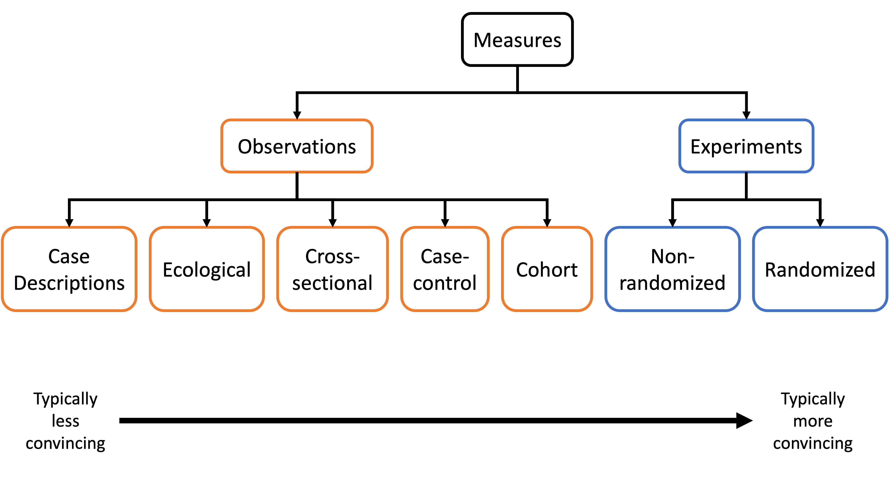
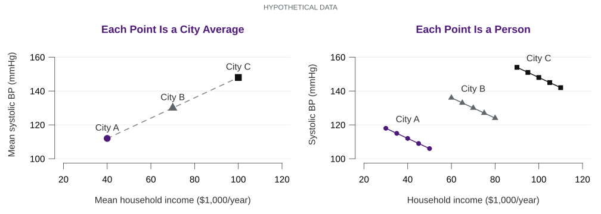

## Hierarchy of Study Designs

{fig-alt="Diagram grouping study designs into observational and experimental approaches. From left to right: case descriptions, ecological, cross-sectional, case-control, and cohort studies are observational; nonrandomized and randomized studies are experimental. An arrow indicates that evidence typically becomes more convincing from left to right."}

::: {.notes}
- Here is a review of our study design hierarchy.
:::


## Ecologic Studies

- **Ecologic studies compare groups**, such as cities, schools, or countries.

- Researchers analyze **group characteristics**, such as average income and average blood pressure.

- They can describe population patterns and investigate questions about policies or environments.

- A relationship between groups does **not necessarily describe the relationship between individuals**.

::: {.notes}
- The important distinction is the level of the question and analysis. 

- Ecologic studies can address population questions directly, as well as generate hypotheses for individual-level research. 

- The hierarchy on the previous slide is a broad guide to individual causal inference, not a ranking of how well each design answers every possible question.
:::


## Unit of Observation vs. Unit of Analysis {.compact}

**Hypothetical example:** Measure residents' income and blood pressure, then compare city averages.

| Term | What Does It Mean? | In This Example |
|---|---|---|
| **Unit of observation** | The entity we collect measurements from | Each resident |
| **Unit of analysis** | The entity we compare and draw conclusions about | Each city |

The same individual measurements could support a different analysis that compares **residents** instead of cities.

::: {.notes}
- Definitions adapted from @decarlo2018units. 

- Here the original observations are residents; aggregating their measurements changes the unit of analysis to cities. 

- If researchers receive only a table of city averages, their available observations are already at the city level. 

- Observation and analysis can be at the same level or different levels. 

- Do not teach that every ecologic study collects individual records.
:::


## Ecologic Fallacy {.compact}

**Ecologic fallacy:** Assuming a relationship between groups also holds for individuals.

{fig-alt="Hypothetical annual household income and systolic blood-pressure data for three cities. Left: city averages increase together, from 40 thousand dollars and 112 millimeters of mercury in City A to 100 thousand dollars and 148 millimeters of mercury in City C. Right: the five individual observations within each city show decreasing blood pressure as income increases. A positive association between city averages does not establish the association among individuals within cities." .nostretch width="1120" height="405" style="object-fit:contain;"}

**City averages alone do not reveal the relationships within cities.**

::: {.notes}
- These are invented teaching data, not evidence about income and blood pressure. 

- Each city contains five equally weighted observations. The left panel contains their exact means; the right panel shows the individual observations that produced them. 

- Income is the resident's reported annual household income, and the blood-pressure measure is systolic blood pressure.

- **Ask students to describe each panel before explaining the error.**

- Between cities, higher average income accompanies higher average blood pressure. Within each city, higher-income residents have lower blood pressure in this constructed example. Neither pattern by itself establishes causation.

- A reversal makes the distinction easy to see, but ecological fallacy does not require a reversal. The error is assuming an individual association from aggregate data alone, whether the unknown individual association is weaker, absent, reversed, or similar. 

Concept: @decarlo2018units. Figure generated from the hypothetical values in assets/ecologic-fallacy.R.
:::


## Practice: What Can We Conclude? {.compact}

Suppose we have **only the city averages** from the previous slide. Which conclusion is supported?

**A.** Increasing a person's income raises their blood pressure.

**B.** Within each city, richer residents have higher blood pressure.

**C.** Cities with higher average income have higher average blood pressure.

**D.** Income has no relationship with anyone's blood pressure.

::: {.notes}
Answer: C. It stays at the level measured in the aggregate data. A adds a causal claim; B assumes an individual association; D also makes an unsupported individual claim. Ask students what information they would need to investigate B. Use a show of hands or letter cards if no live polling tool is configured.
:::


## When the Population Is the Question {.compact}

**Hypothetical question:** After cities adopt a smoke-free indoor-air policy, do their heart-attack admission rates decline compared with cities that do not?

- **Exposure:** A city policy that changes the shared environment.

- **Outcome:** The city's admission rate over time.

- **Why study groups?** We want to evaluate the policy's overall population effect, including effects on people who do not smoke.

- The analysis must still consider other changes occurring in those cities.

::: {.notes}
- So, why would we use an ecological study design?

- This is a proposed study question, not a claim about a particular policy evaluation. 

- Comparing population trends before and after adoption, with suitable comparison cities, fits the policy question. 

- Individual smoking histories could add information, but they would not replace the question about changing a city's policy. 

- A simple comparison of cities would not establish causality. 

- **Ask what else might change at the same time, such as healthcare access or other tobacco policies.**
:::


## Dietary Fat and Breast Cancer Mortality {.compact}

**The question:** Could differences in diet help explain why breast cancer death rates differ across countries?

@sasaki1993

- **Design:** Ecologic study of 30 countries, using data from 1961 to 1986.

- **Exposure:** National food-supply estimates per person, separated by fat type.

- **Outcome:** Female breast cancer mortality rates.

- **Finding:** Animal fat excluding fish fat was positively associated with mortality among women aged 50 and older. Fish fat showed inverse associations when statistically significant.

::: {.fragment}
**The country averages do not tell us what the women who died had eaten.**
:::

::: {.notes}
- Start the story with a researcher looking across countries and wondering whether diet contributes to their different death rates. 

- Existing food-balance and mortality records allow a broad comparison without following individual diets for decades. 

- Distinguish national food supply from measured personal consumption. 

- This is an example of a research question, not a claim that this paper initiated the later trial.

- **What is the potential ecological fallacy we have to be careful to avoid?**
:::


## Low-Fat Dietary Pattern: Randomized Trial {.compact}

**A related question:** Does assignment to a dietary program reduce new breast cancers?

@prentice2006

- **Participants:** 48,835 postmenopausal women, ages 50–79, without prior breast cancer.

- **Intervention:** A program to reduce total fat and increase fruit, vegetables, and grains; comparison participants were not asked to change their diet.

- **Outcome:** New invasive breast cancers during an average 8.1 years of follow-up.

- **2006 result:** The intervention did not produce a statistically significant reduction in invasive breast cancer incidence.

::: {.notes}
- Random assignment strengthens causal inference about assignment to this dietary program. 

- It does not isolate one fat type. 

- A nonsignificant result does not prove the effect is zero. 

- The trial's reported hazard ratio was 0.91 (95% CI 0.83–1.01); interpreting hazard ratios is not required here. This slide summarizes the cited 2006 report, not subsequent follow-up publications.
:::


## Ecologic Studies: Strengths and Limitations {.compact}

::::: {.columns}

:::: {.column width="50%"}

**Strengths**

- Fit questions about population policies and environments
- Reveal patterns across places or time
- Can use existing data efficiently

::::

:::: {.column width="50%"}

**Limitations**

- Group associations may not describe individuals
- Averages can hide differences within groups
- Other population differences can complicate interpretation

::::

:::::

**Choose the design that fits the question and the level of the conclusion.**

::: {.notes}
- Return to the policy example: an ecologic design can be appropriate because the question concerns a population intervention, even when individual data are available. 

- In the dietary study, national food supply is an imperfect proxy for consumption. 

- Ecologic analyses can account for measured population characteristics, but aggregate data do not automatically resolve confounding or differences in measurement between places.
:::


## Group Discussion: Comparing Study Designs {.compact}

**Work in groups of 2–3 for 4 minutes. Prepare a brief explanation for each question.**

| | Ecologic Study | Randomized Trial |
|---|---|---|
| Unit of analysis | Countries | Individual women |
| Exposure / intervention | National supply of different fats | Assignment to a dietary program |
| Outcome | Breast cancer mortality | Invasive breast cancer incidence |

1. Why does the ecologic study not tell us whether changing one woman's diet would change her risk?
2. What does random assignment add, and what dietary question does this trial actually test?
3. Why would it be misleading to say that this trial simply proves or disproves the ecologic study?



::: {.notes}
Purpose: practice matching conclusions to the question, unit of analysis, and design. This is not a competition to name the universally best design.

Facilitation: allow four minutes, then invite a different group to answer each question. Keep the table visible.

Answer key:

1. The country records do not link each woman's own exposure to her outcome. Other national differences could contribute to the pattern. Access to effective treatment is one possible influence on mortality; it is a discussion hypothesis, not a finding established by this paper. Mortality involves both developing cancer and surviving it.
2. Random assignment helps make the groups comparable at baseline. The trial tests assignment to a program with several dietary goals; adherence still matters.
3. Exposure definitions, populations, and outcomes differ. A stronger design for one causal question does not turn it into a test of every related question. Ask students to name at least two differences from the table.

Sources: @sasaki1993; @prentice2006.
:::


## From Study Design to Trustworthy Comparisons {.compact}

The two dietary studies asked different questions. For either study, we still need to ask **what could make the comparison misleading**.

- **Selection:** Who entered the study, and who stayed in it?
- **Information:** Were exposure and outcome measured accurately?
- **Confounding:** Did the groups differ in other causes of the outcome?

We will connect these questions to the bias examples from the case-control lecture.

::: {.notes}
This is the transition from choosing a study design to evaluating the comparison it produces.
:::


## Social Desirability Bias

- **Definition:** Participants report what seems socially acceptable instead of what actually happened.
- **Example:** Someone understates their alcohol use because they worry the interviewer will judge them.
- **Problem:** The recorded answer differs from the behavior we want to measure.
- **Reducing it:** Use neutral questions and protect participants' privacy.

::: {.notes}
- Neutral wording can help, but it does not guarantee accurate reporting. 

- Explain why responses are confidential and consider private self-administered questions when appropriate. 

- Contrast reporting less drinking with actually drinking less because of being observed.
:::


## Hawthorne Effect

- **Definition:** People change their behavior because they know they are being observed.
- **Example:** Participants walk more while a research team monitors their activity.
- Their recorded activity may be accurate, but it may differ from their usual activity.

**Changing behavior and reporting behavior inaccurately are different problems.**

::: {.notes}
- Observation-related behavior change is not automatically measurement error. 

- Its implications depend on the question: are we interested in usual activity outside a study or activity during a monitored intervention? Preserve this distinction in the exercise.
:::


## Practice: Bias and Behavior Changes {.compact}

For each scenario, identify the **bias or behavior change** and explain why.

::: {.incremental}
- Parents of sick children recall pesticide exposure during pregnancy more carefully than parents of healthy children.

- Participants underreport alcohol use because they worry that the interviewer will judge them.

- Outcome assessors know who received treatment and rate those participants more favorably.

- Interviewers ask lung cancer cases more detailed exposure questions than they ask controls.

- Participants exercise more because they know their activity is being monitored.
:::

::: {.notes}
Ask for a brief explanation before revealing the next scenario. These mechanisms are stipulated for the exercise; they are not inferred from observed differences alone.

1. Recall bias: exposure recall differs between groups.
2. Social desirability bias: concern about judgment changes the report.
3. Observer bias: treatment knowledge influences outcome ratings.
4. Interviewer bias: exposure questioning differs between groups.
5. Hawthorne effect: observation changes actual behavior. An accurate measurement of that changed behavior is not itself an information error.
:::


## Reducing Selection Bias {.compact} {visibility="hidden"}

<!-- Setting this to hidden. We should have included this slide in the lecture that introduced selection bias. It feels out of place here. -->

**The comparison depends on who gets included.**

- Define the population that should give rise to both study groups.
- Use clear eligibility rules and consistent recruitment procedures.
- In case-control studies, select controls who represent the exposure experience of the population that produced the cases.
- Follow participants consistently and investigate why people leave a study.

**Selecting by outcome is part of a case-control design. Distorting the exposure comparison is the problem.**

::: {.notes}
Sources: @dicker2025; @cdc2024design. A control should have been eligible to become a case if the outcome had occurred. This does not mean that cases and controls must have the same exposure prevalence or that all studies need a representative sample of the general public. The concern is a valid comparison for the target question.
:::


## How Recruitment Can Distort a Comparison {.compact} {visibility="hidden"}

<!-- Setting this to hidden. We should have included this slide in the case-control lecture. It feels out of place here. -->

**Hypothetical study:** Does smoking increase lung cancer risk?

- Recruit **cases with lung cancer** from a hospital.
- Recruit **controls without lung cancer**, but only from its emphysema clinic.
- Smoking contributes to emphysema, so this control group may contain too many smokers for the intended comparison.

Smoking could look **less strongly associated** with lung cancer because the recruitment process raised smoking prevalence among controls.

**Better approach:** Select controls from the population that produced the cases, without restricting them to a smoking-related diagnosis.

::: {.notes}
Ask: "Which part of recruitment depends on the outcome? Which part also depends on the exposure?" Lung cancer defines case status. Among potential controls, a smoking-related illness influences eligibility. This can distort the exposure contrast even if smoking is measured perfectly. The example illustrates the control-selection principle in @cdc2024design. It is not a report of an actual study, and not all hospital control groups are biased.
:::


## Reducing Information Bias {.compact} {visibility="hidden"}

<!-- Setting this to hidden. We should have included this slide in the lecture that introduced information bias. It feels out of place here. -->

**Make measurements comparable across groups.**

- Use the same exposure and outcome definitions.
- Train interviewers to use the same questions and prompts.
- Blind outcome assessors to treatment when feasible.
- Use measurement tools suited to the population and purpose.
- Ask sensitive questions neutrally and privately.

**Example:** An assessor uses the same mobility test for everyone without knowing who attended the exercise class.

::: {.notes}
The example is hypothetical. Standardization addresses how data are collected; blinding reduces opportunities for expectations to affect judgments. Consistency alone does not make a poorly chosen instrument valid. Source: @dicker2025.
:::


## Review: Sample Size and Bias {.compact}

- **Random error (sampling variability):** Results vary by chance. More observations generally improve precision.
- **Bias:** A systematic problem in selection or measurement can remain even in a very large study.

**Example:** Interviewing more people at local gyms does not fix the problem of estimating community activity from a sample that overrepresents gym users.

For bias, improve **who is included** or **how measurements are made**. Increasing the sample size alone does not repair those processes.

::: {.notes}
- This example concerns estimating community activity, not every possible comparison among gym users. A large biased sample can give a very precise answer to the wrong population question. Then transition: even with careful recruitment and accurate measurement, groups can differ in other causes of the outcome.
:::


## Review: Confounding {.compact}

**Confounding:** Other causes of the outcome get mixed into our estimate of the exposure's effect. We may give credit or blame to the wrong variable.

```{r}
#| label: dag-setup
#| eval: true
#| include: false
library(dagitty)
library(ggdag, warn.conflicts = FALSE)
library(ggplot2)

# Shared slide styling; dagify() below defines each diagram's causal model.
plot_slide_dag <- function(dag) {
  ggplot(tidy_dagitty(dag), aes(x = x, y = y, xend = xend, yend = yend)) +
    geom_dag_edges(
      edge_colour = "#4d1979", edge_width = 1,
      start_cap = ggraph::circle(20, "mm"),
      end_cap = ggraph::circle(20, "mm"),
      arrow_directed = grid::arrow(length = grid::unit(7, "pt"), type = "closed")
    ) +
    geom_dag_text(aes(label = label), colour = "#1f2328", size = 6.5) +
    scale_x_continuous(limits = c(-0.45, 2.45), expand = expansion(mult = 0)) +
    scale_y_continuous(limits = c(-0.3, 1.3), expand = expansion(mult = 0)) +
    theme_dag() +
    theme(plot.margin = margin(5, 10, 5, 10))
}
```

```{r}
#| label: hot-weather-dag
#| eval: true
#| echo: false
#| message: false
#| warning: false
#| dev: svglite
#| fig-width: 10
#| fig-height: 2.7
#| out-width: "1000px"
#| out-height: "270px"
#| fig-class: nostretch
#| fig-align: center
#| fig-alt: "Hot weather points to both ice cream sales and drownings. No arrow connects ice cream sales to drownings in this simplified teaching model."
hot_weather_dag <- dagify(
  ice_cream ~ weather,
  drownings ~ weather,
  labels = c(weather = "Hot weather", ice_cream = "Ice cream\nsales", drownings = "Drownings"),
  coords = list(
    x = c(weather = 1, ice_cream = 0, drownings = 2),
    y = c(weather = 1, ice_cream = 0, drownings = 0)
  )
)
plot_slide_dag(hot_weather_dag)
```

**Would reducing ice cream sales reduce drownings?** This pattern alone does not show that it would.

::: {.notes}
Original diagram for the familiar teaching example from Association and Causality.qmd. The arrows express the simplified causal assumptions, not estimates from data. Warm weather can raise sales and increase opportunities for swimming. The observed association may be useful for prediction without being the causal effect of ice cream sales.

A "spurious association" is one that misleads us about the causal relationship. It is not a synonym for confounding; chance and other biases can also mislead.
:::


## Reading a Causal Diagram {.compact}

An **arrow** represents an assumed causal influence. It can increase or decrease the outcome.

```{r}
#| label: aspirin-stroke-dag
#| eval: true
#| echo: false
#| message: false
#| warning: false
#| dev: svglite
#| fig-width: 10
#| fig-height: 2.7
#| out-width: "1000px"
#| out-height: "270px"
#| fig-class: nostretch
#| fig-align: center
#| fig-alt: "Preexisting heart disease points to aspirin use and stroke. Aspirin use also points to stroke, representing the causal effect under investigation. Heart disease is a common cause in this teaching model."
aspirin_stroke_dag <- dagify(
  aspirin ~ heart_disease,
  stroke ~ heart_disease + aspirin,
  exposure = "aspirin",
  outcome = "stroke",
  labels = c(heart_disease = "Heart disease", aspirin = "Aspirin use", stroke = "Stroke"),
  coords = list(
    x = c(heart_disease = 1, aspirin = 0, stroke = 2),
    y = c(heart_disease = 1, aspirin = 0, stroke = 0)
  )
)
plot_slide_dag(aspirin_stroke_dag)
```

People taking aspirin may already have a different stroke risk. Comparing users with nonusers can mix that difference with aspirin's effect.

**The arrows require knowledge about the problem, not just correlations.**

::: {.notes}
Original rendering of the heart disease, aspirin, and stroke example supplied in Hernán's Confounders Part 1 materials. This is a simplified causal model, not treatment advice or a complete account of prescribing.

Introduce DAG as "directed acyclic graph": arrows have direction, and following them does not loop back to the starting variable. A path is a route along connected arrows. Students do not need formal path rules here. The route connecting aspirin and stroke through preexisting heart disease explains why their association need not equal aspirin's causal effect. Missing arrows also express assumptions. General diagram principles: @hernan2002.
:::


## Practice: Does the Class Increase Falls? {.compact}

**Hypothetical study:** Follow 200 people for one year after some choose to attend a fall-prevention class.

| | People With at Least One Fall | People Followed | One-Year Risk |
|---|---:|---:|---:|
| Attended class | 28 | 100 | **28%** |
| Did not attend | 12 | 100 | **12%** |

**Which conclusion is justified?**

**A.** The class caused more falls.\
**B.** Attendees had more falls, but they may have differed before class.\
**C.** The class prevented falls.

::: {.notes}
Answer: B. These are invented counts for teaching, not findings about an actual program. Assume complete follow-up and accurate measurement so we can focus on confounding. The outcome is whether each person had at least one fall during the same one-year period, not the total number of falls.

Ask what might lead someone to join: a prior fall may both encourage attendance and predict future falls. Participants chose whether to attend; they were not randomized.
:::


## Comparing People With the Same Fall History {.compact}

The same 200 people, now separated by whether they had fallen **before** the class began:

| | No Prior Fall | Prior Fall | All Participants |
|---|---:|---:|---:|
| Attended class | 1 / 10 = **10%** | 27 / 90 = **30%** | **28 / 100 = 28%** |
| Did not attend | 9 / 90 = **10%** | 3 / 10 = **30%** | **12 / 100 = 12%** |

- Within each history group, the risks are **the same**.
- Attendees included more people with prior falls: **90% versus 10%**.

**Accounting for fall history removes the apparent difference in this example.**

::: {.notes}
- Start with the rightmost column, "All Participants." These are the same totals we just saw: 28 of 100 class attendees and 12 of 100 nonattendees had at least one fall during follow-up.

- The rows still separate people by whether they attended the class, just as in the previous table. The "No Prior Fall" and "Prior Fall" columns now divide each attendance group by whether people had fallen before the class began.

- In each cell, the first number is the number of people who had at least one fall during the following year. The second number is the total number of people in that particular attendance and fall-history group.

- For example, read the first cell under "No Prior Fall" as: "Of the 10 class attendees with no prior fall, 1 fell during follow-up, a risk of 10%." Then move down that column: among nonattendees with no prior fall, 9 of 90 fell, also 10%.

- Now read down the "Prior Fall" column: 27 of 90 attendees and 3 of 10 nonattendees fell during follow-up. Both risks are 30%. Reading down each fall-history column lets us compare attendance groups with the same prior fall history.

- This is stratification: compare people within categories of a relevant variable. 

- Students should interpret the supplied percentages; calculation or a pooled adjustment formula is not required. 

- All people and falls remain in the table. We changed the comparison, not the observations.

- In this hypothetical story, previous falls influence attendance and predict subsequent falls. 

- Those risks became mixed into the overall comparison. If both groups had an equal mix of the two history categories, each would have a 20% risk: the average of 10% and 30%. This optional illustration is standardization, not an additional result students must calculate.

- Equal observed risks do not prove that a real intervention has no effect, nor does any change after adjustment prove confounding. Here the constructed numbers and stated causal assumptions illustrate the mechanism. Sources for stratification and interpretation: @dicker2025.
:::


## Conventional Confounder Criteria {.compact}

A conventional definition looks for a variable that:

1. Is associated with the exposure.
2. Is associated with the outcome **among people with the same exposure status**.
3. Is not a step through which the exposure causes the outcome.

**"Conditional on the exposure"** means considering the outcome association separately among exposed and unexposed people.

These criteria are **not a guarantee** that controlling for the variable will help. Its causal role matters. [@hernan2002]

::: {.notes}
Use familiar terms instead of L, A, and Y. This slide evaluates the inherited conventional definition; it is not a recommended variable-selection checklist.

For criterion 3, a mediator is an intermediate step: for example, an exercise program might improve balance, which then reduces falls. Controlling for improved balance would remove part of the total effect we wanted to study. Fall history measured before the program is different from balance changed by the program. The next example illustrates a common effect, or collider.
:::


## A Collider: Two Arrows Meet {.compact}

**Hypothetical recruitment rule:** Enroll people who exercise regularly **or** have had a recent injury, including those with both.

```{r}
#| label: enrollment-collider-dag
#| eval: true
#| echo: false
#| message: false
#| warning: false
#| dev: svglite
#| fig-width: 10
#| fig-height: 2.7
#| out-width: "1000px"
#| out-height: "270px"
#| fig-class: nostretch
#| fig-align: center
#| fig-alt: "Regular exercise and recent injury both point to study enrollment. Enrollment is their common effect. Restricting the comparison to enrolled people can create an association between exercise and injury."
enrollment_dag <- dagify(
  enrollment ~ exercise + injury,
  labels = c(exercise = "Regular\nexercise", enrollment = "Study\nenrollment", injury = "Recent\ninjury"),
  coords = list(
    x = c(exercise = 0, enrollment = 1, injury = 2),
    y = c(exercise = 0.5, enrollment = 0.5, injury = 0.5)
  )
)
plot_slide_dag(enrollment_dag)
```

- Among enrollees, anyone who **does not exercise must have an injury**.
- Exercise could therefore appear protective because of **who was selected**.

**A common effect is not a common cause. Controlling for it can create bias.**

::: {.notes}
Keep the main explanation brief. "Collider" refers to the meeting arrowheads along this path. Selecting enrollees is conditioning on enrollment: we consider only people with enrollment = yes. This example demonstrates the mechanism discussed by @hernan2002 using an original, simpler scenario in place of the supplied video and Pap-test screenshot. It is not a transcript or a claim about an actual exercise study.

Optional numerical explanation: suppose the source population contains 25 people in each of four categories: exercise/injury, exercise/no injury, no exercise/injury, and neither. Injury prevalence is 50% in both exercise groups. The rule excludes only the last category. Among enrollees, injury prevalence is now 50% among exercisers and 100% among nonexercisers. Nothing about anyone's exercise or injury changed.

The example also shows why the conventional criteria are insufficient: enrollment is associated with exercise, is associated with injury among nonexercisers, and is not a causal step from exercise to injury. Yet selecting on it creates a misleading comparison. We do not need the formal rules for opening and blocking paths to understand this example.
:::


## Practice: Which Variable Needs Attention? {.compact}

A study compares people who choose a fall-prevention class with people who do not.

Researchers learn that **prior falls influence class attendance and the chance of another fall**.

What is the best reason to consider prior falls when making the comparison?

**A.** We should control for every variable available.

**B.** Prior falls are a plausible common cause of attendance and later falls.

**C.** Any variable associated with the outcome must be controlled.

::: {.notes}
Answer: B. The stated causal knowledge identifies the reason for concern. Associations alone do not establish a variable's role. A and C overlook mediators, colliders, and the question being asked. Use a show of hands or letter cards as a low-tech fallback.

This replaces the abstract inherited true/false questions with a question about the worked example. Students should explain the common cause, not select a statistical model.
:::


## Addressing Confounding During Study Design {.compact}

| Approach | Basic Idea | Example |
|---|---|---|
| **Randomization** | Assign the intervention by chance | Randomly offer the class |
| **Restriction** | Limit a relevant characteristic | Enroll only people with no prior falls |
| **Matching** | Select comparison participants with similar characteristics | Match participants on fall history |

Randomization balances baseline factors **on average**, including factors we did not measure.

Restriction narrows the population studied. Matching still requires an appropriate analysis.

::: {.notes}
This is a conceptual menu, not instruction in conducting a matched analysis. Random assignment does not guarantee identical groups in a particular sample, and it does not solve every problem arising after assignment. Restriction or matching only addresses the relevant factors selected and measured; neither automatically removes all confounding. Matching on the wrong variables can also introduce problems. Sources: @cdc2024design; @dicker2025.
:::


## Addressing Confounding During Analysis {.compact}

- **Stratification:** Compare exposed and unexposed people within categories of a confounder, as in the fall-history table.

- **Statistical adjustment:** Use methods such as regression or standardization to account for appropriate measured factors.

- Both approaches depend on choosing relevant variables and measuring them adequately.

**When reading a study, ask:** What did the researchers account for, why did they choose those factors, and what important differences might remain?

::: {.notes}
Students need to recognize these approaches and explain their purpose; they do not need to fit a regression model or calculate an adjusted effect. Confounding can remain when important factors are missing or measured poorly. Methods also rely on design and modeling assumptions. These methods do not make an observational comparison equivalent to randomization merely because an estimate is labeled "adjusted." Source: @dicker2025.
:::


## Epidemiology Wrap-Up {.compact}

- Define and explain the **foundations of epidemiology**

- Measure disease using **incidence, prevalence, and rates**

- Describe patterns by **person, place, and time**

- Evaluate **association and causality**

- Distinguish **cohort and case-control** study designs

- Interpret **RR, ARD, and OR**

- Identify major sources of **bias and confounding**


## From Concepts to Your Presentation {.compact}

::::: {.columns}

:::: {.column width="40%"}

**The Conceptual Progression**

- **Descriptive epidemiology:** Describe patterns and generate hypotheses.

- **Analytic epidemiology:** Evaluate exposure–outcome relationships.

- **Critical thinking:** Distinguish association from causation.

::::

:::: {.column width="55%"}

**For Group Presentation 1**

- Describe population patterns using appropriate **epidemiologic measures**.

- Include and cite at least one source of **analytic evidence**.

- Explain the evidence type, exposure, outcome, and main finding.

- Relate the evidence to your findings; discuss **limitations, bias, and confounding**.

- Avoid definitive causal claims or policy recommendations.

::::

:::::

Use the **assignment instructions and rubric in D2L** for the full requirements.

::: {.notes}
Source: Group Presentation 1 assignment instructions, sections 3–6, in the course's Assignments/Group Presentation 1 folder.

Acceptable analytic evidence includes peer-reviewed studies, government or public health reports, surveillance reports with analytic comparisons, and textbooks or course readings that synthesize analytic findings. A single primary research study is not required. Students should explain how their selected evidence supports or contextualizes their descriptive patterns without claiming it proves a causal explanation.

This slide highlights the connection to our epidemiology lessons. The assignment also specifies presentation structure, timing, participation, slide design, and submission expectations; students should consult the full assignment and rubric in D2L.
:::


## References {.references-slide}

::: {#refs}
:::
