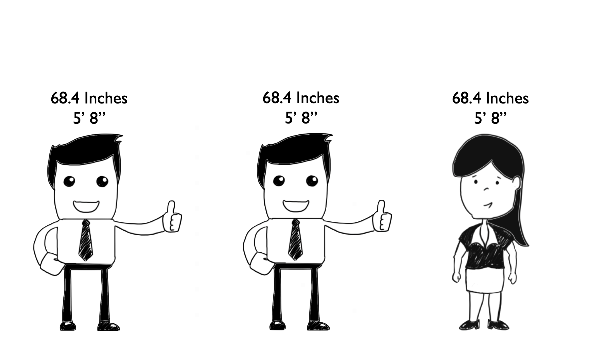
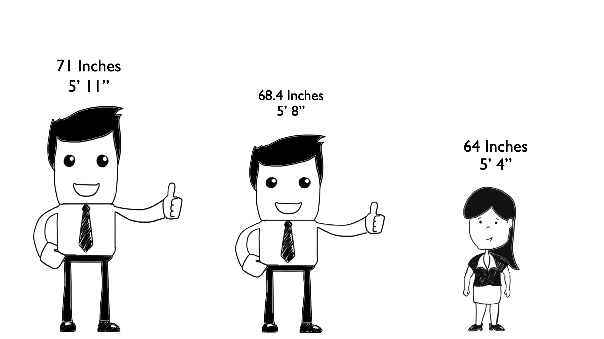
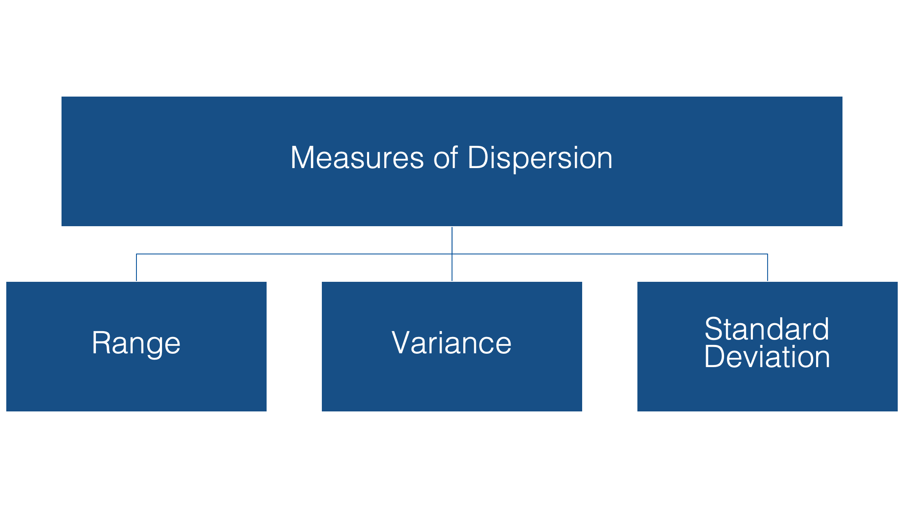
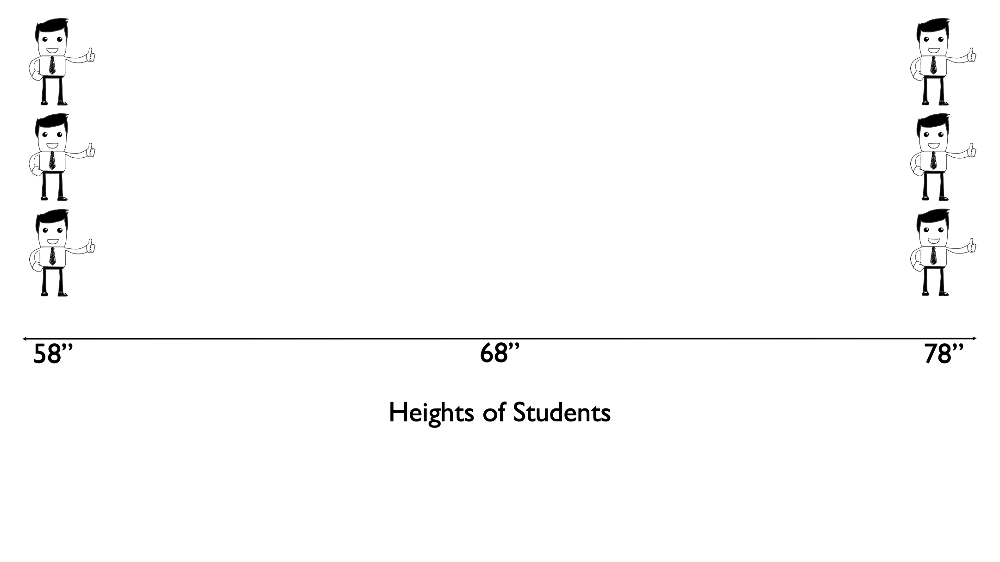
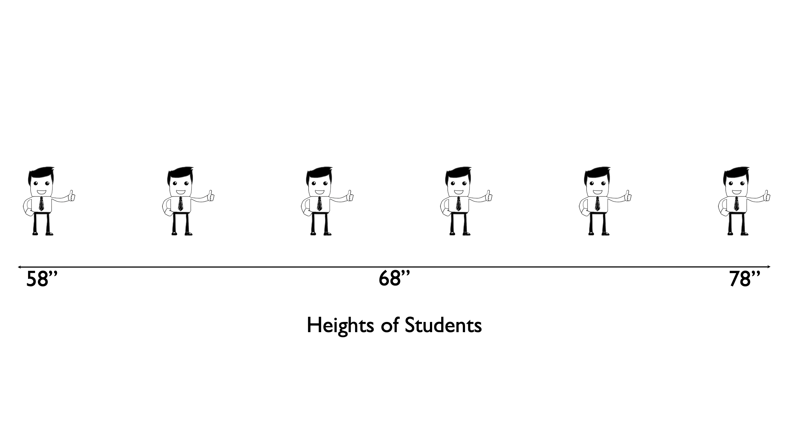
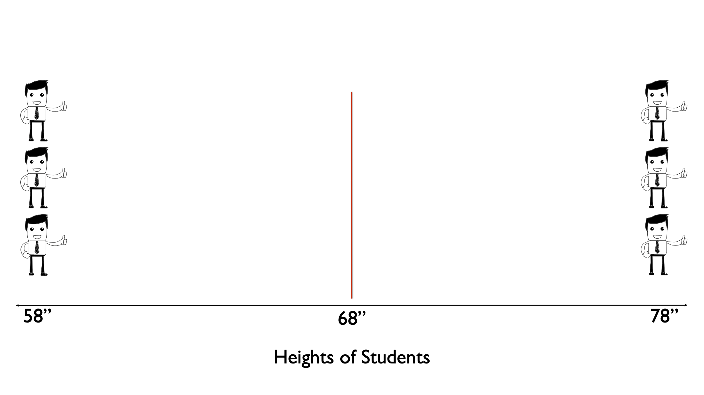
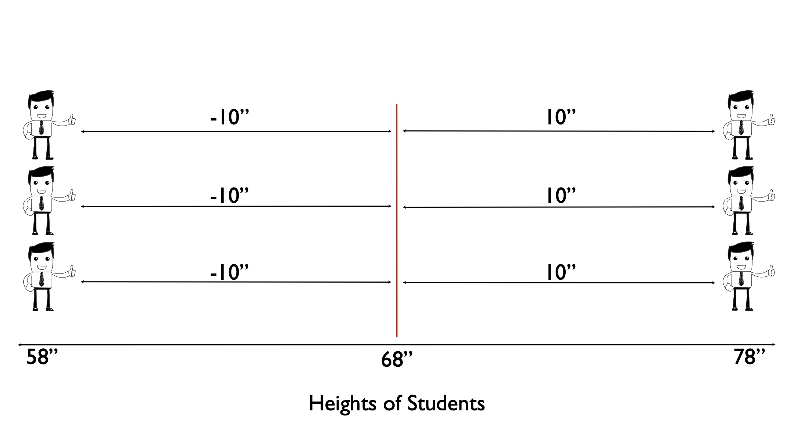
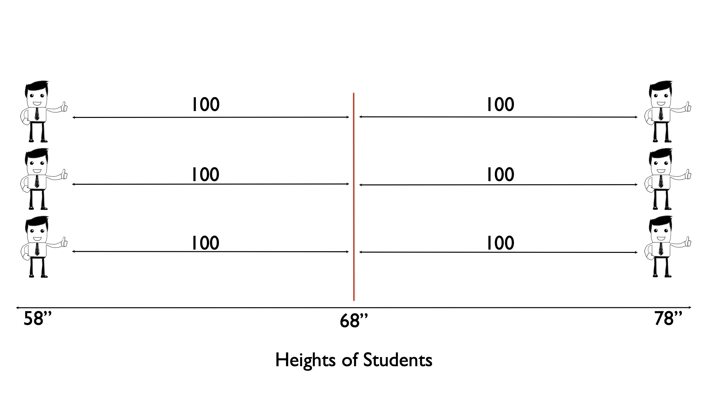
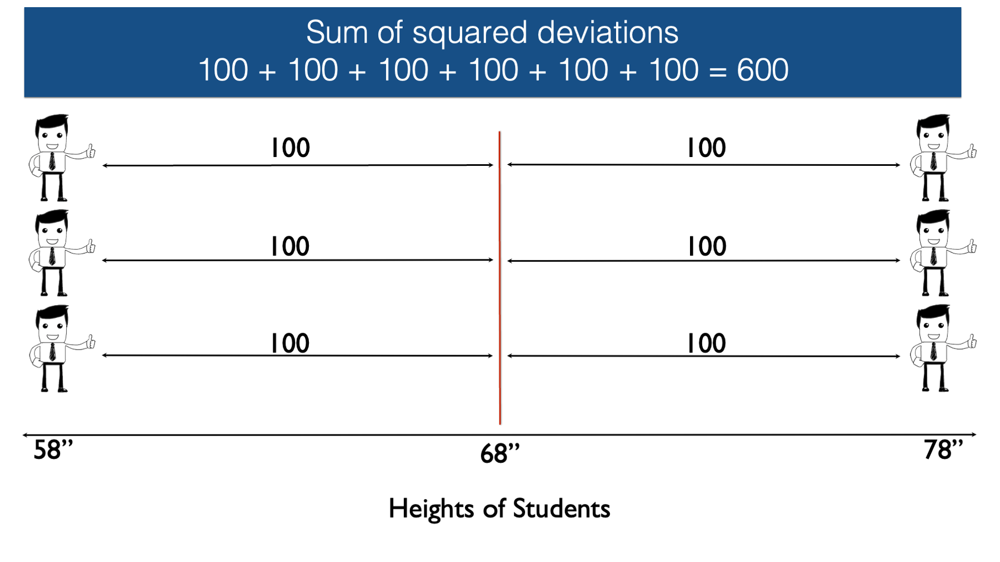
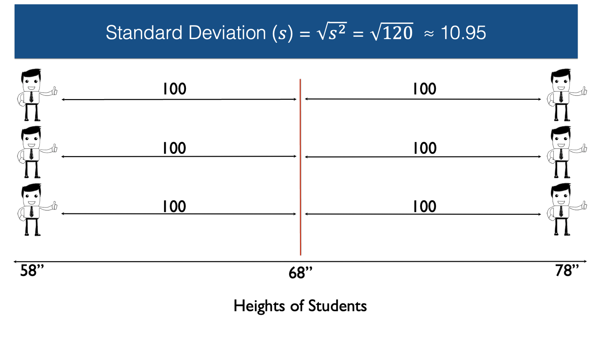

## Learning Objectives {data-visibility="hidden"}

```{r}
#| label: setup
#| include: false

library(tidyverse)

# Read the same small fictional dataset students open in Excel so all displayed
# results and the practice answer key remain consistent with their input file.
practice <- readxl::read_excel(
  "assets/practice_data.xlsx",
  sheet = "sleep_and_stress"
)
sleep <- practice$sleep_hours
stress <- practice$stress_score

# Alter one observation only to isolate its effect on mean versus median.
# This hypothetical value is not an observation from the original exercise.
changed_sleep <- replace(sleep, which.max(sleep), 15)

# Match QUARTILE.INC's interpolation when reporting quartiles. ggplot2 uses
# these quartiles for the boxplots below; different software conventions can differ.
sleep_q <- quantile(sleep, c(0.25, 0.5, 0.75), type = 7)
stress_q <- quantile(stress, c(0.25, 0.5, 0.75), type = 7)

# Adapt Brad's EWB height examples to three equally sized groups. Holding the
# mean and (for B/C) range fixed reveals what those summaries fail to describe.
heights <- tibble(
  group = factor(rep(c("A", "B", "C"), each = 6), levels = c("A", "B", "C")),
  height = c(rep(68, 6), seq(58, 78, by = 4), rep(c(58, 78), each = 3))
) |>
  group_by(group, height) |>
  mutate(stack = (row_number() - (n() + 1) / 2) * 0.24) |>
  ungroup() |>
  mutate(plot_row = 4 - as.integer(group) + stack)
height_summary <- heights |>
  group_by(group) |>
  summarise(mean = mean(height), range = max(height) - min(height), sd = sd(height))

# Follow each of group C's observations from its signed deviation to its squared
# deviation. Sum of squares and sample variance remain distinct quantities.
height_steps <- heights |>
  filter(group == "C") |>
  mutate(row = rep(3:1, 2), deviation = height - mean(height),
         squared_deviation = deviation^2, midpoint = (height + mean(height)) / 2)
height_n <- nrow(height_steps)
height_ss <- sum(height_steps$squared_deviation)
height_variance <- height_ss / (height_n - 1)
height_sd <- sqrt(height_variance)

# A workload example explains why the mean can remain useful when a legitimate
# long observation pulls it above the median; neither summary is always best.
visit_minutes <- c(10, 10, 40)

# Construct teaching distributions with visible tails rather than asking students
# to infer a population distribution from just twelve observations.
shape_data <- tibble(
  shape = rep(c("Symmetric", "Right-skewed", "Left-skewed"), each = 9),
  value = rep(1:9, 3),
  count = c(1, 2, 4, 6, 8, 6, 4, 2, 1,
            8, 7, 5, 3, 2, 1, 1, 1, 1,
            1, 1, 1, 1, 2, 3, 5, 7, 8)
) |>
  mutate(shape = factor(shape, levels = c("Symmetric", "Right-skewed", "Left-skewed")))

# Construct fictional resting heart-rate data with two clear clusters. Repeated
# values keep both peaks visible so students can recognize bimodality at a glance.
bimodal_heart_rate <- tibble(
  resting_heart_rate = rep(
    seq(50, 90, by = 4),
    times = c(1, 4, 8, 5, 1, 1, 1, 5, 8, 4, 2)
  )
)

# Group A is the practice outcome; group B is an additional fictional comparison
# chosen to have a higher median and larger IQR without a flagged outlier.
box_data <- tibble(
  group = rep(c("A", "B"), each = 12),
  score = c(stress, seq(12, 34, by = 2))
)
box_summary <- box_data |>
  group_by(group) |>
  summarise(median = median(score), iqr = IQR(score, type = 7))

# Use the shared course purple and a readable plotting style. Every graph keeps
# explicit axis labels so meaning does not depend on color or surrounding prose.
theme_set(theme_minimal(base_size = 23) +
  theme(panel.grid.minor = element_blank(), plot.margin = margin(8, 16, 8, 8)))
```

- Describe a continuous distribution using shape, center, and spread.
- Interpret SD, IQR, boxplots, and z-scores.
- Calculate sample summaries and create a histogram in Excel.
- Write descriptive interpretations supported by the data.

::: {.notes}
- This lesson continues the October 26 deck and follows the approved course outline.
- Preserve Quiz 4 coverage and Prep 3's existing requirements.
- All data in this lesson are fictional; stress_score is an illustrative score, not a clinical instrument or diagnostic threshold.
- Source selections: Yan Zhang's Statistics Overview and Descriptive Statistics PowerPoint, slides 30-33 and 36-49; Brad Cannell's Measures of Central Tendency and Measures of Dispersion.
- Pacing: retrieval 0-5; histograms 5-17; center 17-25; dispersion 25-37; IQR/boxplots 37-47; z-scores 47-53; Excel 53-65; group practice 65-77; closing 77-80.
:::


## Descriptive Analysis

```{mermaid}
%%{init: {'theme': 'base', 'themeVariables': {'fontSize': '20px', 'fontFamily': 'Arial'}, 'flowchart': {'nodeSpacing': 16, 'rankSpacing': 45}}}%%
flowchart TB
    analysis[Descriptive Analysis] --> numeric[Numerical]
    analysis --> categorical[Categorical]
    numeric --> continuous[Continuous]
    numeric --> discrete[Discrete]
    categorical --> ordinal[Ordinal]
    categorical --> nominal[Nominal]
    continuous --> cn[Numerical]
    continuous --> cg[Graphical]
    discrete --> dn[Numerical]
    discrete --> dg[Graphical]
    ordinal --> on[Numerical]
    ordinal --> og[Graphical]
    nominal --> nn[Numerical]
    nominal --> ng[Graphical]

    classDef emphasized fill:#4D1979,color:#ffffff,stroke:#4D1979,stroke-width:2px;
    classDef muted fill:#eee8f3,color:#75677f,stroke:#d2c5df,stroke-width:1px;
    class analysis,numeric,categorical emphasized;
    class continuous,discrete,ordinal,nominal,cn,cg,dn,dg,on,og,nn,ng muted;
    linkStyle default stroke:#b9a8c9,stroke-width:2px;
```

::: {.notes}
- In epidemiology, we often want to describe the “typical” person in a population or subpopulation.   
- When we analyze data to do so, we call it "descriptive analysis".    
- When conducting descriptive analysis, the method we choose will depend on the type of data we're analyzing.   
- At the most basic level, variables can be described as numerical (quantitative) or categorical (qualitative).   
- We reviewed this distinction last time.  
- Our focus today will be on numerical variables.   
:::


## Numerical Data

```{mermaid}
%%{init: {'theme': 'base', 'themeVariables': {'fontSize': '20px', 'fontFamily': 'Arial'}, 'flowchart': {'nodeSpacing': 16, 'rankSpacing': 45}}}%%
flowchart TB
    analysis[Descriptive Analysis] --> numeric[Numerical]
    analysis --> categorical[Categorical]
    numeric --> continuous[Continuous]
    numeric --> discrete[Discrete]
    categorical --> ordinal[Ordinal]
    categorical --> nominal[Nominal]
    continuous --> cn[Numerical]
    continuous --> cg[Graphical]
    discrete --> dn[Numerical]
    discrete --> dg[Graphical]
    ordinal --> on[Numerical]
    ordinal --> og[Graphical]
    nominal --> nn[Numerical]
    nominal --> ng[Graphical]

    classDef emphasized fill:#4D1979,color:#ffffff,stroke:#4D1979,stroke-width:2px;
    classDef muted fill:#eee8f3,color:#75677f,stroke:#d2c5df,stroke-width:1px;
    class analysis,numeric,continuous,discrete emphasized;
    class categorical,ordinal,nominal,cn,cg,dn,dg,on,og,nn,ng muted;
    linkStyle default stroke:#b9a8c9,stroke-width:2px;
```

::: {.notes}
- Numerical variables can then be further divided into continuous and discrete.   

**Question**: What is the difference between continuous and discrete numerical variables?    
- The distinction is whether the variable can take on a continuum of values or only a certain set of values. 

**Question**: Can you think of some examples?   
- Continuous examples: Height, weight, and sleep duration.   
- Discrete examples: Number of drinks, number of household members, number of clinic visits.   

- For all types and subtypes of variables, there are both numerical and graphical methods we can use for descriptive analysis.   
:::


## Numerical Summaries

```{mermaid}
%%{init: {'theme': 'base', 'themeVariables': {'fontSize': '20px', 'fontFamily': 'Arial'}, 'flowchart': {'nodeSpacing': 16, 'rankSpacing': 45}}}%%
flowchart TB
    analysis[Descriptive Analysis] --> numeric[Numerical]
    analysis --> categorical[Categorical]
    numeric --> continuous[Continuous]
    numeric --> discrete[Discrete]
    categorical --> ordinal[Ordinal]
    categorical --> nominal[Nominal]
    continuous --> cn[Numerical]
    continuous --> cg[Graphical]
    discrete --> dn[Numerical]
    discrete --> dg[Graphical]
    ordinal --> on[Numerical]
    ordinal --> og[Graphical]
    nominal --> nn[Numerical]
    nominal --> ng[Graphical]

    classDef emphasized fill:#4D1979,color:#ffffff,stroke:#4D1979,stroke-width:2px;
    classDef muted fill:#eee8f3,color:#75677f,stroke:#d2c5df,stroke-width:1px;
    class analysis,numeric,continuous,discrete,cn,dn emphasized;
    class categorical,ordinal,nominal,cg,dg,on,og,nn,ng muted;
    linkStyle default stroke:#b9a8c9,stroke-width:2px;
```

::: {.notes}
- Numerical summaries condense many values into a few summary values, called statistics.   
<!-- Which version of the sentence below should we keep? -->
- Those statistics can be grouped by the type of information they give us about the values.   
- Those statistics can be grouped by the characteristic of the values they describe.   
:::


## Review: 3 Important Characteristics of Numerical Variables
<!-- Make the bulleted text larger. -->
::: {.incremental}
1. Center   
2. Spread   
3. Shape    
:::

::: {.notes}
**Question**: Do you remember the three important characteristics of numerical variables we discussed last time?
:::


## Review: 3 Measures of Central Tendency
<!-- Make the bulleted text larger. -->
::: {.incremental}
1. Mean   
2. Median   
3. Mode    
:::

::: {.notes}
- When we describe the center of numerical variables, we do so with measures of central tendency.    

**Question**: Do you remember the three measures of central tendency we discussed last time?
:::


## Numerical Summaries

```{mermaid}
%%{init: {'theme': 'base', 'themeVariables': {'fontSize': '20px', 'fontFamily': 'Arial'}, 'flowchart': {'nodeSpacing': 16, 'rankSpacing': 45}}}%%
flowchart TB
    analysis[Descriptive Analysis] --> numeric[Numerical]
    analysis --> categorical[Categorical]
    numeric --> continuous[Continuous]
    numeric --> discrete[Discrete]
    categorical --> ordinal[Ordinal]
    categorical --> nominal[Nominal]
    continuous --> cn[Numerical]
    continuous --> cg[Graphical]
    discrete --> dn[Numerical]
    discrete --> dg[Graphical]
    ordinal --> on[Numerical]
    ordinal --> og[Graphical]
    nominal --> nn[Numerical]
    nominal --> ng[Graphical]

    classDef emphasized fill:#4D1979,color:#ffffff,stroke:#4D1979,stroke-width:2px;
    classDef muted fill:#eee8f3,color:#75677f,stroke:#d2c5df,stroke-width:1px;
    class analysis,numeric,continuous,discrete,cn,dn emphasized;
    class categorical,ordinal,nominal,cg,dg,on,og,nn,ng muted;
    linkStyle default stroke:#b9a8c9,stroke-width:2px;
```

::: {.notes}
- Today, we will briefly review those measures of central tendency and then discuss **measures of dispersion** -- statistics that describe the spread of numerical values.   
:::


## Graphical Summaries

```{mermaid}
%%{init: {'theme': 'base', 'themeVariables': {'fontSize': '20px', 'fontFamily': 'Arial'}, 'flowchart': {'nodeSpacing': 16, 'rankSpacing': 45}}}%%
flowchart TB
    analysis[Descriptive Analysis] --> numeric[Numerical]
    analysis --> categorical[Categorical]
    numeric --> continuous[Continuous]
    numeric --> discrete[Discrete]
    categorical --> ordinal[Ordinal]
    categorical --> nominal[Nominal]
    continuous --> cn[Numerical]
    continuous --> cg[Graphical]
    discrete --> dn[Numerical]
    discrete --> dg[Graphical]
    ordinal --> on[Numerical]
    ordinal --> og[Graphical]
    nominal --> nn[Numerical]
    nominal --> ng[Graphical]

    classDef emphasized fill:#4D1979,color:#ffffff,stroke:#4D1979,stroke-width:2px;
    classDef muted fill:#eee8f3,color:#75677f,stroke:#d2c5df,stroke-width:1px;
    class analysis,numeric,continuous,discrete,cg,dg emphasized;
    class categorical,ordinal,nominal,cn,dn,on,og,nn,ng muted;
    linkStyle default stroke:#b9a8c9,stroke-width:2px;
```

::: {.notes}
- We'll also discuss some additional graphical summaries of our data today.   
- Graphical summaries are just visual representations of our data.   
- Often, they lack the detail and precision of numerical summaries, but they are generally better for quickly getting a "feel" for the center, spread, and shape of our data.   
- Additionally, graphical summaries tend to be better for making quick, general comparisons. For example, comparing two groups.      
- We will then bring the numerical and graphical summaries together in Excel and practice writing interpretations supported by the data.   
:::


## Review: Sleep Hours

Previous practice data: **12 fictional students' sleep hours**.

::: {style="text-align: center; border: 5px solid black;"}
5,  5.5,  6,  6,  6.5,  6.5,  7,  7,  7.5,  8,  8,  9
:::

::: {.incremental}
- Why don't we stop at viewing/presenting raw data?   
- What type of data is this?    
- What three characteristics of this type of data should we typically summarize?   
- What are the two **high-level methods** we can use to summarize this data?   
:::

::: {.notes}
- Here's the sleep data we looked at last time.  

**Answers**:   
- We don't stop at viewing/presenting raw data because it isn't easy for humans to make sense of it. It's **data**, but not **information**.   
- This is continuous quantitative (numerical) data.   
- Typically, we should summarize the center, spread, and shape of continuous quantitative data.   
- The two high-level methods we can use to present our summaries are tables and charts/graphs.   
:::


## Calculate the Mean in Excel
<!-- Make the bulleted text larger. -->
1. Download **practice_data.xlsx**.   
2. Open **practice_data.xlsx**. Sleep hours are in **B2:B13**.    
3. Type `Mean:` in cell **E2**.   
4. Type `=AVERAGE(B2:B13)` in cell **F2**.   

::: {.notes}
- We discussed the mean last time. Today, we'll practice calculating the mean using Excel.   

**Demonstration**
- Follow the instructions above. Ask students to follow along at the same time.   
- Excel formulas start with `=`.   
- The cells of a sheet are laid out in a grid.   
- `B2:B13` selects cells B2 through B13, excluding the header.   
- Display two decimal places if desired, but retain the full value for calculations.   
:::


## Calculate Measures of Central Tendency in Excel

::: {.full-width-table}

| Statistic | Excel formula        | Result                 |
|--------|----------------------|------------------------|
| Mean   | `=AVERAGE(B2:B13)`   | 6.83 hours             |
| Median | `=MEDIAN(B2:B13)`    |              |
| Mode   |  |  |

:::

::: {.notes}
- We also discussed the median last time.   
- Type `Median:` in cell **E3**.   
- Type `=MEDIAN(B2:B13)` in cell **F3**.   
- Excel calculates the median without requiring us to sort the worksheet first.   

**Demonstration**
- Quickly demonstrate why we say it's more resistant to outlying values.   
:::


## Calculate Measures of Central Tendency in Excel

::: {.full-width-table}

| Statistic | Excel formula        | Result                 |
|--------|----------------------|------------------------|
| Mean   | `=AVERAGE(B2:B13)`   | 6.83 hours             |
| Median | `=MEDIAN(B2:B13)`    | 6.75 hours             |
| Mode   | `=MODE.MULT(B2:B13)` |  |

:::

::: {.notes}
- The mode deserves a brief caution: these data have four modes. `MODE.SNGL()` would return only one; `MODE.MULT()` returns multiple modes. Leave empty cells below that formula for its results.   

- Type `Mode:` in cell **E4**.   
- Type `=MODE.MULT(B2:B13)` in cell **F4**.   

- Microsoft `MODE.MULT` documentation: https://support.microsoft.com/en-us/excel/functions/mode-mult-function
:::


## Calculate Measures of Central Tendency in Excel

::: {.full-width-table}

| Statistic | Excel formula        | Result                 |
|--------|----------------------|------------------------|
| Mean   | `=AVERAGE(B2:B13)`   | 6.83 hours             |
| Median | `=MEDIAN(B2:B13)`    | 6.75 hours             |
| Mode   | `=MODE.MULT(B2:B13)` | 6, 6.5, 7, and 8 hours |

:::

::: {.notes}
Great! Now we know how to calculate the mean, median, and mode using Excel.
:::


## Characteristics of Mean, Median, and Mode

| Characteristic          | Mean            | Median          | Mode           |
|-------------------------|:---------------:|:---------------:|:--------------:|
| Simple                  | Yes             | Yes             | Yes            |
| Only one                | Yes             | Yes             | No             |
| Susceptible to Extremes | Yes             | No              | No             |
| Observed in Data        | Not necessarily | Not necessarily | Yes, if exists |

::: {.notes}
- Before moving on, let's quickly review the characteristics of the mean, median, and mode.   

**Why Not Always Use the Median? Because the mean...**    
- **Uses All Data Information:** The mean incorporates every single number in the dataset. The median only looks at the middle rank, meaning it completely ignores how large or small the outer values are.   
- **Mathematical and Algebraic Convenience:** The mean behaves well in equations, calculus, and further statistical tests (such as variance, standard deviation, and regression analysis). The median is harder to work with mathematically because it relies on ordering rather than a linear formula.   
- **Higher Statistical Efficiency:** For symmetric or normal distributions, the mean has lower variability from sample to sample (higher statistical efficiency). The median requires a larger sample size to achieve the same level of precision.   
- **When Extremes Matter:** If you are measuring total resource needs (like total weight, total income for tax revenue, or total water consumption), you want those large outliers. Using a median would hide the true sum of the data. 
:::


# Measures of Dispersion {.section}

::: {.notes}
- In epidemiology, we often want to describe the “typical” person in a population or subpopulation.   
- Measures of central tendency can help us do that.   
- But it can be equally important to ask "how much like the typical person is everyone else?"   
:::


## How Much Like the Average Is Everyone Else?

::: {style="position: absolute; top: 50%; left: 50%; transform: translate(-50%, -50%); width: 100%; text-align: center; font-size: 2em;"}
Mean Height = 68.4 Inches
:::

::: {.notes}
- To make differences in spread easier to see, we’ll briefly use height as a simplified example. Then we’ll apply the same ideas to sleep duration.   
- Suppose the mean height in a class is **68.4 inches**.    
- To see the raw data and mean in Excel, please switch to the `height_and_weight` worksheet.   
:::


## How Much Like the Average Is Everyone Else?

{.r-stretch fig-align="center" fig-alt="Three fictional students who are each 68.4 inches tall."}

::: {.notes}
- Is everyone in the class 68.4 inches tall?   
:::


## How Much Like the Average Is Everyone Else?

{.r-stretch fig-align="center" fig-alt="Three fictional students who are 71, 68.4, and 64 inches tall."}

::: {.notes}
- Or do individual heights differ, with the mean near the middle?   
- The measures used to answer this question are called measures of dispersion, which we can say is the amount of difference between people in the class, or more generally, the amount of variability in the data.   
:::


## Measures of Dispersion

{.r-stretch fig-align="center" fig-alt="Measures of dispersion include the range, variance, and standard deviation."}

::: {.notes}
- Three common measures of dispersion are:   
:::


## Range

{.r-stretch fig-align="center" fig-alt="Three fictional students who are each 68.4 inches tall."}

::: {.notes}
- The range is simply the difference between the maximum and minimum value in the data.   

**Question**: What is the range in this case?    
- In this case, it's zero.   
:::


## Range

{.r-stretch fig-align="center" fig-alt="Three fictional students who are 71, 68.4, and 64 inches tall."}

::: {.notes}
**Question**: What is the range in this case?    
- It's 71 - 64 = 7 inches.   
:::


## Calculate Measures of Dispersion in Excel

::: {.full-width-table}

| Statistic            | Excel formula              | Result      |
|----------------------|----------------------------|-------------|
| Min                  | `=MIN(C2:C21)`             |    |
| Max                  | `=MAX(C2:C21)`             |    |
| Range                | `=MAX(C2:C21)-MIN(C2:C21)` |    |
| Variance             |           |        |
| Standard Deviation   |        |  |


:::

::: {.notes}
- Now, let's learn how to calculate the range using Excel.   

**Demonstration:**   
- Type `Min:` in cell **F6**.   
- Type `=MIN(C2:C21)` in cell **G6**.   
- Type `Max:` in cell **F7**.   
- Type `=MAX(C2:C21)` in cell **G7**.   
- Type `Range:` in cell **F8**.   
- Type `=F9-F8` in cell **G8**.   
- Type `=MAX(C2:C21)-MIN(C2:C21)` in cell **H8**.   
:::


## Calculate Measures of Dispersion in Excel

::: {.full-width-table}

| Statistic            | Excel formula              | Result      |
|----------------------|----------------------------|-------------|
| Min                  | `=MIN(C2:C21)`             | 64 inches   |
| Max                  | `=MAX(C2:C21)`             | 75 inches   |
| Range                | `=MAX(C2:C21)-MIN(C2:C21)` | 11 inches   |
| Variance             |            |        |
| Standard Deviation   |          |  |

:::

::: {.notes}
- In this case, the range is 11.   
- The range can be useful because it tells us how much difference there is between the tallest person in the class and the shortest person in the class – 11 inches.   
- However, it doesn’t tell us how close to 68.4 inches “most” people in the class are.   
:::


## How Much Like the Average Is Everyone Else?

{.r-stretch fig-align="center" fig-alt="Six fictional students: three at 58 inches and three at 78 inches, with mean 68 inches."}

::: {.notes}
- In other words, are most people in the class out at the edges of the range of values in the data?    
:::


## How Much Like the Average Is Everyone Else?

{.r-stretch fig-align="center" fig-alt="Six fictional students evenly spaced from 58 to 78 inches, with mean 68 inches."}

::: {.notes}
- Or are people “evenly distributed” across the range of heights for the class?   
- Or something else entirely?   
- In both cases, the mean is 68 inches.   

**Question**   
1. Is the range the same in both scenarios?   
  - Yes! The range is 20 inches in both scenarios.   

2. In which scenario does it make sense to say that the typical person is **farther from the mean**?   
  - The first scenario.   
:::


## Variance

{.r-stretch fig-align="center" fig-alt="Six fictional students: three at 58 inches and three at 78 inches, with mean 68 inches."}

::: {.notes}
- The **variance** is a measure of dispersion that is slightly more complicated to calculate, but it gives us a number we can use to quantify the dispersion of heights around the mean.   
- To do this, let’s work through a simple example that only includes six observations: 3 people who are 58 inches tall and 3 people who are 78 inches tall.   
- In this sample of six people from our population, the average height is 68 inches.   
:::


## Variance

{.r-stretch fig-align="center" fig-alt="Six fictional students: three at 58 inches and three at 78 inches, with mean 68 inches. There is a red vertical line extending upward from the x-axis at 68 inches."}

::: {.notes}
Next, let’s draw an imaginary line straight up from the mean.  
:::


## Distances from the Mean

{width=100% fig-align="center" fig-alt="Three heights at 58 inches and three at 78, with a red mean line at 68. The three left deviations are minus 10 inches; the three right deviations are plus 10 inches."}

::: {.notes}
- Then, let’s measure the difference, or distance, between each person’s height and the mean height.   
- Read each deviation as observation minus mean: 58 - 68 = -10; 78 - 68 = +10.   
- Three deviations are -10 and three are +10. Their sum is zero despite visible variation.   

**Question**
1. Remember, our goal is to measure how much distance there is, on average, between the mean height and individual heights. If we stop here, we get zero. Does that mean there is no variation in heights?    
  - No, there is clearly variation in the heights.   

2. Why do we get zero?   
  - Because the positive and negative differences cancel each other out.   

3. Can you think of a way we could avoid cancellation?   
  - Don't give the answer. Move to the next slide.   
:::


## Square the Differences

{width=100% fig-align="center" fig-alt="Three heights at 58 inches and three at 78, with a red mean line at 68. The three left squared deviations are 100 inches; the three right squared deviations are 100 inches."}

::: {.notes}
- Let's square the differences.   
:::


## From Squared Distances to Variance

{width=100% fig-align="center" fig-alt="Six squared deviations of 100 sum to 600 square inches. The banner correctly labels this as the sum of squared deviations."}

::: {.notes}
- Then we add up all the squared differences.   
- Is 600 square inches the sample variance?   
  - No! 
:::


## Variance

<!-- Center the formula horizontally and vertically on the slide. Make the font size larger. -->

$s^2 = \dfrac{`r height_ss`}{`r height_n`-1} = `r height_variance`$ **square inches**.

::: {.notes}
- We divide by n, the number of non-missing observations, minus 1. In this case n equals six, so `n-1` equals five.   
- The result is 120 square inches.   
- The n-minus-one adjustment is used for sample variance.   
:::


## Calculate Measures of Dispersion in Excel

::: {.full-width-table}

| Statistic            | Excel formula              | Result      |
|----------------------|----------------------------|-------------|
| Min                  | `=MIN(C2:C21)`             | 64 inches   |
| Max                  | `=MAX(C2:C21)`             | 75 inches   |
| Range                | `=MAX(C2:C21)-MIN(C2:C21)` | 11 inches   |
| Variance             | `=VAR.S(C2:C21)`           |        |
| Standard Deviation   |          |  |

:::

::: {.notes}
- Now, let's calculate the variance of the student heights using Excel.   

**Demonstration:**   
- Type `Variance:` in cell **F9**.   
- Type `=VAR.S(C2:C21)` in cell **G9**.   

**Different variance formulas in Excel**
<!-- Be prepared to discuss the various variance formulas available in Excel. -->
:::


## Calculate Measures of Dispersion in Excel

::: {.full-width-table}

| Statistic            | Excel formula              | Result              |
|----------------------|----------------------------|---------------------|
| Min                  | `=MIN(C2:C21)`             | 64 inches           |
| Max                  | `=MAX(C2:C21)`             | 75 inches           |
| Range                | `=MAX(C2:C21)-MIN(C2:C21)` | 11 inches           |
| Variance             | `=VAR.S(C2:C21)`           | 10.04 square inches |
| Standard Deviation   |          |  |

:::

::: {.notes}
- So, the sample variance in this case is 10.04 square inches. However, because the variance is expressed in squared units, instead of the original units, it isn’t necessarily intuitive to interpret.   
:::


## Standard Deviation Returns to the Original Units

{width=100% fig-align="center" fig-alt="Standard deviation s equals the square root of sample variance s squared, which equals the square root of 120, approximately 10.95 inches."}

::: {.notes}
- If we take the square root of the variance, we get the standard deviation.   
- When our data are approximately normally distributed, which they aren't in this case, 68/95/99.7 percent of values fall within 1, 2, and 3 standard deviations.   

- If asked why SD is not exactly 10: the sample formula divides the sum of squares by 5 rather than 6. The corresponding population SD for these six values would be 10.   
:::


## Calculate Measures of Dispersion in Excel

::: {.full-width-table}

| Statistic            | Excel formula              | Result              |
|----------------------|----------------------------|---------------------|
| Min                  | `=MIN(C2:C21)`             | 64 inches           |
| Max                  | `=MAX(C2:C21)`             | 75 inches           |
| Range                | `=MAX(C2:C21)-MIN(C2:C21)` | 11 inches           |
| Variance             | `=VAR.S(C2:C21)`           | 10.04 square inches |
| Standard Deviation   | `=STDEV.S(C2:C21)`         |  |

:::

::: {.notes}
- Now, let's calculate the standard deviation of the student heights using Excel.   

**Demonstration:**   
- Type `SD:` in cell **F10**.   
- Type `=STDEV.S(C2:C21)` in cell **G10**.   

**Different variance formulas in Excel**
<!-- Be prepared to discuss the various standard deviation formulas available in Excel. -->
:::


## Calculate Measures of Dispersion in Excel

::: {.full-width-table}

| Statistic            | Excel formula              | Result              |
|----------------------|----------------------------|---------------------|
| Min                  | `=MIN(C2:C21)`             | 64 inches           |
| Max                  | `=MAX(C2:C21)`             | 75 inches           |
| Range                | `=MAX(C2:C21)-MIN(C2:C21)` | 11 inches           |
| Variance             | `=VAR.S(C2:C21)`           | 10.04 square inches |
| Standard Deviation   | `=STDEV.S(C2:C21)`         | 3.17 inches         |

:::

::: {.notes}
- So, this tells us something about how far away from the "typical" person most people are.   
- But if you are like most people, this still isn't super intuitive.   
- Next, we'll complete an exercise to help us build an intuition.    
:::


## Exercise: Comparing Distributions

<!-- Make the bulleted text larger. -->
1. Open **practice_data.xlsx**.   
2. Select the **comparing_distributions** sheet.   
3. Complete the **Comparisons** table.      

::: {.notes}
- For all the columns, the mean is 68 inches.   
- For the column “all_68” the variance and standard deviation are both zero.   
- When comparing the rest of the columns notice that all of them have a non-zero variance. This is because not all people have the same value in that column – they vary.  
- Additionally, we can see very clearly that variance (and standard deviation) are affected by at least two things:   
  1. The second property of the data that is clearly influencing variance is the **width of the range of values** included in the distribution. For example, even_48_88 has a larger variance and standard deviation than even_58_78, even though both are evenly distributed across the range of possible values. The reason is because the range of possible values is larger, and therefore the range of distances from the mean is larger too.   
  2. First is the **distribution of values across the range of possible values.** For example, half_58_78 and half_48_88 have a larger variance than even_58_78 and even_48_88 because all the values are clustered at the min and max - far away from the mean.   
:::


## Z-Scores: Distance in SD Units

::: {style="font-size: 1.35em; margin-top: 1em;"}
$$z = \frac{\text{value} - \text{mean}}{\text{standard deviation}}$$
:::

::: {.full-width-table .fragment style="margin-top: 2em;"}

| Z-score  | Interpretation |
|:--------:|:--------------:|
| Positive | Above the mean |
| 0        | At the mean    |
| Negative | Below the mean |

:::

::: {.notes}
- Standard deviation describes the spread of a distribution. A z-score uses that spread to describe where one value is located relative to the mean.   
- The magnitude tells us **how many SDs** the value is from the mean.   
:::


## Check: Calculate and Interpret a Z-Score

A fictional score distribution has **mean 30** and **SD 5**.

**What is the z-score for a value of 20?**

::: {.fragment}
$$z = \frac{20-30}{5} = -2$$

The value is **2 standard deviations below the mean**.
:::

::: {.notes}
- Ask why the answer is negative; a negative z-score is not a negative raw score.  
- Follow up verbally: a value of 35 has z = 1; a value of 30 has z = 0.   
- But why would we want to do this?    
:::


## Z-Scores: Why?

::: {.full-width-table}

| Health assessment    | Maria's score | Reference mean |  SD | Z-score |
|:---------------------|--------------:|---------------:|----:|--------:|
| Physical functioning |            85 |             75 |   5 |      +2 |
| Emotional well-being |            90 |             80 |  10 |      +1 |

:::

::: {.notes}
- Both health assessments are scored from 0 to 100, with higher scores indicating better health.
- Maria's emotional well-being score is higher in absolute terms: 90 compared with 85 for physical functioning.
- For physical functioning, z = (85 - 75) / 5 = +2.
- For emotional well-being, z = (90 - 80) / 10 = +1.
- Maria's physical functioning score is therefore stronger relative to its reference population, even though its raw score is lower.
- The z-scores describe relative standing. They do not tell us which health domain is more important or whether either score is clinically meaningful.
:::


## Quartiles and the Middle Half

::: {.full-width-table}

| Position | Meaning                  | Sleep hours                                        |
|:--------:|:------------------------:|:--------------------------------------------------:|
| Q1       | 25th percentile          | `r sprintf("%.2f", sleep_q[1])` hours              |
| Q2       | 50th percentile (Median) | `r sprintf("%.3f", sleep_q[2])` hours              |
| Q3       | 75th percentile          | `r sprintf("%.3f", sleep_q[3])` hours              |
| IQR      | Q3 − Q1                  | `r sprintf("%.3f", sleep_q[3] - sleep_q[1])` hours |

:::

::: {.notes}
- The final numerical summary we'll discuss today is quartiles.    
- Quartiles mark positions in the ordered observations.    
 - Q1 is the value at or below which approximately 25% of the observations fall.   
 - Q2 is the value at or below which approximately 50% of the observations fall. It is also the median.   
 - Q3 is the value at or below which approximately 75% of the observations fall.   
- The IQR describes the width of the middle half of a distribution.   
- With small samples, interpolation conventions can produce slightly different quartiles; these use Excel `QUARTILE.INC`'s convention.   
:::


## Calculate Quartiles in Excel

::: {.full-width-table}

| Position | Excel formula                                      | Result       |
|:--------:|:---------------------------------------------------|:------------:|
| Q1       | `=QUARTILE.INC(C2:C21,1)`                          |  |
| Q2       | `=QUARTILE.INC(C2:C21,2)`                          |   |
| Q3       | `=QUARTILE.INC(C2:C21,3)`                          |     |
| IQR      | `=G13-G11` or                                      |   |
| IQR      | `=QUARTILE.INC(C2:C21,3) - QUARTILE.INC(C2:C21,1)` |   |

:::

::: {.notes}
- Now, let's calculate quartiles using Excel.   

**Demonstration:**   
- Open the `height_and_weight` sheet in Excel.   
- Type `Q1:` in cell **F11**.   
- Type `=QUARTILE.INC(C2:C21,1)` in cell **G11**.   
- Type `Q2:` in cell **F12**.   
- Type `=QUARTILE.INC(C2:C21,2)` in cell **G12**.   
- Type `Q3:` in cell **F13**.   
- Type `=QUARTILE.INC(C2:C21,3)` in cell **G13**.   
- Type `IQR:` in cell **F14**.   
- Type `=G13-G11` or `=QUARTILE.INC(C2:C21,3) - QUARTILE.INC(C2:C21,1)` in cell **G12**.   

**Additional information**   
- With small samples, interpolation conventions can produce slightly different quartiles; these use Excel `QUARTILE.INC`'s convention.   
- A quartile does not have to equal an observed value.   
:::


## Calculate Quartiles in Excel

::: {.full-width-table}

| Position | Excel formula                                      | Result       |
|:--------:|:---------------------------------------------------|:------------:|
| Q1       | `=QUARTILE.INC(C2:C21,1)`                          | 65.75 inches |
| Q2       | `=QUARTILE.INC(C2:C21,2)`                          | 68.5 inches  |
| Q3       | `=QUARTILE.INC(C2:C21,3)`                          | 71 inches    |
| IQR      | `=G13-G11` or                                      | 5.25 inches  |
| IQR      | `=QUARTILE.INC(C2:C21,3) - QUARTILE.INC(C2:C21,1)` | 5.25 inches  |

:::

::: {.notes}
- This should be our final result.      
:::


## Excel: Numerical Summaries {.compact}

| Summary | Formula for sleep_hours | Expected result |
|:---|:---|---:|
| n | `=COUNT(B2:B13)` | `r length(sleep)` |
| Mean | `=AVERAGE(B2:B13)` | `r sprintf("%.2f", mean(sleep))` |
| Median | `=MEDIAN(B2:B13)` | `r sprintf("%.2f", median(sleep))` |
| Mode | `=MODE.MULT(B2:B13)` | 6, 6.5, 7, and 8 |
| Minimum | `=MIN(B2:B13)` | `r min(sleep)` |
| Maximum | `=MAX(B2:B13)` | `r max(sleep)` |
| Range | `=MAX(B2:B13)-MIN(B2:B13)` | `r max(sleep) - min(sleep)` |
| Sample variance | `=VAR.S(B2:B13)` | `r sprintf("%.2f", var(sleep))` |
| Sample SD | `=STDEV.S(B2:B13)` | `r sprintf("%.2f", sd(sleep))` |
| Q1 | `=QUARTILE.INC(B2:B13,1)` | `r sprintf("%.2f", sleep_q[1])` |
| Q2 | `=QUARTILE.INC(B2:B13,2)` | `r sprintf("%.2f", sleep_q[2])` |
| Q3 | `=QUARTILE.INC(B2:B13,3)` | `r sprintf("%.2f", sleep_q[3])` |
| IQR | `=QUARTILE.INC(B2:B13,3)-QUARTILE.INC(B2:B13,1)` | `r sprintf("%.2f", sleep_q[3] - sleep_q[1])` |


# Graphical Summaries {.section}
<!-- Decide what language to use and then be consistent. We variously say graphical summaries and graphical descriptions. -->

::: {.notes}
- Now, let's shift from numerical summaries to graphical summaries.   
:::


## Choosing a Chart/Graph for One Variable

::: {.full-width-table}

| Variable Type        | Usually Appropriate                  |
|:---------------------|:-------------------------------------|
| Categorical          | Bar chart<br>Pie chart               |
| Continuous Numerical | Histogram<br>Boxplot<br>Density plot |
| Discrete Numerical   | Bar chart<br>Histogram<br>Dot plot   |

:::

::: {.notes}
- In the same way that the variable type will determine the numerical summaries we can use, it will also determine the graphical summaries we can use.   
- This table doesn't represent the entire universe of chart/graph types. It presents only some common ones that we will discuss.   
:::


## Histograms

::::: {.columns}
:::: {.column width="58%"}
```{r}
#| label: histogram-overview
#| fig-width: 7
#| fig-height: 4.2
#| out-width: "100%"
#| fig-alt: "Histogram of sleep duration for twelve fictional students. Each touching bar counts students whose sleep duration falls within a one-hour interval from 5 to 10 hours."

# Use one-hour bins to make the connection between intervals and bar heights
# easy to see before students examine distribution shape in the next slides.
ggplot(tibble(sleep_hours = sleep), aes(sleep_hours)) +
  geom_histogram(
    binwidth = 1,
    boundary = 5,
    closed = "left",
    fill = "#4D1979",
    color = "white"
  ) +
  scale_x_continuous(breaks = 5:10, limits = c(5, 10), expand = c(0, 0)) +
  labs(x = "Sleep duration (hours)", y = "Number of students")
```
::::

:::: {.column width="42%"}
A histogram groups numerical values into intervals called **bins**.

- The horizontal axis shows the values and their units.
- The height of each bar shows how many observations fall in that bin.
- The bars touch because the bins cover adjacent intervals.

Use the pattern of bars to examine the distribution's shape and spread.
::::
:::::

::: {.notes}
- Contrast a histogram with a bar chart: histogram bins represent ordered numerical intervals, not separate categories.
- Ask students what the tallest bar means in the context of sleep duration.
- Counts across all bins should add up to the sample size, 12 students here.
:::


## Reading Distribution Shape in a Histogram

```{r}
#| label: distribution-shapes
#| fig-width: 12
#| fig-height: 3.4
#| out-width: "95%"
#| fig-alt: "Three constructed distributions. The symmetric distribution peaks in the middle; the right-skewed distribution clusters at low values with a long right tail; the left-skewed distribution clusters at high values with a long left tail."

# Predefined interval frequencies make tail direction visible and reproducible.
ggplot(shape_data, aes(value, count)) +
  geom_col(width = 1, fill = "#4D1979", color = "white") +
  facet_wrap(~shape, nrow = 1) +
  scale_x_continuous(breaks = c(1, 5, 9)) +
  labs(x = "Value", y = "Count")
```

**Name skew by the direction of the longer tail.**

::: {.notes}
- Ask students to point to the tail of each skewed distribution.
- Symmetric does not necessarily mean normal; a distribution can also have multiple peaks.
- Do not promise a stable distribution shape from a very small sample.
:::


## A Bimodal Distribution Has Two Peaks

```{r}
#| label: bimodal-resting-heart-rate
#| fig-width: 9
#| fig-height: 3.8
#| out-width: "82%"
#| fig-alt: "Histogram of fictional resting heart rates with one peak near 58 beats per minute and a second peak near 82 beats per minute."

# Four-beat-per-minute bins preserve the two clusters built into this example.
ggplot(bimodal_heart_rate, aes(resting_heart_rate)) +
  geom_histogram(
    binwidth = 4,
    boundary = 48,
    fill = "#4D1979",
    color = "white"
  ) +
  scale_x_continuous(breaks = seq(50, 90, by = 8)) +
  labs(x = "Resting heart rate (beats per minute)", y = "Number of adults")
```

**Bimodal** means that the distribution has two distinct peaks.

::: {.notes}
- The data are fictional and were constructed to make the two peaks easy to see.
- Ask students to identify each peak before introducing the term bimodal.
- Two peaks can suggest that the data combine subgroups, but the histogram alone cannot identify the subgroups or explain the pattern.
:::


## Check: Which Direction Is the Skew?

<!-- Let's show what this would look like as a histogram. -->

Most clinic visits last **15-25 minutes**, but a few last **60-90 minutes**.

**A.** Left-skewed

**B.** Right-skewed

**C.** The long visits make the distribution symmetric

::: {.fragment}
**B. Right-skewed.** The long visits extend the tail toward larger values.
:::

::: {.notes}
- Give students 30 seconds to choose, then have them explain to a neighbor before voting.
- Use raised fingers or written letters; no polling service is required.
- The scenario is fictional and concerns visit duration, not a clinical recommendation.
- Distinguish where most observations lie from the direction the tail extends.
:::


## Histogram: Bin Width Changes the Picture

```{r}
#| label: bin-widths
#| fig-width: 11
#| fig-height: 3.4
#| out-width: "90%"
#| fig-alt: "Two histograms of the same twelve sleep durations use half-hour and two-hour bins. Narrow bins show detail; wide bins combine observations and hide detail."

# Calculate both versions explicitly so only the grouping changes, not the data.
half_bins <- hist(sleep, breaks = seq(5, 10, 0.5), right = FALSE, plot = FALSE)
wide_bins <- hist(sleep, breaks = c(4, 6, 8, 10), right = FALSE, plot = FALSE)
bins <- bind_rows(
  tibble(left = head(half_bins$breaks, -1), right = tail(half_bins$breaks, -1),
         count = half_bins$counts, width = "0.5-hour bins"),
  tibble(left = head(wide_bins$breaks, -1), right = tail(wide_bins$breaks, -1),
         count = wide_bins$counts, width = "2-hour bins")
)
ggplot(bins) +
  geom_rect(aes(xmin = left, xmax = right, ymin = 0, ymax = count),
            fill = "#4D1979", color = "white") +
  facet_wrap(~width) +
  labs(x = "Sleep duration (hours)", y = "Number of students")
```

**Did the students' sleep change, or only how we grouped it?**

::: {.fragment}
Only the grouping changed. Inspect more than one sensible bin width.
:::

::: {.notes}
- Both panels contain exactly the same twelve values and use common axis scales.
- Wide bins hide detail; very narrow bins can make a small sample appear irregular.
- Look for clusters, gaps, and possible outliers without declaring every irregularity meaningful.
:::


## Create a Histogram in Excel

1. Select **B1:B13**, including the sleep_hours header.
2. Choose **Insert → Statistic Chart → Histogram**.
3. Add a clear title and axis titles: **Sleep duration (hours)** and **Number of students**.
4. Inspect the bins. Try a **1-hour bin width** and compare with the automatic grouping.

**Do the plotted counts add up to 12?**

::: {.notes}
- On some versions, use Insert → Recommended Charts → All Charts → Histogram.
- Use Chart Design → Add Chart Element for axis titles where available.
- Windows bin controls are generally under Format Axis → Axis Options. Mac controls may appear under Format Data Series; interface wording depends on the version.
- Read the displayed interval labels. Excel's treatment of boundary values may differ from the left-closed bins in the teaching graph, even with the same bin width.
- Avoid a Pareto chart, which orders bars by frequency rather than numerical position.
- Microsoft histogram instructions: https://support.microsoft.com/en-us/excel/create-a-histogram
:::


## Describe What You Can See

A useful histogram description addresses:

- **Shape:** where values cluster and which direction any tail extends.
- **Spread:** the observed values and units.
- **Possible outliers:** observations that stand apart and warrant checking.

::: {.notes}
- Demonstrate by describing the displayed Excel histogram, using its actual bin boundaries.
- For the sleep sample, values span 5-9 hours and most observations fall between 6 and 8 hours; avoid insisting it has a precise population distribution shape.
- A histogram supports descriptive statements; it does not establish causal effects or representativeness.
- Connect this wording directly to Prep 3's requested histogram observations.
:::


## Boxplots

::::: {.columns}
:::: {.column width="58%"}
```{r}
#| label: boxplot-overview
#| fig-width: 7
#| fig-height: 4.2
#| out-width: "100%"
#| fig-alt: "Vertical boxplot of sleep duration for twelve fictional students with each observation shown as a dot. The boxplot summarizes the same values displayed by the dots."

# Show the raw observations with the boxplot so students can see that the
# compact summary represents the same twelve sleep-duration values.
ggplot(practice, aes(x = "Sleep", y = sleep_hours)) +
  geom_boxplot(
    width = 0.4,
    fill = "#E8DDF1",
    color = "#4D1979",
    linewidth = 1,
    outlier.shape = NA
  ) +
  geom_jitter(width = 0.08, height = 0, size = 3.2, alpha = 0.75,
              color = "#4D1979") +
  scale_y_continuous(breaks = 5:9) +
  labs(x = NULL, y = "Sleep duration (hours)")
```
::::

:::: {.column width="42%"}
A boxplot gives a compact summary of a numerical distribution.

- It shows the distribution's center and spread.
- Its compact form makes groups easy to compare on the same scale.
- It can flag observations that fall far from the middle of the data.

A boxplot can hide peaks, gaps, and sample size. Inspect the raw data or a histogram too.
::::
:::::

::: {.notes}
- Each dot represents one fictional student's sleep duration. The boxplot summarizes those same twelve values.
- Read values along the vertical axis. The horizontal position only separates overlapping dots.
- Use the next slide to identify the median, quartiles, IQR, and whiskers.
- A boxplot does not require the distribution to be symmetric or normal.
:::


## Reading a Boxplot

```{r}
#| label: sleep-boxplot
#| fig-width: 6
#| fig-height: 3.2
#| out-width: "60%"
#| fig-alt: "Vertical boxplot of the twelve sleep values: Q1 is 6, median is 6.75, Q3 is 7.625 hours, and whiskers reach 5 and 9 hours. No observations fall beyond the 1.5-IQR fences."

# Use geom_boxplot's interpolated quartiles, consistent with the table above.
ggplot(practice, aes(x = "Sleep", y = sleep_hours)) +
  geom_boxplot(width = 0.4, fill = "#E8DDF1", color = "#4D1979", linewidth = 1) +
  scale_y_continuous(breaks = 5:9) +
  labs(x = NULL, y = "Sleep duration (hours)") +
  theme(axis.title.y = element_text(size = 9))
```

- Line inside the box: **median**.
- Lower and upper box edges: **Q1 and Q3**. Box height: **IQR**.
- Whiskers and separate points show values beyond the middle half.

::: {.notes}
- Ask students to locate the three quartiles from the previous slide.
- The height of the box shows the IQR because the numerical values run vertically.
- A boxplot summarizes the distribution but can hide multiple peaks; inspect the histogram too.
- Adapted from Yan slide 43.
:::


## Whiskers and Potential Outliers

For the boxplots in this lesson:

- Fences are **Q1 − 1.5 × IQR** and **Q3 + 1.5 × IQR**.
- Whiskers reach the most extreme observed values **within the fences**.
- Values beyond the fences appear as separate points.

::: {.notes}
- Whiskers do not necessarily reach the minimum and maximum of the whole dataset.
- The fences are calculated cutoffs; the whisker endpoints are actual observations.
- A flagged point may be a valid observation. It is not automatically an error or proof of a different population.
- Other boxplot conventions exist; this is the convention used in the displayed plots.
:::


## Check: Compare These Boxplots

```{r}
#| label: compare-boxplots
#| fig-width: 10
#| fig-height: 3.1
#| out-width: "85%"
#| fig-alt: "Vertical boxplots of fictional stress scores. Group A has median 17.5, IQR 5.5, and a flagged point at 35. Group B has median 23 and IQR 11 with no flagged points."

# Both groups share a score axis so box heights can be compared directly.
ggplot(box_data, aes(group, score)) +
  geom_boxplot(width = 0.45, fill = "#E8DDF1", color = "#4D1979",
               linewidth = 1, outlier.size = 4) +
  labs(x = "Group", y = "Fictional stress score (points)") +
  theme(axis.title.y = element_text(size = 9))
```

**Which group has the higher median? Larger IQR? A flagged outlier?**

::: {.fragment}
**B:** higher median and larger IQR. **A:** a flagged point at 35.
:::

::: {.notes}
- Give students one minute to answer all three questions before revealing the response.
- Group A is the workbook's stress_score variable; group B is an additional fictional comparison.
- Group A median = 17.5 and IQR = 5.5; group B median = 23 and IQR = 11.
- Group A's upper fence is 28.75, so 35 is flagged; the upper whisker ends at 25.
- Adapted from Yan slide 44. This checks the boxplot skill required by Quiz 4 with a different example.
:::


## Creating a Boxplot in Excel

1. Select **B1:B13**, including the sleep_hours header.
2. Choose **Insert → Statistic Chart → Box & Whisker**.
3. Change the chart title to **Sleep Duration** and add the vertical axis title **Hours**.
4. Right-click the box and choose **Format Data Series**. Select **Show inner points** to display each student's value.

**Find the median and IQR. Does Excel flag any potential outliers?**

::: {.fragment}
Median = **6.75 hours**; IQR = **1.625 hours**. Excel flags **no potential outliers**.
:::

::: {.notes}
- On some versions, use Insert → Recommended Charts → All Charts → Box & Whisker.
- Ask students to create the chart before revealing the answer.
- The lower and upper edges of the box are Q1 = 6 and Q3 = 7.625 hours, so IQR = 7.625 − 6 = 1.625 hours.
- Excel's default quartile setting may differ by version. If needed, open Format Data Series and choose Inclusive Median to match QUARTILE.INC and the values used in this lesson.
:::


## Bar Chart

1. Open the **height_and_weight** sheet and select **A1:B21**, including the headers.
2. Choose **Insert → PivotTable**. Place the PivotTable in a new worksheet.
3. Drag **sex** to **Rows** and **id** to **Values**. Confirm that Values displays **Count of id**.
4. Select the PivotTable and choose **Insert → Bar Chart → 2-D Clustered Bar**.
5. Title the chart **Students by Sex**. Label the horizontal axis **Number of students**.

::: {.notes}
- Ask students to create the PivotTable and chart before revealing the answer.
- If Excel summarizes id as Sum of id, open Value Field Settings and select Count.
- The PivotTable should show Female = 12, Male = 6, and (blank) = 2.
- Keep the blank category visible. Removing it would hide two records with missing sex values.
- A bar chart uses separate bars for categories. The bars do not touch because the categories are distinct rather than adjacent numerical intervals.
:::


## Density Plot

::::: {.columns}
:::: {.column width="64%"}
```{r}
#| label: sleep-density-plot
#| fig-width: 7.5
#| fig-height: 4.2
#| out-width: "100%"
#| fig-alt: "Density plot of sleep duration for twelve fictional students. The smooth curve has one broad peak near 6.5 to 7 hours and tapers toward 5 and 9 hours."

# A density plot replaces histogram bins with a smooth curve. The shaded area
# emphasizes the distribution's overall shape rather than individual students.
ggplot(practice, aes(x = sleep_hours)) +
  geom_density(
    adjust = 1,
    fill = "#4D1979",
    color = "#4D1979",
    alpha = 0.35,
    linewidth = 1.2
  ) +
  scale_x_continuous(breaks = 5:9, limits = c(4.5, 9.5)) +
  labs(x = "Sleep duration (hours)", y = "Density")
```
::::

:::: {.column width="36%"}
A density plot shows a **smoothed estimate** of a distribution's shape.

- Higher parts of the curve indicate where observations are more concentrated.
- The total area under the curve equals 1.
- The amount of smoothing affects the curve.

With only 12 observations, use this plot as a rough summary.
::::
:::::

::: {.notes}
- This graph uses the same twelve fictional sleep values as the histogram and boxplot.
- A density plot does not show counts. Its vertical scale represents density, and the total area under the curve equals 1.
- The curve extends slightly beyond the observed minimum and maximum because the smoothing method places a small amount of density around each observation.
- With such a small sample, avoid treating bumps in the curve as stable features of a larger population.
:::


## Dot Plot

::::: {.columns}
:::: {.column width="64%"}
```{r}
#| label: sleep-dot-plot
#| fig-width: 7.5
#| fig-height: 4.2
#| out-width: "100%"
#| fig-alt: "Dot plot of sleep duration for twelve fictional students. Dots are stacked at repeated values: one at 5, one at 5.5, two each at 6, 6.5, 7, and 8, one at 7.5, and one at 9 hours."

# Stack repeated half-hour values so each dot remains visible and represents
# one student. A half-hour bin matches the precision of the recorded data.
ggplot(practice, aes(x = sleep_hours)) +
  geom_dotplot(
    binwidth = 0.5,
    method = "histodot",
    stackdir = "up",
    stackratio = 1.1,
    dotsize = 0.9,
    fill = "#4D1979",
    color = "white"
  ) +
  scale_x_continuous(breaks = 5:9, limits = c(4.5, 9.5)) +
  scale_y_continuous(NULL, breaks = NULL) +
  labs(x = "Sleep duration (hours)")
```
::::

:::: {.column width="36%"}
A dot plot displays the **individual observations**.

- Each dot represents one student.
- Dots stack when students report the same value.
- Gaps and repeated values remain visible.

Dot plots work especially well for small datasets.
::::
:::::

::: {.notes}
- Ask students to confirm that the graph contains twelve dots.
- The tallest stacks occur at 6, 6.5, 7, and 8 hours, with two students at each value.
- Unlike a density plot, this graph preserves every observed value and directly shows the small sample size.
- The vertical position only separates repeated observations; it does not represent a separate measured variable.
:::


## Group Exercise: Describe Stress Scores

Use **stress_score in C2:C13** from the same practice file.

1. Calculate **n, mean, sample SD, minimum, and maximum**.
2. Create a histogram with a title and labeled axes.
3. Write three observations about **shape, spread, and possible outliers**.
4. Be ready to explain one number and one feature of your graph.

**Work for 8 minutes. We will use 4 minutes to compare answers.**

::: {.notes}
- Minutes 65-77: eight minutes of work plus four minutes of debrief.
- Work in groups of three or four; assign an Excel operator, a range/formula checker, and an interpreter.
- Change B2:B13 to C2:C13; do not include the output summary cells in the input range.
- If Excel access fails, use the following data and displayed graph to write interpretations; use a calculator for the mean and range.
- These fictional practice scores do not establish any health threshold.
:::


## Practice Data and Graph {.compact}

:::: {.columns}
::: {.column width="35%"}
Stress scores, sorted:

**12, 14, 15, 15, 16, 17, 18, 19, 20, 22, 25, 35**

**Describe the distribution in your own words.**
:::
::: {.column width="65%"}
```{r}
#| label: stress-practice-histogram
#| fig-width: 7
#| fig-height: 4.2
#| out-width: "100%"
#| fig-alt: "Histogram of twelve fictional stress scores. Counts in five-point bins from 10 to under 40 are 2, 6, 2, 1, 0, and 1. Most scores are 12-25; one score is 35."

# Provide the same practice input graphically for students without Excel access.
ggplot(practice, aes(stress_score)) +
  geom_histogram(breaks = seq(10, 40, 5), closed = "left",
                 fill = "#4D1979", color = "white") +
  scale_x_continuous(breaks = seq(10, 40, 5)) +
  scale_y_continuous(breaks = seq(0, 6, 2)) +
  labs(x = "Fictional stress score (points)", y = "Number of students")
```
:::
::::

::: {.notes}
- Leave this slide visible during group work; keep the debrief answers on the next slide.
- Use an ordinary classroom timer for the eight minutes; no additional interactive infrastructure is needed.
- These bins include their lower boundary and exclude their upper boundary; Excel bins can group boundary observations differently.
- Students can describe the broad pattern even when bin boundaries differ.
:::


## Group Exercise: Compare Your Results

| Summary | stress_score |
|:---|---:|
| n | `r length(stress)` |
| Mean | `r sprintf("%.2f", mean(stress))` points |
| Sample SD | `r sprintf("%.2f", sd(stress))` points |
| Minimum; maximum | `r min(stress)`; `r max(stress)` points |

- Most scores lie between **12 and 25**, with a tail toward higher scores.
- Observed scores span **`r max(stress) - min(stress)` points**.
- **35** stands apart and warrants checking; it is not automatically an error.

::: {.notes}
- Ask groups for their values before advancing to this slide.
- Ask one group to explain its SD in terms of variability among the twelve scores, not uncertainty in the mean.
- Accept descriptions that match their histogram rather than requiring identical phrasing.
- The 35-point observation is also the flagged point in the earlier group A boxplot.
- If values differ, first check the selected column, selected rows, and use of STDEV.S.
:::


## Connection to Prep 3

For your **assigned outcome**, report:

- **n, mean, SD, minimum, and maximum**.
- A labeled histogram and observations about its shape, spread, and possible outliers.

**Use your assigned project dataset, not today's practice file.**

Scatterplots come in the next lesson. Prep 3 also requires variable classifications and individual contribution statements.

::: {.notes}
- Minutes 77-80: this connection and the exit check.
- Preserve the existing assignment: mean and SD remain required even for skewed data.
- Today's median, IQR, and boxplot work supports interpretation and Quiz 4; it does not add a new graded deliverable.
- Do not announce a new deadline here; use the confirmed course deadline.
:::


## Sources {.compact}

- Brad Cannell. *Measures of Central Tendency* and *Measures of Dispersion*, Introduction to Univariate Descriptive Analysis in R. Adapted explanations and height examples.
- Yan Zhang. *Statistics Overview and Descriptive Statistics*, APHS 20203. Selected concepts adapted from slides 30-33 and 36-49 of the supplied PowerPoint.
- APHS 20203: *Statistical Thinking and Describing Data*, the approved course outline, and *Group Presentation - Prep 3*.
- Microsoft Support: [Create a histogram](https://support.microsoft.com/en-us/excel/create-a-histogram) and [STDEV.S](https://support.microsoft.com/en-us/excel/functions/stdev-s-function).

All numerical examples are **fictional teaching examples**.

::: {.notes}
- EWB source folder: Introduction to Univariate Descriptive Analysis in R / 03 Descriptive Analysis of Continuous Variables.
- Height illustrations are redrawn from the source examples using reproducible R plots and the TCU palette; the original EWB files remain unchanged.
- Source PowerPoint: APHS 20203 W9-Stats overview and Descriptive Statistics.pptx.
- Adapt the source concepts to the approved lesson sequence rather than reproducing the entire source deck.
- Microsoft documentation checked on October 27, 2026; menu labels can differ by Excel version.
:::
