## Learning Objectives {visibility="hidden"}

- Explain why estimates vary across random samples from the same population.
- Distinguish random sampling error from systematic error (bias).
- Distinguish standard deviation from standard error and explain what affects precision.
- Calculate and interpret a 95% confidence interval for a mean in Excel.
- Explain what 95% confidence means over repeated samples.

::: {.notes}
- Objectives remain hidden, matching the current presentation. The 26 visible slides include the title and follow the approved 80-minute sequence.
:::


## Question: What is Error?

When we talk about error in epidemiology, we are generally talking about the difference between the true underlying population value of interest and our measure (or estimate) of that value.

A. True\
B. False

::: {.fragment}
**True.** Error is simply the difference between the truth and our estimate of the truth.
:::


## The Big Picture: What is Truth?

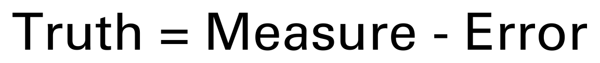{style="width: 100%; height: 430px; object-fit: contain;" fig-alt="Truth equals measure minus error."}

::: {.notes}
- Another way to say this is that the truth is equal to our measure of the truth minus the error in our measure.
:::


## The Big Picture: Truth by Another Name

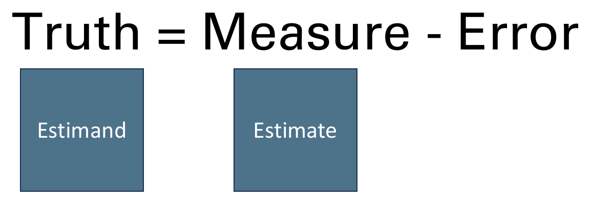{style="width: 100%; height: 430px; object-fit: contain;" fig-alt="Truth equals measure minus error. Truth is labeled Estimand, and Measure is labeled Estimate."}

::: {.notes}
- Another term that we will use to refer to the true quantity we aspire to measure in our target population is estimand. Likewise, another term that we will use to refer to the quantity that actually resulted from our data collection and analysis is estimate.
:::


## The Big Picture: Truth from Another Perspective

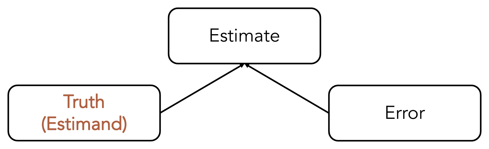{style="width: 100%; height: 430px; object-fit: contain;" fig-alt="Arrows from Truth (Estimand) and Error converge on Estimate, showing that an estimate reflects both the truth and error."}

::: {.notes}
- Graphically, that might look something like this. When we conduct a study in epidemiology, we end up with estimates. Those estimates are a result of the true underlying population value – the truth – and the error in our measures.
- In this sense, error can simply be taken to mean the literal difference between our estimate of the truth and the actual truth. It doesn’t have to be any more complicated than that. Later, our description of errors will get more detailed, and our discussion of the effects of errors will get more specific, but we will still be having a more detailed and specific discussion about this basic idea – the difference between our estimate and the truth.
:::


## Quick Terminology Review {.compact}

Match each term to its definition.

:::: {.columns .text-columns}
::: {.column width="28%"}
**Terms**

1. Estimand
2. Estimator
3. Estimate
4. Error
:::
::: {.column width="72%"}
**Definitions**

A. The quantity that actually resulted from our data collection and analysis.

B. The difference between the estimate and the estimand.

C. The true quantity we aspire to measure in our target population.

D. The analysis technique or algorithm used to produce the estimate from our data.
:::
::::

::: {.notes}
- Answers: 1–C (estimand); 2–D (estimator); 3–A (estimate); 4–B (error).
:::


## The Big Picture: Accuracy

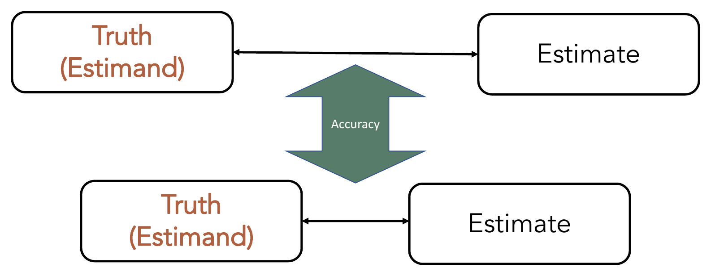{style="width: 100%; height: 430px; object-fit: contain;" fig-alt="Two pairs of Truth (Estimand) and Estimate boxes. The lower pair is closer together, illustrating greater accuracy when an estimate is closer to the truth."}

::: {.notes}
- And the accuracy of our estimate is a measure of how close it is to the truth.   
- Or how much error we have.   
:::


## The Big Picture: Estimate without Error

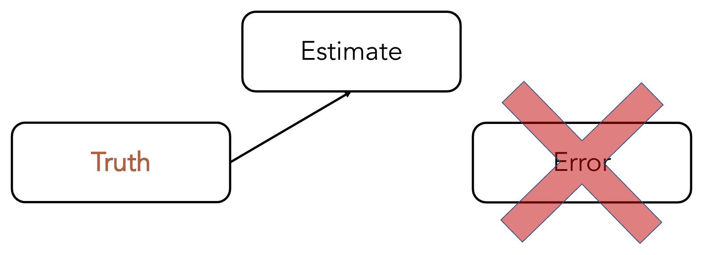{style="width: 100%; height: 430px; object-fit: contain;" fig-alt="Truth points to Estimate. The Error box is crossed out, illustrating an estimate without error."}

::: {.notes}
- Why does this matter? It matters because our goal is to know the truth or at least to know something “close enough” to the truth for our purposes. In theory, if we can eliminate error or at least quantify and correct for it, then we can know the truth.
- At this point, you may be thinking to yourself, “easier said than done,” and we would tend to agree. Completely removing, or even perfectly quantifying, the error in our estimates is typically difficult work, and often accompanied by our old friend uncertainty. However, and we will keep coming back to this, we can often do a “good enough” job for our results to be useful for our purposes.
- As a next step in thinking about how to eliminate and/or quantify error, it can be useful to learn more about the various ways we get error in our measurements in the first place.
:::


## Quick Review: Types of Error

The two highest-level (most general) categories of error are typically considered to be...

A. Bias and confounding

B. Random and systematic

C. Differential and non-differential

D. Ignorable and non-ignorable

::: {.notes}
- Correct answer: B. Random and systematic.
:::


## The Big Picture: Types of Error

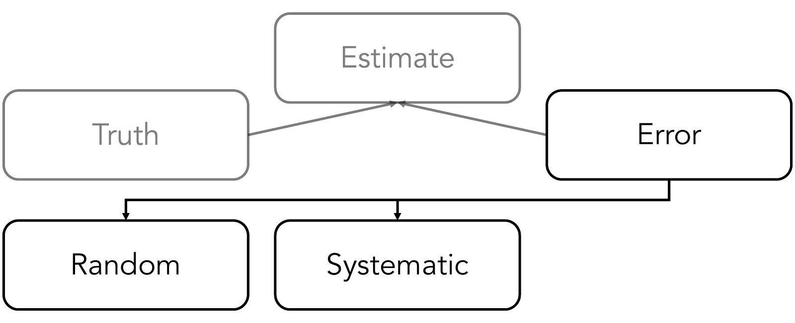{style="width: 100%; height: 430px; object-fit: contain;" fig-alt="Truth and Error contribute to Estimate. Error branches into Random and Systematic categories."}

::: {.notes}
- Traditionally, error is first categorized as random or systematic.   
- We've already talked a lot about systematic error. What was another name we used for systematic error?   
:::


## {#what-is-random-error .center data-menu-title="What is random error?"}

```{=html}
<style>
/* This title-free prompt matches the source PowerPoint's centered layout. */
.reveal .slides section#what-is-random-error { border-top: 0; padding-top: 0; }
.reveal .slides section#what-is-random-error > h2 { display: none; }
</style>
```

::: {style="display: flex; align-items: center; justify-content: center; height: 600px; font-size: 1.6em; text-align: center;"}
What is random error?
:::

::: {.notes}
- Well, we already know what error is, but what is random error? You might say that it is error that occurs at random, but what does that mean? What does it mean when we say that something is random?
- When we use random in everyday speech, we typically mean that something happens for no reason – there is an effect without a cause.
:::


## Thought Experiment: Chance and Predictions

If we just had enough information about causes and effects, then we could perfectly predict every outcome.

A. True

B. False

C. Not sure

::: {.notes}
- Modern Epidemiology, chapter 15, discusses the competing views about randomness.
- One school of thought is that chance (lack of a cause?) plays a central role in virtually all processes.
- The other is that chance is just an umbrella term for causes we don't fully understand. In other words, there is a reason for everything that happens whether we know it or not.    
- Luckily, in epidemiology, random error (chance) can be defined a little bit more precisely. That's what we will discuss next.   
:::


## How Stressed Are Students?

A campus wellness team wants to estimate the **mean stress score among all undergraduates this semester**.

- **Population:** All undergraduates this semester.
- **Parameter:** Their population mean StressScore.
- **Sample:** 12 randomly selected students.

**Should we expect the mean stress score from these 12 students to be the same as the mean for all undergraduates?**

::: {.notes}
- Ask students whether they expect the sample mean to equal the population mean, and have them explain their predictions.
- We've already discussed bias and confounding. Today, we will discuss sampling variability.   
:::


## Explore the Population in Excel

Open the [Excel sampling demonstration](assets/prepared-excel-sampling-demonstration.xlsx) and select the **Population** worksheet.

- Each row represents one student in a **simulated population** of 10,000 students.
- These are computer-generated example StressScores, not actual student records.
- Calculate the mean of all 10,000 scores: `=AVERAGE(B7:B10006)`.

::: {.fragment}
**Population mean: 20.99 points.**
:::

::: {.notes}
**Instructions**

- Orient students to the Population Sheet.
- Select `E3` and type `=AVERAGE(B10:B10009)` in the formula bar.    
- Explain that averaging all 10,000 scores gives the population mean: **20.99 points**.    
- We only know this value because we created the entire simulated population. In most real world scenarios we won't have this information.   
:::


## Explore One Sample in Excel

Select the **Samples** worksheet and locate **Sample 1**.

- This random sample contains **12 students** from the simulated population.
- Find their student IDs and StressScores.
- Calculate the mean of their 12 scores.

::: {.fragment}
**Sample mean: 21.98 points.**
:::

::: {.notes}
**Instructions**

- Switch to **Samples**. Explain that each row represents a different prepared random sample.   
- For Sample 1 in row 8, show the 12 student IDs in `AB8:AM8` and their scores in `O8:Z8`. These students were selected from the population just shown.   
- Select `C8` and show `=AVERAGE(O8:Z8)` in the formula bar. This averages only the 12 scores in Sample 1, giving a sample mean of **21.98 points**. 

**Ask**: "Is this the same as 20.99? Is our sample mean above or below the population mean?"  

- In most real world scenarios, we will only have information from our sample.
:::


## One Population, One Sample

**The sample mean is an estimate of the population mean.**

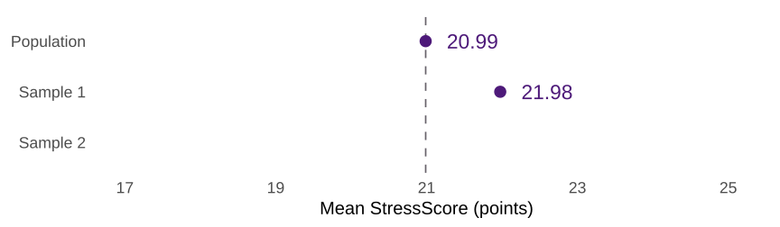{width=100% height=350 fig-alt="The teaching population mean StressScore is 20.99 points. Sample 1 has a mean of 21.98 points, above the population mean. A dashed reference line marks the population mean."}

::: {.notes}
- Here, we plotted our population mean (20.987924) and our sample mean (21.9766667).   
:::


## The Same Population, Another Sample

Sample 2 contains **another random selection of 12 students** from the same population.

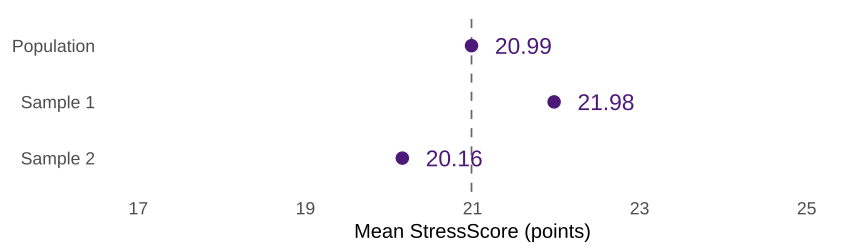{width=100% height=350 fig-alt="The population mean remains 20.99. Sample 1 has a mean of 21.98, above the population mean. Sample 2 has a mean of 20.16, below the population mean."}

**The population stays the same. The sample estimate changes.**

::: {.notes}
- And we could do the same thing with sample 2.   
- Notice that the mean of sample 2 is once again different from the populatiion mean, but it is also different from the mean of sample 1.   
- The population mean hasn't changed, but our sample, and therefore our estimate of the population mean, has changed.    
:::


## In a Real Study, the Population Mean Is Unknown

:::: {.columns .text-columns}
::: {.column width="50%"}
**What We Observe**

Sample 1's mean StressScore:

**21.98 points**
:::
::: {.column width="50%"}
**What We Want to Know**

The mean among all undergraduates:

**?**
:::
::::

How much might an estimate vary just because we sampled different students?

::: {.notes}
- So, to drive this point home:   
- We usually sample because measuring the entire population is impractical.    
- Knowing the sample mean does not reveal its exact distance from the unknown population mean.   
- But that's exactly what we want to know. The distance (the error) so that we can eliminate it and know the truth.  
- Unfortunately, we can rarely assertain that answer for one sample, but we can quantify the the variability of estimates across repeated samples.  
:::


## Sampling Error

$$
\text{Sampling error} = \text{Sample mean} - \text{Population mean}
$$

| Sample | Sample Mean | Population Mean | Sampling Error |
| ------ | ----------: | --------------: | -------------: |
| 1      | 21.98       | 20.99           | +0.99          |
| 2      | 20.16       | 20.99           | −0.83          |

A positive error is an **overestimate**. A negative error is an **underestimate**.

::: {.notes}
- Here, error means the difference between an estimate and the population value.   
- Tie this to measurement error and standard deviations.   
:::


## Repeated Samples, Different Means

These are the **first 10 samples** in the [Excel sampling demonstration](assets/prepared-excel-sampling-demonstration.xlsx). Each has **12 students**.

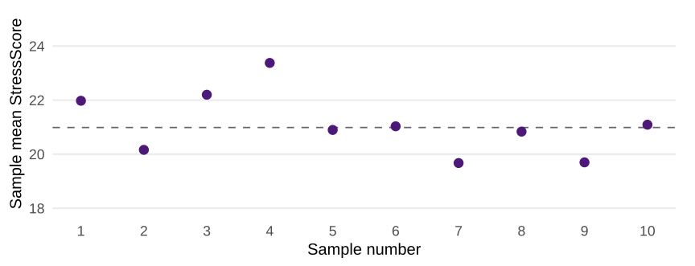{width=100% height=350 fig-alt="The means of the first ten prepared samples vary above and below the fixed population mean of 20.99 points. Each sample contains 12 students."}

The dashed line marks the **population mean of 20.99**.

::: {.notes}
- For example, our true estimand of interest is the mean stress score.   
- We do 10 studies, each of which produces an estimate of the mean stress score.   
- In this hypothetical scenario, we know that the true mean stress score is 20.99. However, we can see here that none of the estimates produced by our 10 studies were exactly equal to 20.99. Therefore, there is error in each of the studies.   
- How much?   
:::


## The Same Samples, Shown as Errors

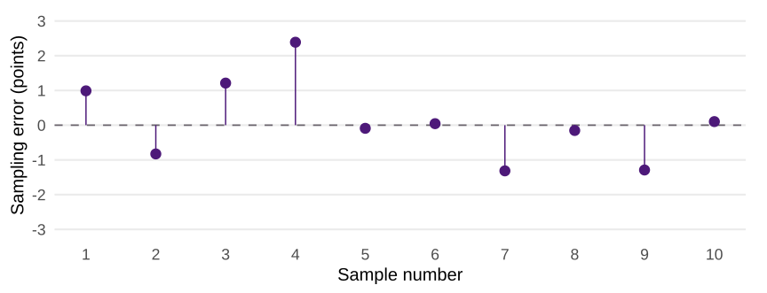{width=100% height=375 fig-alt="Signed sampling errors for the same ten samples, calculated as each sample mean minus 20.987924. Some errors are positive and others negative. The dashed zero line marks an estimate equal to the population mean."}

Subtract the **population mean** from each sample mean. The dashed line now marks **zero error**.

::: {.notes}
- Well, if we change the y-axis from the mean stress score to the error in the estimate of the true true mean stress score (sampling error), we can see the amount of error in each estimate.    
- For example, study number one overestimates the population mean by about one point. 21.98 − 20.99 = +0.99 points.  
- **Ask** What about study 2?   
:::


## Do the Errors Cancel Out?

{width=100% height=350 fig-alt="The same ten signed sampling errors appear above and below zero. Their sum is approximately positive 1.06 points, so they do not cancel exactly."}

For these 10 samples: **sum of errors ≈ +1.06 points**; **average error ≈ +0.106 points**.

The errors in a particular set of samples **need not sum to zero**.

::: {.notes}
- And if we average the errors across repeated samples, they average toward zero _in the long run_.
- Positive and negative errors offset one another, but this batch still has a small positive average error. A nonzero average in ten samples does not establish that the estimator is biased.    
:::


## Average of the Sample Means

{width=100% height=350 fig-alt="The same ten sample means on the original StressScore scale. Their average is 21.09 points, compared with the fixed population mean of 20.99 points."}

**Average of the 10 sample means ≈ 21.09 points.** Population mean ≈ **20.99 points**.

An unbiased estimator has **zero expected error** across repeated samples.

::: {.notes}
- And if we change the y-axis back to the original scale we can see that the average of the estimates is 21.09.    
- The average sample mean is about 0.106 points above the population mean, matching the average error on the previous slide.
- Under simple random sampling, the sample mean is an unbiased estimator of the population mean. Across all possible samples of the same size, its expected value equals the population mean.   
- Over many independent repetitions, the average sample mean tends toward the population mean, and the average error tends toward zero. This does not mean each additional sample brings the average closer or that any finite batch must match exactly.   
:::


## How Much Might Our Estimate Vary?

In our demonstration, we knew the population mean, so we could calculate each sample’s error.

In a real study, we usually have **one sample** and an **unknown population mean**.

We cannot calculate our sample’s exact error, but we can estimate how much sample means would vary across repeated samples.

- The **standard error** summarizes that variability.
- A **confidence interval** uses it to express uncertainty around our estimate.

::: {.notes}
- So far, we’ve been able to compare every sample mean with the truth. In a real study, we usually don’t have that luxury. We have our sample, but we don’t know the population mean—that’s what we’re trying to estimate.
- We can’t tell exactly how far off our estimate is. But we can use the variation in our sample to estimate how much sample means would vary if we repeated the sampling process. That brings us to standard errors and confidence intervals.
:::


## Standard Deviation and Standard Error

For the **separate Prep 4 worked sample** of 12 students:

| Measure               | What Varies?                          | StressScore Example |
| --------------------- | ------------------------------------- | ------------------: |
| Standard deviation    | Individual scores within the sample   | 3.64 points         |
| Standard error        | Sample means across repeated samples  | 1.05 points         |

For a sample mean, estimate the standard error as **sample SD ÷ √n**.

::: {.notes}
- Compare SD and SE, then discuss sample size and precision. These numbers come from the Prep 4 workbook, not Sample 1 of the sampling demonstration.
- The sample SD describes the spread of individual scores. The SE estimates the SD of the sampling distribution of the mean.
- Here, 3.64 ÷ √12 is about 1.05. Use full precision when calculating interval endpoints.
:::


<!-- Left off here. When you pick back up, ask Codex to help you clear the comments. -->


## What Makes an Estimate More Precise?

<!-- I think this slide comes too early. We haven't introduced confidence level or confidence interval yet. -->

A smaller **standard error** means the sample estimate tends to vary less across repeated samples.

- With the same sample SD and confidence level, a larger sample gives a **narrower** mean confidence interval.
- With the same sample size and confidence level, a larger sample SD gives a **wider** interval.
- For the same data, a higher confidence level gives a **wider** interval.

::: {.notes}
- Compare 12 versus 48 students using the same SD. Mention that sample size also changes the t critical value through degrees of freedom.
- Ask which condition is held fixed in each comparison. A narrow interval can still be centered on a biased estimate.
:::


## A 95% Confidence Interval for a Mean

<!-- We missed a step. We show the calculation for confidence intervals without discussing what they are conceptually and what purpose the serve. Additionally, we discuss the margin of error without ever introducing it. Oh, and we discuss the t critical value without introducing it. -->

Start with the sample mean, then subtract and add a **margin of error**.

$$
\text{Sample mean} \ \pm \ \underbrace{t^* \times \frac{s}{\sqrt{n}}}_{\text{Margin of error}}
$$

- $s$ is the sample SD. We use it to estimate the standard error.
- $t^*$ is the **two-sided t critical value** with **$n-1$ degrees of freedom**.
- A 95% interval leaves 5% across the two tails of the reference distribution.

::: {.notes}
- 28–31 min. Build the formula from the sample mean and a margin of error. Both Excel workbooks use a two-sided t critical value with n−1 degrees of freedom.
- For this small-sample illustration, assume independent observations from an approximately normal population. Explain that the procedure depends on the study design and its assumptions.
:::


## Excel Demo: Repeated Confidence Intervals

Open the [prepared Excel sampling demonstration](assets/prepared-excel-sampling-demonstration.xlsx).

1. On **Samples**, trace one row from its 12 scores to its mean, SE, and interval.
2. Check whether its interval contains the **population mean of 20.99**.
3. On **Coverage**, compare the intervals from all **100 samples**.

**Will every interval capture the mean? Must exactly 95 of 100 capture it?**

::: {.notes}
- 31–40 min across slides 14–15. Allow about four minutes to trace one row and five minutes to interpret the plot and coverage count.
- Begin on Samples so students predict before seeing the Coverage summary. Row 8 is Sample 1. Its mean is 21.98, SD 5.39, SE 1.56, and 95% CI 18.55 to 25.40.
- Columns O:Z hold the 12 linked scores. Columns B:J show n, mean, SD, SE, df, critical value, margin, and limits. Column K identifies capture or miss using the full-precision population mean.
- The source population is approximately normal. Samples are independent draws; within each sample, selection is without replacement. With only 12 of 10,000 students, the finite-population correction is negligible. Coverage is approximate, not an exact guarantee for this finite population.
- If Excel is unavailable, use the next slide's plot and the example values in these notes.
- Adapted from lab_warm_up_random_error.qmd, Confidence intervals section. Its original samples had 10 people; the approved adaptation uses 12.
:::


## Which Intervals Capture the Population Mean?

<!-- Do we need this slide if we just showed the same concept in Excel on the previous slide? -->

Dots show sample means. Vertical lines show **95% confidence intervals**.

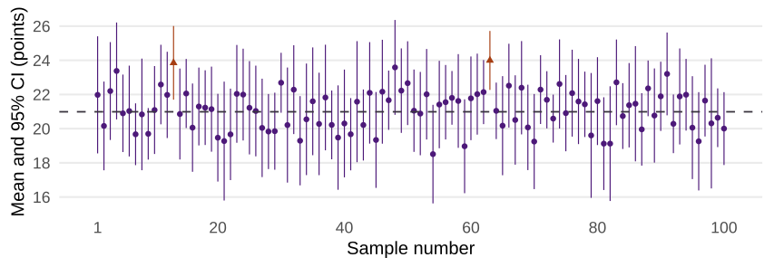{width=100% height=355 fig-alt="Confidence intervals for all 100 prepared samples. The dashed line marks the fixed population mean of 20.987924. Ninety-eight intervals cross it. Samples 13 and 63 miss it and are identified with orange lines and triangular markers."}

::: {.fragment}
**98 of 100 capture the mean.** Samples **13 and 63** miss it.
:::

::: {.notes}
- Ask students to find the two intervals that miss before revealing the count. The orange triangles and lines mark those samples; color is not the only cue.
- The workbook compares full-precision endpoints with 20.987924. Labels are rounded for teaching.
- Over many repetitions, the method captures the fixed mean about 95% of the time when its assumptions hold. This particular batch captures it 98% of the time. Another batch can have a different percentage.
- Each completed interval either contains the population mean or does not. The 95% describes the method's long-run coverage, not a probability assigned to this fixed parameter after observing one interval.
- In a real study we do not know the population mean and cannot directly check capture. The simulation makes that otherwise hidden fact visible.
- Adapted from random_error.pptx, slides 45 and 49–52, and lab_warm_up_random_error.qmd. This plot uses the approved workbook's fixed samples.
:::


## Question: What Does 95% Confidence Mean?

A team reports a 95% confidence interval for mean StressScore. What does **95%** describe?

A. The percentage of students whose scores fall inside the interval.  
B. The long-run percentage of intervals from this method that capture the true mean.  
C. The probability that the true mean is inside this particular interval.  
D. The percentage of future sample means that fall inside this interval.

::: {.notes}
- 40–45 min across slides 16–17. Poll by show of fingers, one through four. Answer B, assuming the sampling and model conditions hold.
- With repeated sampling, the interval changes while the population mean stays fixed. For any one computed interval, the true mean is either inside or outside.
- Adapted from Random Error, slides 45 and 49–52.
:::


## Question: Confidence Level and Interval Width

The team uses the **same 12 scores** and the **same method** to calculate three confidence intervals. Which interval is widest?

A. The 90% confidence interval.\
B. The 95% confidence interval.\
C. The 99% confidence interval.\
D. They all have the same width.

::: {.notes}
- Answer C. On Samples, change M5 from 95% to 99%, then return to Coverage. The intervals widen and this batch captures the mean in 99 of 100 samples. Restore M5 to 95% afterward. Sample means, SDs, and SEs stay fixed.
- Higher confidence requires a larger critical value and a wider interval when the data and method stay the same.
- Ask students what they give up to obtain higher confidence: a narrower range of estimates. The SD and SE remain unchanged.
- Adapted from Random Error quiz.docx, question 3. Corrected the source feedback, which reverses the relationship between confidence level and interval width. Higher alpha gives a narrower interval, all else equal.
:::


## Excel Demo: Sample Mean and Standard Error

<!-- Should we make this a group exercise? -->

Switch to the **separate** [Prep 4 worked Excel example](assets/prep-4-mean-confidence-interval.xlsx). Column A contains the 12 simulated StressScores.

| Calculation    | Excel Formula                | Result |
| -------------- | ---------------------------- | -----: |
| Sample size    | `=COUNT(A5:A1000)`           | 12     |
| Sample mean    | `=AVERAGE(A5:A1000)`         | 21.00  |
| Sample SD      | `=STDEV.S(A5:A1000)`         | 3.64   |
| Standard error | `=D13/SQRT(D11)`             | 1.05   |

::: {.notes}
- 45–55 min across slides 18–19. This workbook has a different set of 12 simulated StressScores. Its mean is 21.00. It is the calculation template students will use for Prep 4.
- The example formulas allow room for additional scores. Point out that COUNT counts numeric cells and STDEV.S calculates sample SD.
- If Excel is unavailable in class, walk through the values on this slide and the next one.
:::


## Excel Demo: Critical Value and Limits

<!-- We discuss degrees of freedom without every introducing what they are or why we need them. -->

| Calculation        | Excel Formula           | Result |
| ------------------ | ----------------------- | -----: |
| Degrees of freedom | `=D11-1`                | 11     |
| Two-sided t value  | `=T.INV.2T(0.05,D15)`   | 2.20   |
| Margin of error    | `=D16*D14`              | 2.31   |
| Lower limit        | `=D12-D17`              | 18.69  |
| Upper limit        | `=D12+D17`              | 23.31  |

Report the **95% CI for the population mean StressScore as 18.69 to 23.31 points**. Excel uses full precision even when the cells display two decimals.

::: {.notes}
- Show where the workbook stores n, df, SE, and the critical value.
- Explain why the first argument to T.INV.2T is 0.05. It is the total area across both tails.
- Ask students to use the displayed margin to reconstruct both endpoints.
:::


## Comparing the Interval With the Prep 4 Norm

<!-- I'm not sure what this slide is doing. -->

| Assigned Outcome | Hypothetical Population Norm |
| ---------------- | ---------------------------: |
| StressScore      | 20                           |
| AnxietyScore     | 10                           |

The estimated mean is **21 points**, with a **95% CI of 18.69 to 23.31**. The interval includes the **norm of 20**, along with values below and above it.

The data are compatible with a population mean of 20 under the method's assumptions. **This does not establish that the true mean is 20.**

::: {.notes}
- 55–60 min. The hypothetical comparison norm of 20 is separate from the sampling demonstration’s population mean of 20.99. Ask whether the result proves the mean is 20. The interval includes 20 along with other values compatible with the data and assumptions.
- For Prep 4, students use the norm for their assigned outcome and explain their decision from the interval.
- For the corresponding two-sided t test at the 0.05 level, we fail to reject a population mean of 20. Keep that decision distinct from proving the norm is correct or deciding whether a difference matters in practice.
- Adapted from random_error.pptx, slides 31, 52–53, and Resources/Confidence Intervals.docx. Emphasize the estimate and full interval rather than only the test decision.
:::


## Group Exercise: One Score Changes

<!-- Where is the Prep 4 worked workbook? -->

In a copy of the **Prep 4 worked workbook**, change the last score from **27 to 31**.

1. Predict what will happen to the mean and to the interval width.
2. Record the new mean, sample SD, and 95% confidence interval.
3. Compare the new interval with the original. Is the estimate more or less precise? Does your decision about the norm of 20 change?

::: {.notes}
- 60–72 min across slides 21–22. Allow about 8 minutes for group work and 4 minutes for comparison and discussion.
- If Excel is unavailable, give groups the new mean (21.33), SE (1.26), and t critical value (2.20). Have them approximate the endpoints and explain the result.
:::


## Group Debrief: One Score Changes

| Result             | Original Scores | With 31 Replacing 27 |
| ------------------ | --------------: | -------------------: |
| Sample mean        | 21.00           | 21.33                |
| Sample SD          | 3.64            | 4.36                 |
| 95% CI             | 18.69 to 23.31  | 18.57 to 24.10       |

The interval is **wider** because the scores vary more and the sample size is unchanged. The norm of **20** is still inside the interval.

::: {.notes}
- The sample mean increased, yet the lower limit decreased. Ask which part of the calculation explains that result.
- Both intervals support the same decision at the 0.05 level, even though they differ in precision.
:::


## Estimating a Proportion

<!-- We don't give any information about how to calculate this interval. We also don't give enough information about how to interpret it. -->

The wellness team also surveys **120 randomly sampled students** about whether they used campus wellness services this semester.

- **48 of 120** said yes. The sample proportion is **40%**.
- An approximate **95% confidence interval is 31% to 49%**.
- The interval estimates the **percentage of all undergraduates** who used the services this semester.

**What would the team recalculate if it drew a new sample?**

::: {.notes}
- 72–76 min. Both the sample percentage and the interval can change. The population percentage remains fixed.
- This is a simulated example. The approximate interval is supplied to practice interpretation. The Excel demonstration uses the procedure for a mean.
- Adapted from the repeated incidence-proportion example in Random Error, slides 14–18.
:::


## What to Report for Prep 4

<!-- Instead of an exit question, let's work through some examples. -->

- Report the sample size, sample mean, sample SD, and 95% confidence interval for your assigned outcome.
- Explain what the interval estimates and what its width says about precision.
- Compare the interval with the assigned hypothetical norm and explain your decision.

**Exit question:** What happens to CI width if n increases while SD and confidence level stay the same?

::: {.notes}
- 76–80 min. Exit prompt: Ask students to explain in one sentence what would happen to interval width if n increased while the sample SD and confidence level stayed the same.
- The population-hypothesis and formal reject/fail-to-reject portions of Prep 4 follow in the November 16 lesson.
- Remind students to copy the workbook, replace the simulated data with their assigned scores, and set the matching norm.
:::
