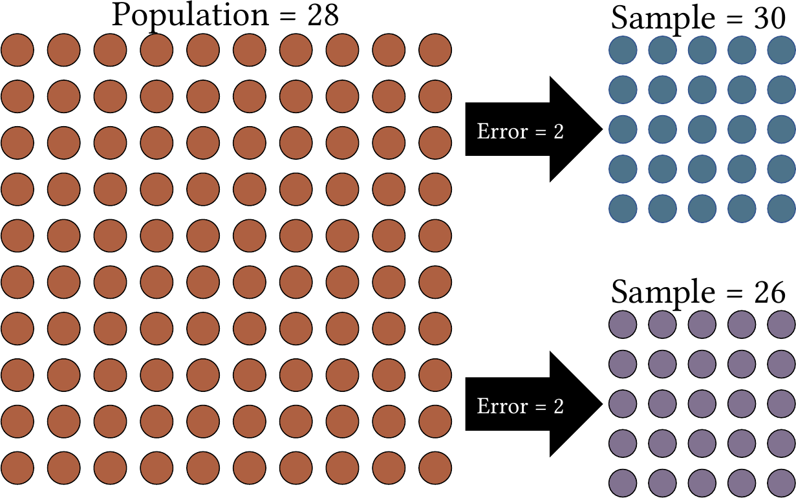
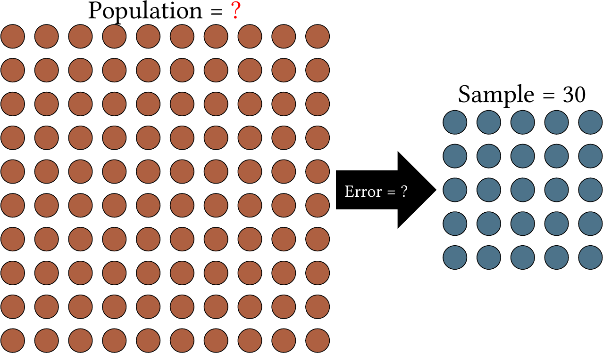
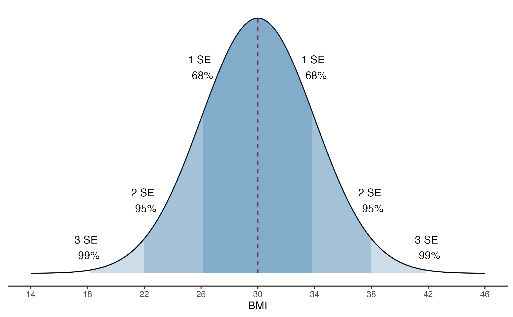
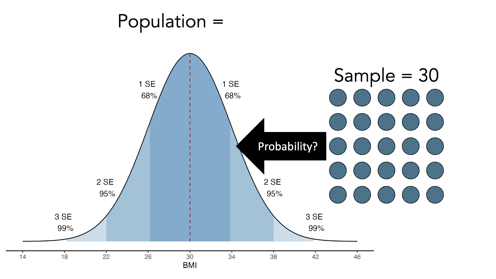

## Suppose We Knew the Population Mean

{style="width: 100%; height: 320px; object-fit: contain;" fig-alt="A sample with mean BMI 30 drawn from a population with mean BMI 28. The estimate is two units above the truth."}

::: {.notes}
- Last week, we saw examples of random error in our measurements. The most prominant source of random error in our studies, and the source that we will focus on for the rest of today, is sampling error – or sampling variability.

- For example, the average BMI of adults living in Texas may be 28. If we go measure the BMI of a simple random sample of adult Texans, we may find that the average BMI in our sample is 30. 

- Of course, in this hypothetical world we know that 30 is 2 units higher than the truth, and the reason for that 2-unit difference is just the luck of the draw. 
:::

## Draw Another Sample

{style="width: 100%; height: 345px; object-fit: contain;" fig-alt="Two samples from a population with mean BMI 28. Their means, 30 and 26, lie two units above and below the population mean."}

::: {.notes}
- If we draw another simple random sample, then the average in that sample may be 2-units lower than the truth. With random error, our estimates differs from the truth, but tend to lie all around the truth, seemingly at random.

- In this case, we could more explicitly say that random error is due to the fact that we collect measurements of whatever exposure or outcome we are interested in from a sample of people from our target population instead of collecting measures from everyone in our target population. 

- And in this context, what does the word “random” mean?
:::

## How Far Are We From the Truth?

{style="width: 100%; height: 345px; object-fit: contain;" fig-alt="Only the sample mean of 30 is known. Question marks replace the population mean and the sampling error."}

::: {.notes}
- This begs the question, “When we draw a sample and calculate a value of interest, how different is the result we got from the result we would have gotten if we were basing our calculation on measures taken from the entire population instead?” Without having some idea of how close these values are, it makes us feel ill-equipped to draw conclusions and make policy decisions.

- **Why can’t we answer this question directly?**

- Unfortunately, we can’t typically answer that question directly, because that would require knowing the answer we would have gotten if we collected measures from the entire population. And if we collected measures from the entire population, then there would be no need to also collect measures from a sample of the population. 

- So, it seems like we are kind of stuck in a vicious cycle. We draw a sample because we can’t measure the entire population. Then, we want to know how accurate our sample estimate is, but we can’t know for sure because we can’t measure the entire population. 

- **How might we try to get around this problem?**
:::

## Suppose the Population Looked Like This

{style="width: 100%; height: 390px; object-fit: contain;" fig-alt="Bell-shaped BMI distribution centered at 30. The original graph labels 26 and 34 as 1 SE with 68%, 22 and 38 as 2 SE with 95%, and 18 and 42 as 3 SE with 99%."}

::: {.notes}
- So, we typically can’t answer the question that we really want to answer – "how much does our estimate calculated from a sample of people differ from the true population value. 

- However, we can sort of do the opposite. If we make some assumptions about the distribution of our quantity of interest in the target population – for example, that it is normally distributed -- then statistics gives us many tools we can use to estimate how compatible our data is with that assumed population distribution. 

**NOTE**: We are not saying that this is how the population looks.
:::

## Would a Sample Mean of 30 Surprise You?

{style="width: 100%; height: 390px; object-fit: contain;" fig-alt="Population BMI curve centered at 30, beside 25 circles labeled Sample = 30. A left-pointing arrow labeled Probability? connects the sample to the population curve. The original curve includes 1, 2, and 3 SE labels."}

::: {.notes}
- For example, let’s once again say that we drew a sample of people from our target population and found that the mean BMI for those people was 30. If we assume that our sample came from a population where the mean BMI is 30 with a standard deviation of 4, then it wouldn’t be surprising at all for our sample to have a mean of 30. 

- Further, it wouldn’t seem odd at all to draw this sample from the hypothetical population distribution, which lends some credit to the idea that our assumed population distribution is close to being accurate. 

**Question**
- But, what are some other possible reasons for the lack of discrepancy?   
  - Luck of the draw – we just happened to draw a sample of people whose BMI averaged to a value that is compatible with this assumed population distribution even though the actual distribution in our target population is very different from the assumed distribution.   
  - We incorrectly made assumptions about our population – the real mean is 38.   
  - We incorrectly calculated our sample mean. Just happened to be compatible with our assumed distribution.   
  - There were errors in our BMI measures.   

:::

## What if the Sample Mean Were 50?

{style="width: 100%; height: 390px; object-fit: contain;" fig-alt="Population BMI curve centered at 30, beside 25 circles labeled Sample = 50. A left-pointing arrow labeled Probability? connects the sample to the population curve. The original curve includes 1, 2, and 3 SE labels."}

::: {.notes}
**Questions**   
- If we instead found that our sample distribution was 50, would it feel more or less likely that our sample was drawn from this hypothetical population distribution? 

- And would it make us more or less skeptical about how closely our assumed population distribution matches the actual population distribution?

- But, what are some other possible reasons for the discrepancy?   
  - Luck of the draw – we just happened to draw a sample of people whose BMI averaged to a value that is compatible with this assumed population distribution even though the actual distribution in our target population is very different from the assumed distribution.   
  - We incorrectly made assumptions about our population – the real mean is 38.   
  - We incorrectly calculated our sample mean. Just happened to be compatible with our assumed distribution.   
  - There were errors in our BMI measures.   

In practice, most epidemiologists don’t typically graph out the assumed distribution and make comparisons to it in the way we just did (although, maybe we should). 
:::

## Statistical Hypothesis Testing

1. Assume that our value of interest has a specific size   
    - Typically, that size corresponds to no association or no effect – the null   
    - Null Hypothesis Significance Testing (NHST)   

2. Select an alpha level – somewhat arbitrary   
    - Type I error – rejecting the null when it is correct   
    - Fit our data to a statistical model and all of that model’s assumptions   

3. Calculate a test statistic

4. Use the test statistic to calculate a p-value

::: {.notes}
- Traditionally, this has been done with statistical hypothesis testing. Specifically, null hypothesis significance testing. 

- These are roughly the steps.

- We will walk through an example and talk more about each step next.
:::

## Does Mean StressScore Differ From 20?

**Null hypothesis, H₀:** The population mean StressScore equals 20.

**Alternative hypothesis, H₁:** The population mean StressScore differs from 20.

A **two-sided test** treats departures above and below 20 as evidence against H₀.

Here, 20 is a hypothetical population norm. H₀ gives us the reference value to compare with our sample mean.

::: {.notes}
- Step 1 was to assume that our value of interest has a specific size.   

- In this case, what is the our value of interest and what is its size?   

- The value of interest is difference in between the population mean stress score and 20.

- The size is 0. Typically, that size corresponds to no association or no effect – the null. 
:::

## Statistical Hypothesis Testing

1. Assume that our value of interest has a specific size   
    - Typically, that size corresponds to no association or no effect – the null   
    - Null Hypothesis Significance Testing (NHST)   

2. Select an alpha level – somewhat arbitrary   
    - Type I error – rejecting the null when it is correct   
    - Fit our data to a statistical model and all of that model’s assumptions   

3. Calculate a test statistic

4. Use the test statistic to calculate a p-value

::: {.notes}
- Reminder.
:::

## Alpha and Our Decision Rule

Before seeing the data, we choose alpha (α), the cutoff we will compare our p-value with. **If p < α, we reject H₀**. Otherwise, we fail to reject H₀.

Convention: **α = .05**

- **p < .05: Reject H₀.** The data provide evidence that the population mean differs from 20.
- **p ≥ .05: Fail to reject H₀.** The data do not provide enough evidence that the population mean differs from 20. This does not prove that it equals 20.

A **Type I error** occurs when we reject a true H₀. With α = .05, a valid test makes this error in about 5% of repeated studies when H₀ is true.

::: {.notes}
- Step 2: Select an alpha level.

- Alpha is the cutoff we choose for deciding when to reject the null hypothesis. Choosing α = .05 means accepting a 5% chance of rejecting the null hypothesis when it is actually true. 

- If the null hypothesis were true and we repeated this study many times, our testing procedure would incorrectly reject it about 5% of the time.

- The conventional .05 cutoff is not a natural dividing line between truth and falsehood. It has just become a convention.

- We will calculate a p-value shortly. For now, establish the meanings of the two possible decisions.

- A 5% long-run error rate does not mean a 5% probability that this particular decision is wrong.
:::

## Statistical Hypothesis Testing

1. Assume that our value of interest has a specific size   
    - Typically, that size corresponds to no association or no effect – the null   
    - Null Hypothesis Significance Testing (NHST)   

2. Select an alpha level – somewhat arbitrary   
    - Type I error – rejecting the null when it is correct   
    - Fit our data to a statistical model and all of that model’s assumptions   

3. Calculate a test statistic

4. Use the test statistic to calculate a p-value

::: {.notes}
- Reminder.
:::

## A Model for Our StressScore Example

We will use a **one-sample t test** to compare a sample mean with 20.

For this example, assume:

- We take a simple random sample of students, with independent observations.
- StressScore follows a normal distribution in the population.

We estimate the standard error using the **sample SD**. If H₀ is true, the test statistic follows a *t* distribution with **n − 1 degrees of freedom**.

::: {.notes}
- These assumptions make the reference distribution valid for this example. They do not become true merely because we choose a t test.
- The repeated-studies workbook generates independent observations from a normal distribution. For actual data, we would need to assess the sampling process and distribution.
- Degrees of freedom identify which t distribution to use. For a one-sample t test, we lose one degree of freedom when estimating the mean.
:::

## How Far Is Our Estimate From 20?

$$
t = \frac{\text{sample mean} - 20}{\text{standard error of the mean}}
$$

A sample mean **two standard errors above 20** gives *t* = +2. A mean **two standard errors below 20** gives *t* = −2.

**The two-sided p-value answers this question:** If H₀ and the model assumptions hold, how often would a random sample give a t statistic at least this far from zero in either direction?

::: {.notes}
- Now, we calculate the test statistic. In this case, it's a t value.

- The t value is used to calculate the p-value.
:::

## A Concrete Calculation

Suppose **25 students** have a mean StressScore of **22** and a sample SD of **5**. We are testing **H₀: μ = 20**.

$$
SE = \frac{s}{\sqrt{n}} = \frac{5}{\sqrt{25}} = 1
$$

$$
t = \frac{\bar{x} - \mu_0}{SE} = \frac{22 - 20}{1} = 2
$$

Our sample mean is **2 standard errors above** the mean specified by H₀.

::: {.notes}
- These are hypothetical summary values chosen to make the arithmetic easy. They are separate from Sample 1 in the workbook.
- Ask students to identify the observed mean, the null value, and the standard error before substituting numbers.
- If the sample mean were 18 with the same SE, t would be −2.
:::

## Statistical Hypothesis Testing

1. Assume that our value of interest has a specific size   
    - Typically, that size corresponds to no association or no effect – the null   
    - Null Hypothesis Significance Testing (NHST)   

2. Select an alpha level – somewhat arbitrary   
    - Type I error – rejecting the null when it is correct   
    - Fit our data to a statistical model and all of that model’s assumptions   

3. Calculate a test statistic

4. Use the test statistic to calculate a p-value

::: {.notes}
- Step 4: Use the test statistic to calculate a p-value
:::

## From the t Statistic to a p-Value

For **t = 2** with **25 − 1 = 24 degrees of freedom**, Excel gives:

`=T.DIST.2T(ABS(2), 24)` → **p ≈ .057**

If H₀ and the model assumptions hold, about **5.7%** of repeated samples would give **t ≤ −2 or t ≥ 2**.

Because **.057 > .05**, we **fail to reject H₀**. We do not have enough evidence that the population mean StressScore differs from 20.

::: {.notes}
- The two-sided p-value includes both tails: values at least as far from zero as the observed statistic.
- ABS takes the absolute value, so a t statistic of −2 gives the same two-sided p-value.
- This is a probability calculated under H₀ and the model assumptions. It is not the probability that H₀ is true.
- Use the unrounded p-value for the decision. Here, p = .05693985.
:::

## What Our p-Value Means

For our StressScore example, **t = 2** and **p ≈ .057**.

**Assuming H₀ and the model assumptions hold**, about 5.7% of repeated samples would give a *t* statistic **as far from zero as 2, or farther**, in either direction.

This does **not** mean:

- There is a 5.7% probability that H₀ is true.
- There is a 5.7% probability that chance alone explains our result.

The probability includes **equally extreme and more extreme results**, not just the result we observed.

::: {.notes}
- Keep the conditioning explicit: we assume a population mean StressScore of 20 and the model assumptions, then ask about possible sample results.
- In this example, the relevant results are t ≤ −2 or t ≥ 2. We are not calculating the probability that the population mean equals 20.
- Adapted from Random Error, slides 28–29 and 36. Source: Greenland S, Senn SJ, Rothman KJ, et al. Statistical tests, P values, confidence intervals, and power: a guide to misinterpretations. Eur J Epidemiol. 2016;31:337–350. doi:10.1007/s10654-016-0149-3.
:::

## What Our Test Decision Means

At **α = .05**:

- **Reject H₀:** The data provide evidence against H₀ under the model assumptions. This does not prove that H₀ is false.
- **Fail to reject H₀:** The data do not provide enough evidence against H₀. This does not prove that H₀ is true or that there is no effect.

Our sample mean was **22**, compared with the null value of **20**. With **p ≈ .057**, we fail to reject H₀, even though we observed a **2-point difference**.

::: {.notes}
- A test decision follows the chosen rule; it does not establish a hypothesis with certainty. Even when assumptions hold, random sampling can lead to an incorrect decision.
- A small p-value can also reflect a violation of another model assumption. Rejecting H₀ is not a way to verify those assumptions.
- A large p-value can occur when the data are too imprecise to distinguish the null from meaningful alternatives. Failing to reject does not establish equality.
- Adapted from Random Error, slides 30–33. Source: Greenland et al. (2016), doi:10.1007/s10654-016-0149-3.
:::

## Question: What Does a p-Value of .03 Mean?

A two-sided test of H₀: μ = 20 gives **p = .03**. Which interpretation fits?

A. There is a 3% chance that the population mean equals 20.  
B. If H₀ and the model assumptions hold, about 3% of repeated samples would give a test statistic this far from zero or farther.  
C. About 3% of individual students have a StressScore this far from 20.

::: {.notes}
- 17–20 min. Vote A, B, or C by a show of fingers. Ask a student to explain what we assumed before calculating p.
- B. The reference distribution assumes H₀. Its tails describe test statistics across repeated samples. Adapted from Random Error, slide 28.
- Ask for the decision at α = .05, then at .01. The evidence is the same. The chosen threshold changes the decision.
:::

## Hypothesis Testing: Can We Reject a True Null?

Open the [Hypothesis Testing workbook](assets/Hypothesis%20Testing.xlsx) on the **Activity** tab. Start with **B7 = 0.05**.

The workbook contains **100 simulated studies of 20 students each**. We generated the scores from a normal population with mean **20** and SD **4**. Each study tests H₀: μ = 20.

**Predict with a partner:** Will all 100 studies fail to reject H₀?

::: {.notes}
- 20–21 min. This is a new simulation. Last week the finite teaching population had a mean of 20.99. In this workbook the generating mean is exactly 20.
- In an actual study we would generally lack this knowledge. Here it lets us tell when a decision is wrong.
:::

## Work Through Sample 1

1. Use the scores in **B13:B32**. Fill in the mean, sample SD, and SE in **E14:E16**.
2. Use the supplied *t* critical value in **E20**. Enter the lower and upper CI limits in **E21:E22**.
3. Compare your answers with **row 37**. Does the interval include 20? What decision does the two-sided p-value support?

The workbook lists the five Excel formulas beside the data.

::: {.notes}
- 21–26 min. Five minutes for formula entry, following the one-minute prediction. Pairs can share a screen.
- Key: E14 = AVERAGE(B13:B32), E15 = STDEV.S(B13:B32), E16 = E15/SQRT(E13), E21 = E14-E20*E16, E22 = E14+E20*E16.
- Sample 1 has mean 19.89, SE 0.73, 95% CI 18.35 to 21.42, and p = .877. Fail to reject H₀.
- If Excel is slow, project row 37 and proceed directly to the next exercise.
:::

## Find Two Studies That Lead to Different Decisions

At **α = .05**, use rows **37–136** on the Activity tab.

1. Find one interval that **includes 20** and one that **misses 20**.
2. For each, record the sample number, CI, p-value, and decision.
3. Explain to your partner why the CI and the test agree.

::: {.notes}
- 26–33 min. Give pairs time to search before asking for a sample number. At .05, samples 64 and 70 reject. One mean is above 20 and one below.
- For a paper or projected version, give Sample 1 (CI 18.35 to 21.42, p = .877) and Sample 64 (CI 20.19 to 24.11, p = .0332). Ask for decisions.
- Both procedures use the same SE and two-sided t model. The 95% interval contains the reference means that would survive this test at α = .05.
:::

## Change Alpha and Count the Rejections

Record the counts at **.05**. Predict what will happen at **.01**, then at **.10**.

Change **B7** each time. Record the number of intervals containing 20 and the number of rejections in **J5:K7**.

**Which quantities changed? Which stayed the same? Why is every rejection in this workbook a Type I error?**

::: {.notes}
- 33–39 min. Read counts from E4 and E6. In worksheet order (.05, .01, .10), the numbers containing 20 are 98, 100, 96. Rejections are 2, 0, 4.
- Scores, means, SEs, and p-values stay fixed. Lower α raises the confidence level, widens the interval, and makes rejection harder. Restore B7 to .05.
- A Type I error is rejecting a true null. The counts describe this batch. A 5% long-run error rate does not require exactly five rejections per 100 studies.
:::

## What the 5% Error Rate Means

In our simulation, **H₀ is true in every study**. Every rejection is therefore a Type I error.

With **α = .05**, the testing procedure would reject H₀ in about **5% of studies over many repetitions**, assuming the model assumptions hold.

This does **not** mean that a particular significant result has a 5% chance of being wrong.

Changing alpha changes the **p-value cutoff for rejection**. It does **not** change the calculated p-values.

::: {.notes}
- Connect the long-run rate to the workbook: this batch has 2 rejections in 100 studies at α = .05. Another batch could have a different count.
- Here we know every rejection is wrong because we generated every study under H₀. In actual research, we generally do not know whether H₀ is true.
- At α = .10, reject when p < .10. At α = .05, reject when p < .05. We choose alpha before examining the results; changing it here is a teaching demonstration.
- Adapted from Random Error, slide 37. Source: Greenland et al. (2016), doi:10.1007/s10654-016-0149-3.
:::

## Prep 4: Find Your Assigned Variables

| Groups  | Correlation                      | Mean comparison               | Categorical comparison             |
| ------- | -------------------------------- | ----------------------------- | ---------------------------------- |
| 1, 3, 5 | SleepHours and StressScore       | StressScore by ActivityLevel  | StressCat and CaffeineUse          |
| 2, 4    | ScreenTimeHours and AnxietyScore | AnxietyScore by SocialSupport | AnxietyCat and MindfulnessPractice |

Work with your project group. Groups **1–2** use dataset **A**, groups **3–4** use **B**, and group **5** uses **C**.

::: {.notes}
- 49–50 min. Ask one person in each group to pull up the Prep 4 instructions and another to record the hypotheses. These are the current five groups.
:::

## Hypotheses for a Correlation

For your group's two continuous variables, describe their **linear association in the population**.

**H₀:** The population correlation between **[variable 1]** and **[variable 2]** equals zero.

**H₁:** The population correlation between **[variable 1]** and **[variable 2]** differs from zero.

For groups **1, 3, and 5**, fill the blanks with **SleepHours** and **StressScore**. Groups **2 and 4** use **ScreenTimeHours** and **AnxietyScore**.

::: {.notes}
- Model the first pair aloud. H₀ says that the population correlation between SleepHours and StressScore equals zero. H₁ says that it differs from zero.
- Zero correlation means no linear association. It does not rule out a curved relationship.
- The alternative includes positive and negative correlations. Students do not need to calculate r to state these hypotheses.
:::

## Hypotheses for Comparing Means

Compare the **population mean outcome across all three categories** of your grouping variable.

**H₀:** Mean **[outcome]** is equal across all **[grouping variable]** categories in the population.

**H₁:** At least one population mean **[outcome]** differs across **[grouping variable]** categories.

Use **StressScore by ActivityLevel** or **AnxietyScore by SocialSupport**, according to your group's assignment.

::: {.notes}
- Example: Mean StressScore is equal across all ActivityLevel categories in the population, versus at least one population mean StressScore differs across those categories.
- The alternative does not require every group to differ from every other group and does not specify which group has the highest mean.
- This compares group means. It is a different question from comparing one population mean with the norm of 20.
:::

## Hypotheses for Categorical Variables

Ask whether the **distribution of outcome categories differs across groups** in the population.

**H₀:** **[Outcome category variable]** and **[grouping variable]** are independent in the population.

**H₁:** **[Outcome category variable]** and **[grouping variable]** are associated in the population.

For **StressCat and CaffeineUse**, H₀ means that the proportions in each stress category are the same across caffeine-use groups.

::: {.notes}
- Groups 1, 3, and 5 use StressCat and CaffeineUse. Groups 2 and 4 use AnxietyCat and MindfulnessPractice.
- For groups 2 and 4, H₀ means that the proportions in each anxiety category are the same across mindfulness-practice groups.
- An association means at least one of those category proportions differs across groups. It does not imply that one variable causes the other.
:::

## Write Your Group's Six Hypothesis Statements

Work with your project group. Have one person record your answers in your Prep 4 notes.

1. Copy each of the three **H₀/H₁ pairs** from the preceding slides.
2. Replace every bracketed placeholder with your group's assigned variable name.
3. Read all **six statements** together. Each should describe the population and say what would be equal, independent, or different.

::: {.notes}
- 50–56 min. Circulate and ask whether each statement describes a population. Have partners check that each alternative includes every departure covered by the two-sided or overall test.
- Example for groups 1, 3, 5: the population correlation between SleepHours and StressScore equals zero versus differs from zero.
- Mean StressScore is equal across all ActivityLevel categories versus at least one population mean differs. StressCat and CaffeineUse are independent versus associated in the population.
- For groups 2 and 4 use the corresponding anxiety variables. For categorical independence, students can describe the same outcome-category proportions across groups.
:::

