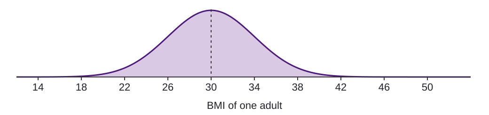
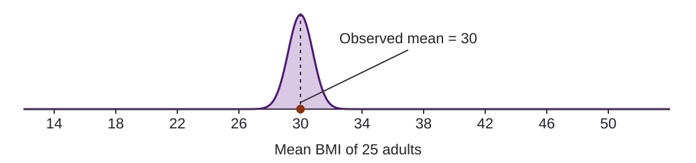
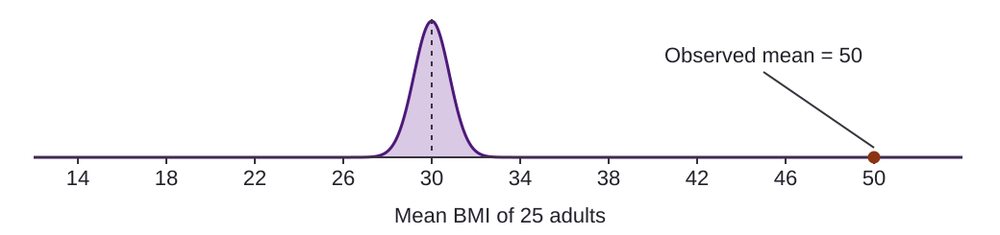

## Suppose We Knew the Population Mean

Imagine the average BMI of all adults in Texas is **28**. We draw a simple random sample and get **30**.

{style="width: 100%; height: 320px; object-fit: contain;" fig-alt="A sample with mean BMI 30 drawn from a population with mean BMI 28. The estimate is two units above the truth."}

::: {.notes}
- 0–2 min. Opening adapted from Brad Cannell’s Epidemiology III Random Error, slides 21–27. The first three diagrams are the originals.
- Suppose we could measure every adult in Texas. In this hypothetical world we know the answer. How far is our estimate from the truth? In which direction?
:::

## Draw Another Sample

Same population. Same sample size. This time we get **26**.

{style="width: 100%; height: 345px; object-fit: contain;" fig-alt="Two samples from a population with mean BMI 28. Their means, 30 and 26, lie two units above and below the population mean."}

::: {.notes}
- 2–3 min. Both estimates missed by two units. Ask whether changing who happened to be sampled could account for both results.
- Connect to the different sample means students saw in last week’s Excel demonstration.
:::

## How Far Are We From the Truth?

{style="width: 100%; height: 345px; object-fit: contain;" fig-alt="Only the sample mean of 30 is known. Question marks replace the population mean and the sampling error."}

We observed **30**. What would we need to know to work out the sampling error?

::: {.notes}
- 3–5 min. Pause. Someone will usually say we need the population mean. Ask how we would get it.
- That is the problem we started with. We drew a sample because measuring everyone was impractical. How might we get around that?
:::

## Suppose the Population Looked Like This

Imagine BMI in the population follows a normal distribution with **mean 30** and **SD 4**.

{width=95% fig-alt="Bell-shaped distribution of individual adult BMIs, centered at 30 with a standard deviation of 4."}

What sample means would you expect if you drew **25 adults at random**, over and over?

::: {.notes}
- 5–7 min. Original slide 24 turns the question around. We can assume a population and ask what kinds of samples it would produce.
- The curve describes individuals. Ask where the means of samples of 25 would center and whether they would vary as much as individuals.
:::

## Would a Sample Mean of 30 Surprise You?

{width=95% fig-alt="Sampling distribution of mean BMI for samples of 25. The observed mean of 30 is at its center."}

Here each draw gives us a **mean of 25 adults**. Under our assumptions, the means center on 30 and their standard error is **4/√25 = 0.8**.

::: {.notes}
- 7–8 min. Keep sample size fixed from here on. The horizontal scale is the same as on the previous slide.
- A sample mean near 30 fits this model easily. Could another population also have produced a sample mean near 30? Invite an example.
:::

## What if the Sample Mean Were 50?

{width=95% fig-alt="The same sampling distribution centered at 30, with an observed sample mean of 50 marked far to the right."}

How surprising would this result be? What might you check before drawing a conclusion about the population?

::: {.notes}
- 8–10 min. Hold the assumed population and sample size fixed. Ask what changed between the last two slides.
- Elicit the assumptions about the population, the sampling procedure, and possible measurement or calculation errors. Chance is also possible. A 20-unit discrepancy here is 25 standard errors.
:::

## Statistical Hypothesis Testing

1. State a claim about the population and what would count as a departure from it.
2. Choose a significance level, α, before looking at the results.
3. Use a statistical model to work out which results we would expect if the claim were true.
4. Compare our result with that expectation using a **test statistic** and a **p-value**.

::: {.notes}
- 10–12 min. Name what students just did. The claim we use to generate the expected results is the null hypothesis. Often it specifies zero difference or zero association.
- For the BMI example, the claim was a specific population mean. A different mean in either direction counts as a departure.
:::

## Does Mean StressScore Differ From 20?

**Null hypothesis, H₀:** The population mean StressScore equals 20.

**Alternative hypothesis, H₁:** The population mean StressScore differs from 20.

Before seeing the data, set **α = .05**. A two-sided test treats departures above and below 20 as evidence against H₀.

::: {.notes}
- 12–14 min. These are claims about the population. Ask which claim supplies the reference value for the test.
- Under a true null and the assumptions of this continuous test, choosing α = .05 gives a 5% long-run chance of rejecting. We will see how that works in Excel.
:::

## How Far Is Our Estimate From 20?

$$
t = \frac{\text{sample mean} - 20}{\text{standard error of the mean}}
$$

A sample mean **two standard errors above 20** gives *t* = +2. A mean **two standard errors below 20** gives *t* = −2.

Under H₀, how often would a random sample give a *t* statistic **at least this far from zero** in either direction?

::: {.notes}
- 14–17 min. That last question defines the two-sided p-value. Interpret distance as the absolute value of t.
- In Activity 2, observations are independent normal draws. We estimate SE from the sample SD. With 20 observations, compare t to a t distribution with 19 degrees of freedom.
- At our chosen α, reject H₀ if p < .05. Otherwise, fail to reject it. Use the unrounded p-value.
:::

## Question: What Does a p-Value of .03 Mean?

A two-sided test of H₀: μ = 20 gives **p = .03**. Which interpretation fits?

A. There is a 3% chance that the population mean equals 20.  
B. If H₀ and the model assumptions hold, about 3% of repeated samples would give a test statistic this far from zero or farther.  
C. About 3% of individual students have a StressScore this far from 20.

::: {.notes}
- 17–20 min. Vote A, B, or C by a show of fingers. Ask a student to explain what we assumed before calculating p.
- B. The reference distribution assumes H₀. Its tails describe test statistics across repeated samples. Adapted from Random Error, slide 28.
- Ask for the decision at α = .05, then at .01. The evidence is the same. The chosen threshold changes the decision.
:::

## Activity 2: Can a Study Reject a True Null?

Open [Activity 2: Repeated Studies](../Activity%202%20-%20Repeated%20Studies.xlsx) on the **Activity** tab. Start with **B7 = 0.05**.

The workbook contains **100 simulated studies of 20 students each**. We generated the scores from a normal population with mean **20** and SD **4**. Each study tests H₀: μ = 20.

**Predict with a partner:** Will all 100 studies fail to reject H₀?

::: {.notes}
- 20–21 min. This is a new simulation. Last week the finite teaching population had a mean of 20.99. In this workbook the generating mean is exactly 20.
- In an actual study we would generally lack this knowledge. Here it lets us tell when a decision is wrong.
:::

## Work Through Sample 1

1. Use the scores in **B13:B32**. Fill in the mean, sample SD, and SE in **E14:E16**.
2. Use the supplied *t* critical value in **E20**. Enter the lower and upper CI limits in **E21:E22**.
3. Compare your answers with **row 37**. Does the interval include 20? What decision does the two-sided p-value support?

The workbook lists the five Excel formulas beside the data.

::: {.notes}
- 21–26 min. Five minutes for formula entry, following the one-minute prediction. Pairs can share a screen.
- Key: E14 = AVERAGE(B13:B32), E15 = STDEV.S(B13:B32), E16 = E15/SQRT(E13), E21 = E14-E20*E16, E22 = E14+E20*E16.
- Sample 1 has mean 19.89, SE 0.73, 95% CI 18.35 to 21.42, and p = .877. Fail to reject H₀.
- If Excel is slow, project row 37 and proceed directly to the next exercise.
:::

## Find Two Studies That Lead to Different Decisions

At **α = .05**, use rows **37–136** on the Activity tab.

1. Find one interval that **includes 20** and one that **misses 20**.
2. For each, record the sample number, CI, p-value, and decision.
3. Explain to your partner why the CI and the test agree.

::: {.notes}
- 26–33 min. Give pairs time to search before asking for a sample number. At .05, samples 64 and 70 reject. One mean is above 20 and one below.
- For a paper or projected version, give Sample 1 (CI 18.35 to 21.42, p = .877) and Sample 64 (CI 20.19 to 24.11, p = .0332). Ask for decisions.
- Both procedures use the same SE and two-sided t model. The 95% interval contains the reference means that would survive this test at α = .05.
:::

## Change Alpha and Count the Rejections

Record the counts at **.05**. Predict what will happen at **.01**, then at **.10**.

Change **B7** each time. Record the number of intervals containing 20 and the number of rejections in **J5:K7**.

**Which quantities changed? Which stayed the same? Why is every rejection in this workbook a Type I error?**

::: {.notes}
- 33–39 min. Read counts from E4 and E6. In worksheet order (.05, .01, .10), the numbers containing 20 are 98, 100, 96. Rejections are 2, 0, 4.
- Scores, means, SEs, and p-values stay fixed. Lower α raises the confidence level, widens the interval, and makes rejection harder. Restore B7 to .05.
- A Type I error is rejecting a true null. The counts describe this batch. A 5% long-run error rate does not require exactly five rejections per 100 studies.
:::

## Suppose the True Mean Were 22

We still test **H₀: μ = 20**, but imagine drawing our samples from a population with mean **22**.

| Our decision      | What happened in this population? |
| ----------------- | --------------------------------- |
| Reject H₀         | We detected the difference.       |
| Fail to reject H₀ | We made a Type II error.          |

**Power** is the probability of detecting this specified difference across repeated studies. If the probability of a Type II error is β, power is **1 − β**.

::: {.notes}
- 39–44 min. Keep this as a thought experiment. Changing alpha in Activity 2 cannot create a population with a true mean of 22.
- Ask students to complete each row aloud before defining power. A failure to reject with a true mean of 20 was the correct decision. With a true mean of 22, the same decision misses a real difference.
:::

## Question: Which Study Has More Power?

Both studies test μ = 20 at α = .05. The true mean is 22, and the population SD is 4 in both.

A. The study that samples **20** students.  
B. The study that samples **80** students.  
C. Both studies have the same power.

What happens to the standard error when the sample size quadruples?

::: {.notes}
- 44–49 min. Vote by raising one, two, or three fingers. B. Quadrupling n halves the standard error. The same two-point departure is larger in standard-error units.
- Ask what happens if the true mean is farther from 20, with n and variability fixed. Power rises. Changing the true effect alone does not narrow the interval.
- Holding the effect, sample size, and variability fixed, raising α makes rejection easier. Power rises and so does the risk of a Type I error when H₀ is true.
:::

## Back to Sleep and Stress

For the **20 students** in our November 2 practice workbook, we found **r = −.834** and **r² = .696**.

A two-sided Pearson test of **H₀: ρ = 0** gives **p < .001**.

What does *r* tell us about sleep and stress? What question does the p-value answer?

::: {.notes}
- 49–54 min. The alternative says the population linear correlation differs from zero. Have a pair report the direction, strength, decision at .05, and interpretation.
- More sleep accompanies lower stress scores in this sample. The paired data provide evidence of a population linear association under the test assumptions. The study design does not establish causation.
- Calculated from the 20 original sleep_hours and stress_score pairs: r = −.8342532, t = −6.4192, df = 18, two-sided p ≈ .00000483. CORREL alone returns r.
:::

## How Much Does a Significant Difference Matter?

On a 100-point scale, Group A scored **0.4 points higher** on average than Group B.

The **95% CI for the population mean difference (A − B) is 0.1 to 0.7 points**.

1. What value would represent equal population means? What decision would the corresponding two-sided test give at α = .05?
2. What would you need to know to decide whether the difference matters to students?

::: {.notes}
- 54–59 min. Zero is outside the interval. The difference is statistically significant. Ask which group scored higher and what sizes of difference are compatible with the data.
- Practical importance depends on what a point means on this scale and how large a difference would affect a decision. A p-value alone gives neither size nor importance.
- Begin the Prep 4 group work at minute 59.
:::

## Prep 4: Find Your Assigned Variables

| Groups  | Correlation                      | Mean comparison               | Categorical comparison             |
| ------- | -------------------------------- | ----------------------------- | ---------------------------------- |
| 1, 3, 5 | SleepHours and StressScore       | StressScore by ActivityLevel  | StressCat and CaffeineUse          |
| 2, 4    | ScreenTimeHours and AnxietyScore | AnxietyScore by SocialSupport | AnxietyCat and MindfulnessPractice |

Work with your project group. Groups **1–2** use dataset **A**, groups **3–4** use **B**, and group **5** uses **C**.

::: {.notes}
- 59–60 min. Ask one person in each group to pull up the Prep 4 instructions and another to record the hypotheses. These are the current five groups.
:::

## Write Three Pairs of Population Hypotheses

Use your group's variable names in each **H₀** and **H₁**.

1. **Correlation:** What would zero population correlation mean for your two continuous variables?
2. **Mean comparison:** What does H₀ say about the population means across all three levels of your grouping variable? What would be enough for H₁?
3. **Categorical association:** What would independence mean for your two categorical variables?



::: {.notes}
- 60–66 min. Circulate and ask whether each statement describes a population. Have partners check that each alternative includes every departure covered by the two-sided or overall test.
- Example for groups 1, 3, 5: the population correlation between SleepHours and StressScore equals zero versus differs from zero.
- Mean StressScore is equal across all ActivityLevel categories versus at least one population mean differs. StressCat and CaffeineUse are independent versus associated in the population.
- For groups 2 and 4 use the corresponding anxiety variables. For categorical independence, students can describe the same outcome-category proportions across groups.
:::

## Use the Interval to Make a Decision

Open the [Prep 4 worked example](../../Module%2010%20-%20Inferential%20Statistics%E2%80%94Estimation/Random%20Error%20and%20Confidence%20Intervals/assets/prep-4-mean-confidence-interval.xlsx) or use the values below.

The 12 students had a mean StressScore of **21.00**. The **95% CI for the population mean is 18.69 to 23.31 points**.

Use the interval alone to test **H₀: μ = 20** against **H₁: μ ≠ 20** at **α = .05**. Write your decision and one sentence explaining it in context.

::: {.notes}
- 66–72 min. Allow a couple of minutes to write, then compare sentences. Ask someone to identify the reference value and both limits aloud.
- Example: We fail to reject H₀ because 20 falls inside the 95% interval. A population mean StressScore of 20 is compatible with these observations, as are other means in the interval.
- An interval containing 20 does not establish that the population mean equals 20. The Prep 4 submission uses CI reasoning only.
:::

## Apply the Same Reasoning to Your Group

| Assigned outcome | Hypothetical population norm |
| ---------------- | ---------------------------: |
| StressScore      |                           20 |
| AnxietyScore     |                           10 |

Name your outcome and norm. For your own data, report **n, mean, sample SD, and a two-sided 95% t interval**. Use its width to discuss precision and its limits to explain your decision.

What would happen to precision with a larger sample if variability stayed the same?

::: {.notes}
- 72–76 min. Ask each group to identify its norm before interpreting its CI. Larger n generally narrows the interval, holding confidence and variability fixed. More variability widens it at fixed n and confidence.
- Prep 4 also asks for three discussion points about n, variability, and why another dataset could lead to a different conclusion, plus each member’s contribution.
:::

## Exit Check: Which Value Belongs in Each Interval?

1. The 95% CI for **mean StressScore** is **18.7 to 23.3**. We are comparing the mean with the Prep 4 stress norm.
2. The 95% CI for the **difference in mean StressScore (A − B)** is **−2 to 6**. We are comparing two group means.

For each interval, write the reference value and your decision at **α = .05**. Be ready to explain why the reference values differ.

::: {.notes}
- 76–80 min. Ask everyone to answer independently, then hear one explanation for each case.
- First: 20 is inside the interval. Fail to reject μ = 20. Second: 0 is inside the interval. Fail to reject a population mean difference of zero. Neither result proves equality.
- Close with Wednesday’s question: If we want to compare means, how does the way we sampled or paired the observations determine which test we use?
:::
